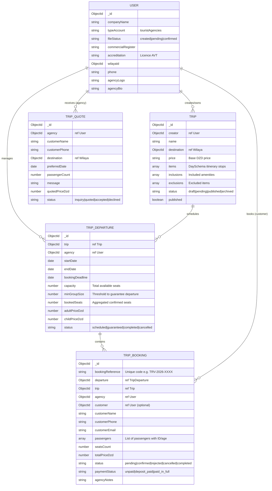
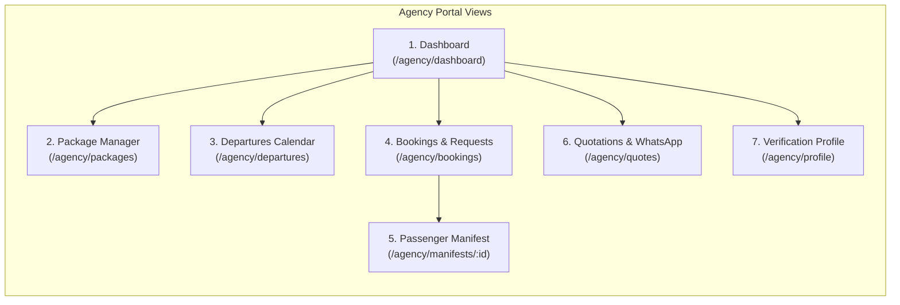
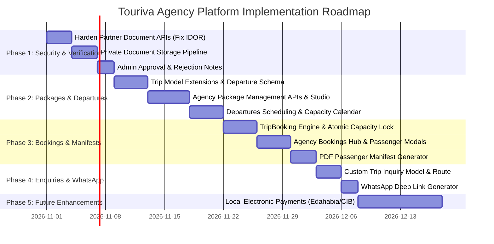

# TOURIVA — ALGERIAN TOURISM AGENCY PLATFORM: PHASE 1 AUDIT & ARCHITECTURAL PLAN

**Document Date:** October 29, 2026  
**Auditor / Architect:** Antigravity Autonomous Systems & Security Engineering Agent  
**Target Repository:** `/home/next/next projects/touriva`  
**Target Commit:** `dd591cd9383849cf56d456ae173cb86e589c88b0`  
**Classification:** Architectural Blueprint, Due Diligence & Technical Implementation Plan  
**Status:** Audit & Plan Complete — Awaiting Authorization Prior to Execution  

---

## 1. EXECUTIVE SUMMARY

The mission of this audit is to determine the safest, most practical, and commercially viable architecture for adding a **Tourism-Agency Management Platform** to Touriva, tailored specifically for licensed Algerian travel agencies (*Agences de Voyages et de Tourisme — AVT*).

### Strategic Context & Business Mission

Algerian travel agencies operate under specific statutory requirements overseen by the Ministry of Tourism and Handicrafts (*Ministère du Tourisme et de l'Artisanat*). In the domestic and inbound market, these agencies organize group circuits, Saharan expeditions (e.g., Djanet, Taghit, Timimoun), coastal getaways, and cultural excursions (e.g., Casbah, Tipaza, Djemila). 

Today, most Algerian travel agencies manage their bookings through manual, disconnected channels: WhatsApp messaging, phone calls, paper passenger manifests, and manual CCP/BaridiMob payment verification.

Touriva already possesses the foundational building blocks required to solve this problem:
1. An official partner onboarding and document accreditation workflow for agencies and guides ([`User.js`](file:///home/next/next%20projects/touriva/backend/models/User.js), [`Documents.vue`](file:///home/next/next%20projects/touriva/frontEnd/touriva/src/views/Documents.vue));
2. A multi-day itinerary and trip modeling engine ([`Trip.js`](file:///home/next/next%20projects/touriva/backend/models/Trip.js), [`New.vue`](file:///home/next/next%20projects/touriva/frontEnd/touriva/src/views/Trip/New.vue));
3. A basic traveler reservation pipeline ([`TripSubscription.js`](file:///home/next/next%20projects/touriva/backend/models/TripSubscription.js));
4. A sovereign vector mapping stack based on MapLibre GL and OpenStreetMap ([`TourivaMap.vue`](file:///home/next/next%20projects/touriva/frontEnd/touriva/src/components/TourivaMap.vue));
5. An AI trip generation concierge integrated with an Ollama LLM ([`aiTripGenerator.js`](file:///home/next/next%20projects/touriva/backend/services/aiTripGenerator.js)).

### Core Audit Verdict on Agency Architecture

- **Do NOT repurpose the Shop Seller Dashboard for tourism agencies.** The retail shop (`shop/frontEnd/touriva_shop_seller_admin` and `shop/backend`) is architected exclusively for physical SKUs, physical shipping orders, and merchant products. Attempting to force travel packages and passenger manifests into the retail product schema is fundamentally incompatible and would compromise both systems.
- **Do NOT build a separate 6th standalone web frontend.** Adding another standalone web application multiplies deployment overhead, duplicates state/auth/i18n logic, and excludes agencies from managing operations on mobile devices.
- **RECOMMENDED SOLUTION: Extend `frontEnd/touriva` with an isolated, modular `/agency/*` route tree and dedicated `AgencyLayout.vue`, backed by strict multi-tenant ownership enforcement in the primary `backend/`.** This preserves a unified code-split web bundle, enables immediate native mobile usage for Algerian agency operators on the existing Android app ([`frontEnd/touriva/android`](file:///home/next/next%20projects/touriva/frontEnd/touriva/android)), and maintains clean separation between consumer and B2B workflows.

---

## 2. ACTUAL ARCHITECTURE & FILE INVENTORY

The current Touriva workspace consists of seven application boundaries:

```
/home/next/next projects/touriva/
├── backend/                               # Primary Tourism REST API (Node/Express 5/MongoDB)
│   ├── controllers/                       # 26 Route Controllers (trips, users, sites, hotels, etc.)
│   ├── middleware/                        # requireAuth.js, requireRole.js
│   ├── models/                            # 20 Mongoose Schemas (Trip, User, Site, Hotel, etc.)
│   ├── routes/                            # 25 Express Routers
│   ├── services/                          # aiTripGenerator.js (Ollama integration)
│   └── tests/                             # 6 Jest test suites (59 passing tests)
├── frontEnd/
│   ├── touriva/                           # Primary Tourist & Provider Client (Vue 3, Vuetify 3, Pinia)
│   │   ├── android/                       # Capacitor 7 Android Shell (Target SDK 35, API 22+)
│   │   ├── src/layouts/                   # MainLayout.vue, PageLayout.vue
│   │   ├── src/router/                    # index.js (Client-side routing & auth guards)
│   │   ├── src/stores/                    # Pinia Stores (trips, auth, users, sites, etc.)
│   │   ├── src/utils/                     # osmMap.js (MapLibre), geocoding.js (58 Wilayas DB)
│   │   └── src/views/                     # Catalog, Trip Builder, Dossier Uploads, Account
│   └── touriva_adminPanel/                # Platform Super-Admin Portal (Vue 3, CASL Permissions)
│       └── src/views/                     # Central moderation for Users, Catalog, Billings, Ads
└── shop/                                  # E-Commerce Subsystem (Artisan Crafts & Travel Goods)
    ├── backend/                           # Retail REST API (Products, Orders, Categories)
    └── frontEnd/
        ├── touriva_shop_web/              # Consumer Marketplace Storefront
        ├── touriva_shop_admin/            # E-Commerce Central Admin
        └── touriva_shop_seller_admin/     # Retail Merchant Dashboard (Physical Goods Only)
```

---

## 3. EXISTING FUNCTIONALITY INVENTORY & CLASSIFICATION

Every capability related to users, tourism providers, trips, bookings, and documents was verified directly against the codebase:

| Capability Domain | Touriva Implementation | Status | Evidence (Files & Symbols) |
|---|---|:---:|---|
| **User Roles & Account Types** | Roles: `client`, `partner`, `administrator`. Account Types: `touristAgencies`, `touristGuide`, `associations`, `visitor`, `others`. | **Implemented & Verified** | [`User.js#L29-L38`](file:///home/next/next%20projects/touriva/backend/models/User.js#L29-L38) |
| **Agency Registration** | Phone-based signup with Algerian format normalization (`+213` and `05/06/07...`), agency name, manager identity. | **Implemented & Verified** | [`UserInformation.vue#L140-L240`](file:///home/next/next%20projects/touriva/frontEnd/touriva/src/views/user/UserInformation.vue#L140-L240), [`usersController.js#L55-L120`](file:///home/next/next%20projects/touriva/backend/controllers/usersController.js#L55-L120) |
| **Agency Document Upload** | Uploads `commercialRegister`, `accreditation` (licence), and `id`. Stored directly as base64 strings in the User document. | **Implemented (With Security Caveats)** | [`Documents.vue#L140-L195`](file:///home/next/next%20projects/touriva/frontEnd/touriva/src/views/Documents.vue#L140-L195), [`Document.vue#L150-L190`](file:///home/next/next%20projects/touriva/frontEnd/touriva/src/views/Document.vue#L150-L190) |
| **Admin Dossier Moderation** | Admin reviews uploaded partner documents and toggles `fileStatus` between `created`, `pending`, and `confirmed`. | **Implemented & Verified** | [`frontEnd/touriva_adminPanel/src/views/User/index.vue#L280-L330`](file:///home/next/next%20projects/touriva_adminPanel/src/views/User/index.vue#L280-L330), [`AlertPartner.vue`](file:///home/next/next%20projects/touriva_adminPanel/src/components/AlertPartner.vue) |
| **Itinerary & Trip Model** | `Trip` model supports name, creator guide/agency, destination wilaya, DZD price, and day-by-day stops with lat/lng. | **Implemented & Verified** | [`Trip.js#L14-L45`](file:///home/next/next%20projects/touriva/backend/models/Trip.js#L14-L45), [`New.vue#L320-L420`](file:///home/next/next%20projects/touriva/frontEnd/touriva/src/views/Trip/New.vue#L320-L420) |
| **Trip Publishing & Moderation** | Partners create trips in `created` status; publish toggle submits them for admin review (`pending` -> `published`). | **Implemented & Verified** | [`MyTrips.vue#L340-L365`](file:///home/next/next%20projects/touriva/frontEnd/touriva/src/views/Trip/MyTrips.vue#L340-L365), [`tripsController.js#L40-L90`](file:///home/next/next%20projects/touriva/backend/controllers/tripsController.js#L40-L90) |
| **Basic Traveler Booking** | Travelers submit name and phone to reserve a spot on a trip. Stored in `TripSubscription` collection. | **Implemented & Verified** | [`TripSubscription.js`](file:///home/next/next%20projects/touriva/backend/models/TripSubscription.js), [`tripSubscriptionController.js#L6-L32`](file:///home/next/next%20projects/touriva/backend/controllers/tripSubscriptionController.js#L6-L32) |
| **Partner Booking Viewer** | Creators view participant name and phone for their own trips via accordion list. | **Implemented & Verified** | [`Subscriptions.vue#L60-L120`](file:///home/next/next%20projects/touriva/frontEnd/touriva/src/views/Subscription/Subscriptions.vue#L60-L120) |
| **Scheduled Departures** | Modeling distinct calendar departure dates with fixed seat capacities for recurring excursion packages. | **Missing** | Zero departure models exist; `Trip` has flat duration days only |
| **Booking Status Transitions** | Agency workflow to accept, confirm, reject, or cancel a booking with traveler notification. | **Missing** | `TripSubscription` has no status field |
| **Passenger Counts & Details** | Tracking passenger count, child/adult breakdown, national ID/passport numbers for security manifests. | **Missing** | `TripSubscription` records only single contact name + phone |
| **Capacity & Overbooking Checks** | Server-side validation preventing reservations beyond transport/hotel limits. | **Missing** | `subscribeToTrip` performs zero capacity checks |
| **Custom Quotes & Inquiries** | Traveler custom circuit request form and agency quotation builder. | **Missing** | Zero quotation models or routes exist |
| **Direct WhatsApp Follow-up** | One-tap WhatsApp deep link pre-filled with excursion code, traveler name, and departure dates. | **Missing** | UI lacks WhatsApp integration buttons |
| **IDOR Protection on Documents** | Restricting `loadPartnerPhotos` and `uploadPartnerImages` strictly to self or administrator. | **Missing / Vulnerable** | [`usersController.js#L495-L527`](file:///home/next/next%20projects/touriva/backend/controllers/usersController.js#L495-L527) lacks ownership check |
| **Document Storage Security** | Storing files in secure object storage with MIME validation instead of raw base64 strings in MongoDB. | **Partially Implemented (Fragile)** | Files stored as raw base64 data URLs in Mongo documents |
| **In-App & Email Notifications** | Alerting agencies of new booking requests or travelers of booking approvals. | **Broken / Disabled** | Notification router commented out in [`server.js#L30`](file:///home/next/next%20projects/touriva/backend/server.js#L30) |

---

## 4. INCOMPATIBILITY ASSESSMENT: WHY SHOP SELLER ADMIN CANNOT BE THE AGENCY DASHBOARD

The repository contains an e-commerce seller administration interface at [`shop/frontEnd/touriva_shop_seller_admin`](file:///home/next/next%20projects/touriva/shop/frontEnd/touriva_shop_seller_admin). The audit evaluated whether this existing application could be adapted to serve as the tourism agency portal.

### Technical Proof of Incompatibility

1. **Disconnected Backend & Database Isolation:**  
   `touriva_shop_seller_admin` communicates with `shop/backend` running on port 4001. `shop/backend` does not load, register, or reference any tourism entities. It contains zero references to `Trip`, `Hotel`, `Restaurant`, `Site`, `TripSubscription`, or `aiTrip` ([`shop/backend/server.js`](file:///home/next/next%20projects/touriva/shop/backend/server.js)).
2. **Incompatible Domain Entities:**  
   The seller dashboard is engineered around physical product management:
   - Data models: `Product` (with SKU `code`, `brandId`, physical `features`), `Order` (e-commerce purchase orders with delivery addresses).
   - Tourism requirements: Excursion itineraries, daily schedules, hotel/monument stops, departure dates, seat capacity, guide accreditations, passenger manifests, and Wilaya administrative geographies.
3. **Incompatible Business Logic & Lifecycles:**  
   A retail order moves through `pending` -> `confirmed` -> `completed` (fulfillment and shipping). A travel booking moves through departure date validity, passenger manifest verification, group minimum thresholds, and excursion execution.
4. **Conclusion:**  
   Repurposing the shop seller dashboard would require rewriting its stores, replacing its backend connections, and corrupting the e-commerce codebase. **The shop seller admin must remain strictly dedicated to retail artisan merchandise.**
5. **Reusable Elements:**  
   While the application itself cannot be used, its **presentation patterns** can be safely extracted and adapted:
   - Vuetify data table styling and search filter bars;
   - Status badge styling (`status-badge` success/warning/error);
   - PDF manifest/invoice generation patterns using `jspdf` and `jspdf-autotable`.

---

## 5. RECOMMENDED ARCHITECTURE: DEDICATED AGENCY ROUTE TREE IN MAIN CLIENT

### Comparison of Architectural Alternatives

| Evaluation Dimension | Option A: Extend `frontEnd/touriva` (Recommended) | Option B: Build Dedicated 6th Frontend (`touriva_agencyPanel`) | Option C: Extend Platform Admin (`touriva_adminPanel`) |
|---|---|---|---|
| **Architecture** | Add `/agency/*` route tree with dedicated `AgencyLayout.vue` | Create new standalone Vue/Vite project cloned from admin | Add agency screens into super-admin panel |
| **Mobile Access (Android)** | **Immediate Native Support:** Runs inside existing Capacitor Android APK/AAB | **Zero Mobile Access:** Requires maintaining a second Android app | **Zero Mobile Access:** Desktop-only super-admin app |
| **Deployment Overhead** | **Zero New Deployments:** Builds with existing web bundle on Render | **High:** Requires new Render web service, URL, domain, CORS | **Zero New Deployments:** Uses existing admin URL |
| **Component Reuse** | Reuses `osmMap.js`, `geocoding.js`, Vuetify themes, i18n, Pinia stores | Duplicates stores, styles, utility code, and translation keys | High component reuse, but severe architectural conflict |
| **Security & Multi-Tenancy** | Clean isolation via `requiresRole('partner')` and backend ownership | Total codebase isolation | **Severe Security Hazard:** Super-admin and agency data co-located |
| **Bundle Size Impact** | Negligible when lazy-loaded via dynamic route imports | None (separate bundle) | None (separate bundle) |

### Recommended Design

Create a modular, lazy-loaded **Agency Hub** inside `frontEnd/touriva`:
- Layout: `frontEnd/touriva/src/layouts/AgencyLayout.vue` (clean sidebar tailored to agency workflows).
- Routes: `/agency/dashboard`, `/agency/packages`, `/agency/departures`, `/agency/bookings`, `/agency/quotes`, `/agency/profile`.
- Route Guard: Enforces `auth.token`, `user.role === 'partner'`, `user.typeAccount === 'touristAgencies'`, and `user.fileStatus === 'confirmed'`.
- Shared API: Communicates with primary `backend/` over existing authenticated Axios instance.

```mermaid
flowchart TD
    subgraph Browser / Android Device
        A["Touriva Unified Client (frontEnd/touriva)"]
        A -->|Tourist Routes '/'| B["MainLayout.vue (Discovery, Trips, Sites, Hotels)"]
        A -->|Agency Routes '/agency/*'| C["AgencyLayout.vue (Agency Portal)"]
    end

    subgraph Primary Backend ('backend/')
        C -->|JWT + Role: Partner| D["/api/agency/* Endpoints"]
        B -->|Public / Client Auth| E["/api/trips, /api/sites, /api/bookings"]
        D --> F["Multi-Tenant Ownership Middleware"]
        F --> G[(Touriva MongoDB Database)]
    end

    subgraph Platform Admin
        H["frontEnd/touriva_adminPanel"] -->|JWT + Role: Admin| I["/api/admin/* Moderation & Compliance"]
        I --> G
    end
```

---

## 6. PROPOSED DATA MODELS & RELATIONSHIPS

To support agency operations without breaking existing tourist functionality, the database schema will be extended cleanly.



### Detailed Schema Specifications

#### 1. Enhanced `Trip` Schema Extensions (`backend/models/Trip.js`)
Extend existing `TripSchema` with backward-compatible fields:
- `inclusions`: `[{ type: String }]` (e.g., "Transport 4x4 climatisé", "Hébergement en demi-pension", "Guide local certifié").
- `exclusions`: `[{ type: String }]` (e.g., "Billets d'avion", "Dépenses personnelles", "Pourboires").
- `durationDays`: `{ type: Number, default: 1 }`
- `durationNights`: `{ type: Number, default: 0 }`
- `meetingPoint`: `{ type: String }` (e.g., "Aéroport d'Alger - Terminal 1").
- `cancellationPolicy`: `{ type: String, enum: ['flexible', 'moderate', 'strict'], default: 'moderate' }`
- `status`: `{ type: String, enum: ['draft', 'pending', 'published', 'archived'], default: 'draft' }`

#### 2. New `TripDeparture` Model (`backend/models/TripDeparture.js`)
Handles calendar departures for packages:
```javascript
const TripDepartureSchema = new mongoose.Schema({
  trip: { type: Schema.Types.ObjectId, ref: 'Trip', required: true, index: true },
  agency: { type: Schema.Types.ObjectId, ref: 'User', required: true, index: true },
  startDate: { type: Date, required: true },
  endDate: { type: Date, required: true },
  bookingDeadline: { type: Date, required: true },
  capacity: { type: Number, required: true, min: 1 },
  minGroupSize: { type: Number, default: 1 },
  bookedSeats: { type: Number, default: 0, min: 0 },
  adultPriceDzd: { type: Number, required: true },
  childPriceDzd: { type: Number, default: 0 },
  status: { 
    type: String, 
    enum: ['scheduled', 'guaranteed', 'completed', 'cancelled'], 
    default: 'scheduled' 
  },
  notes: { type: String }
}, { timestamps: true })

// Compound index for fast date querying and validation
TripDepartureSchema.index({ agency: 1, startDate: 1 })
TripDepartureSchema.index({ trip: 1, status: 1, startDate: 1 })
```

#### 3. New `TripBooking` Model (`backend/models/TripBooking.js`)
Upgrades the flat `TripSubscription` into an agency-grade booking entity:
```javascript
const PassengerSchema = new mongoose.Schema({
  fullName: { type: String, required: true },
  ageCategory: { type: String, enum: ['adult', 'child', 'infant'], default: 'adult' },
  idType: { type: String, enum: ['cni', 'passport'], default: 'cni' },
  idNumber: { type: String },
  specialRequests: { type: String }
}, { _id: false })

const TripBookingSchema = new mongoose.Schema({
  bookingReference: { type: String, required: true, unique: true, uppercase: true },
  departure: { type: Schema.Types.ObjectId, ref: 'TripDeparture', required: true, index: true },
  trip: { type: Schema.Types.ObjectId, ref: 'Trip', required: true, index: true },
  agency: { type: Schema.Types.ObjectId, ref: 'User', required: true, index: true },
  customer: { type: Schema.Types.ObjectId, ref: 'User', default: null },
  customerName: { type: String, required: true },
  customerPhone: { type: String, required: true },
  customerEmail: { type: String },
  passengers: [PassengerSchema],
  seatsCount: { type: Number, required: true, min: 1 },
  totalPriceDzd: { type: Number, required: true },
  status: {
    type: String,
    enum: ['pending', 'confirmed', 'rejected', 'cancelled', 'completed'],
    default: 'pending',
    index: true
  },
  paymentStatus: {
    type: String,
    enum: ['unpaid', 'deposit_paid', 'paid_in_full', 'refunded'],
    default: 'unpaid'
  },
  agencyNotes: { type: String },
  cancellationReason: { type: String },
  statusHistory: [{
    status: String,
    changedAt: { type: Date, default: Date.now },
    changedBy: { type: Schema.Types.ObjectId, ref: 'User' },
    note: String
  }]
}, { timestamps: true })

TripBookingSchema.index({ agency: 1, createdAt: -1 })
```

#### 4. New `TripQuote` Model (`backend/models/TripQuote.js`)
Facilitates bespoke custom excursion inquiries:
```javascript
const TripQuoteSchema = new mongoose.Schema({
  agency: { type: Schema.Types.ObjectId, ref: 'User', required: true, index: true },
  customerName: { type: String, required: true },
  customerPhone: { type: String, required: true },
  customerEmail: { type: String },
  destinationWilaya: { type: Schema.Types.ObjectId, ref: 'Wilaya' },
  preferredStartDate: { type: Date },
  durationDays: { type: Number },
  groupSize: { type: Number, required: true },
  inquiryDetails: { type: String, required: true },
  budgetDzd: { type: Number },
  quotedPriceDzd: { type: Number },
  quoteValidityDate: { type: Date },
  status: {
    type: String,
    enum: ['inquiry_received', 'quoted', 'accepted', 'declined', 'expired'],
    default: 'inquiry_received'
  },
  agencyResponseNotes: { type: String }
}, { timestamps: true })
```

---

## 7. PROPOSED API ROUTES & PERMISSION RULES

All routes will be created under `/api/agency/` and guarded with dedicated authorization middleware:

### Middleware Architecture

1. `requireAuth`: Validates JWT token and hydrates `req.user`.
2. `requireRole('partner')`: Restricts access to partners.
3. `requireAgencyVerified`: Verifies `req.user.typeAccount === 'touristAgencies'` and `req.user.fileStatus === 'confirmed'`.
4. `requireAgencyOwnership(Model, paramKey)`: Extracts document by ID, validates that `doc.agency.toString() === req.user._id.toString()`, preventing IDOR.

### Route Specifications

| Method | Endpoint Path | Middleware Stack | Purpose |
|---|---|---|---|
| **GET** | `/api/agency/profile` | `requireAuth, requireRole('partner')` | Retrieve current agency profile, licence status, verification state |
| **PATCH** | `/api/agency/profile` | `requireAuth, requireRole('partner')` | Update agency bio, contact phone, logo, wilaya address (disallowed fields: `fileStatus`, `role`) |
| **POST** | `/api/agency/documents` | `requireAuth, requireRole('partner')` | Upload accredited licence scan/PDF with secure MIME/size validation |
| **GET** | `/api/agency/stats` | `requireAuth, requireAgencyVerified` | Summary stats (active packages, upcoming departures, pending booking requests) |
| **GET** | `/api/agency/packages` | `requireAuth, requireAgencyVerified` | List all packages owned by current agency with status filters |
| **POST** | `/api/agency/packages` | `requireAuth, requireAgencyVerified` | Create new excursion package in `draft` state (auto-sets `creator = req.user._id`) |
| **GET** | `/api/agency/packages/:id` | `requireAuth, requireAgencyVerified` | Get package detail (enforces agency ownership) |
| **PUT** | `/api/agency/packages/:id` | `requireAuth, requireAgencyVerified` | Update package itinerary, inclusions, price (enforces agency ownership) |
| **PATCH** | `/api/agency/packages/:id/publish` | `requireAuth, requireAgencyVerified` | Transition package from `draft` to `pending` review for admin approval |
| **GET** | `/api/agency/departures` | `requireAuth, requireAgencyVerified` | List scheduled departures across all agency packages with date filters |
| **POST** | `/api/agency/departures` | `requireAuth, requireAgencyVerified` | Schedule a new departure date with seat capacity and DZD pricing |
| **PATCH** | `/api/agency/departures/:id` | `requireAuth, requireAgencyVerified` | Modify departure capacity, deadline, or status (enforces agency ownership) |
| **GET** | `/api/agency/bookings` | `requireAuth, requireAgencyVerified` | Filterable list of all customer bookings (paginated, sorted by departure) |
| **GET** | `/api/agency/bookings/:id` | `requireAuth, requireAgencyVerified` | Full passenger manifest and contact info for a specific booking |
| **PATCH** | `/api/agency/bookings/:id/status` | `requireAuth, requireAgencyVerified` | Transition booking: `confirmed`, `rejected`, or `cancelled` with atomic seat adjustments |
| **GET** | `/api/agency/departures/:id/manifest` | `requireAuth, requireAgencyVerified` | Export passenger manifest for police/transport compliance (JSON / printable PDF) |
| **GET** | `/api/agency/quotes` | `requireAuth, requireAgencyVerified` | List custom trip inquiries assigned to this agency |
| **POST** | `/api/agency/quotes/:id/respond`| `requireAuth, requireAgencyVerified` | Submit formal quote and generate pre-filled WhatsApp deep link |

---

## 8. FRONTEND SCREENS & WORKFLOWS

The agency portal in `frontEnd/touriva` will feature seven core views wrapped in `AgencyLayout.vue`:



### Detailed Screen Specifications

#### 1. Agency Dashboard (`/agency/dashboard`)
- **Metric Cards:** Active Packages, Upcoming Departures This Month, Pending Booking Requests, Total Confirmed Passengers.
- **Urgent Action Queue:** Unconfirmed booking requests requiring action within 24h.
- **Departures Widget:** Next 3 guaranteed departures with seat occupancy progress bars (e.g., `18 / 20 Seats Booked`).

#### 2. Package & Itinerary Studio (`/agency/packages` & `/agency/packages/new`)
- **Package Table:** Displays package name, destination Wilaya, duration, base price, and state badge (`Draft`, `Under Review`, `Published`, `Paused`).
- **Interactive Itinerary Builder:** Reuses Touriva's map-backed daily stops builder ([`New.vue`](file:///home/next/next%20projects/touriva/frontEnd/touriva/src/views/Trip/New.vue)) to establish multi-day stops with MapLibre route polylines.
- **Inclusions / Exclusions Editor:** Chip-based selector for standard Algerian travel inclusions (4x4, meals, licensed guide, monument entry).

#### 3. Departures & Capacity Calendar (`/agency/departures`)
- **Calendar & List View:** Schedules departure dates for published packages.
- **Capacity Controls:** Sets maximum bus/4x4 passenger capacity (e.g., 14 seats for a Toyota Land Cruiser desert circuit, 30 for a coaster).
- **Seat Occupancy Gauge:** Real-time occupancy percentage with color indicators (Green: guaranteed, Amber: filling up, Red: fully booked).

#### 4. Booking Requests & Approval Hub (`/agency/bookings`)
- **Booking Queue:** Filterable tabs for `Pending Requests`, `Confirmed Bookings`, `Cancelled`.
- **Customer Modal:** Displays customer phone, email, passenger names, age categories, and special notes.
- **One-Click Actions:** `Confirm Reservation`, `Reject with Reason`, `Call Customer`, `Contact via WhatsApp`.

#### 5. Official Passenger Manifest View (`/agency/departures/:id/manifest`)
- **Algerian Transport Compliance:** Generates the official passenger manifest required by Algerian transport authorities (*Feuille de Route / Liste des Passagers*) including full name, ID number, and emergency contact.
- **Export Options:** Printable format and instant PDF download leveraging `jspdf` and `jspdf-autotable`.

#### 6. Custom Quotations & WhatsApp Integration (`/agency/quotes`)
- **Inquiry Cards:** Displays custom tour inquiries submitted by travelers (destination, party size, target dates).
- **Quotation Form:** Agency enters package details, total DZD price, and payment terms.
- **Direct WhatsApp Link Generator:** Generates a pre-formatted `https://wa.me/213XXXXXXXX` link pre-populated with quote summary, enabling immediate personal communication.

#### 7. Agency Dossier & Verification Screen (`/agency/profile`)
- **Accreditation Status Banner:** Clearly displays `Official Verification Confirmed` or `Application Under Review`.
- **Licence Resubmission Form:** If an admin requests a clearer scan of the *Licence AVT* or *Registre de Commerce*, the agency can upload the requested document without re-registering.

---

## 8. MULTI-TENANT SECURITY ASSESSMENT & SAFEGUARDS

The introduction of an agency platform introduces multi-tenancy: multiple competing commercial agencies operate on the same system. Strict technical boundaries must prevent tenant data leaks.

### 1. Backend-Enforced Multi-Tenancy (Eliminating IDOR)
- **Vulnerability Identified in Existing Code:** [`usersController.js#L495-L527`](file:///home/next/next%20projects/touriva/backend/controllers/usersController.js#L495-L527) (`uploadPartnerImages` and `loadPartnerPhotos`) takes `:id` from parameters without verifying that `req.user._id === id`. Any authenticated partner could overwrite or view another partner's documents.
- **Remediation:** Remove `:id` from partner profile endpoints. Rely strictly on `req.user._id` extracted from the cryptographically verified JWT token (`User.findById(req.user._id)`).
- **Agency Data Scoping:** Every query for departures, bookings, manifests, and packages must include `{ agency: req.user._id }` in the MongoDB query filter at the controller level. Frontend parameters must never be trusted to dictate tenant ownership.

### 2. Overbooking Prevention & Concurrency Control
- **Risk:** Two customers submitting booking requests for the last remaining seat simultaneously.
- **Remediation:** Implement atomic conditional updates in MongoDB:
  ```javascript
  const departure = await TripDeparture.findOneAndUpdate(
    {
      _id: departureId,
      status: { $in: ['scheduled', 'guaranteed'] },
      $expr: { $lte: [{ $add: ['$bookedSeats', requestedSeats] }, '$capacity'] }
    },
    { $inc: { bookedSeats: requestedSeats } },
    { new: true }
  )
  if (!departure) {
    return res.status(409).json({ error: 'Seats no longer available for this departure.' })
  }
  ```

### 3. Document Privacy & Upload Hardening
- **Current Defect:** Documents are uploaded as unvalidated base64 strings stored in Mongo documents.
- **Remediation:** 
  1. Store accreditation files in a protected, private filesystem directory outside the web root (`uploads/accreditations/private/`).
  2. Implement strict MIME verification (permit only `application/pdf`, `image/jpeg`, `image/png`, `image/webp`).
  3. Cap file sizes at 5MB per document.
  4. Never serve documents via static public URLs. Serve documents strictly through an authenticated route (`GET /api/agency/documents/:docKey`) accessible only by the owning agency or platform administrators.

### 4. PII Protection (Passenger Data Privacy)
- Customer phone numbers, national ID numbers, and email addresses must only be visible to the specific agency operating the booked departure and platform administrators.
- Public excursion pages must never expose passenger counts or customer identities.

### 5. Audit Logging
- Record a permanent audit log on every booking status transition (`pending` -> `confirmed` / `cancelled`), storing timestamp, user ID, previous status, new status, and IP address.

---

## 9. TESTING STRATEGY & VERIFICATION PLAN

Before any agency functionality is deployed, automated test suites must verify both new capabilities and backward compatibility.

### 1. Existing Workflow Regression Suite
Execute existing test suites to guarantee zero regression on core Touriva services:
- `backend/tests/security_remediation.test.js` (Verify CASL roles and privilege escalation protections).
- `backend/tests/tourism_services.test.js` (Verify public browsing of sites, hotels, restaurants).
- `backend/tests/trips_and_subscriptions.test.js` (Verify existing trip catalog).
- `frontEnd/touriva/src/__tests__/osm_map_stack.test.js` (Verify MapLibre mapping stack).

### 2. New Agency Multi-Tenant & RBAC Suite (`backend/tests/agency_platform.test.js`)
Build automated tests verifying:
- **Tenant Isolation:** Agency A cannot read, update, or delete packages, departures, or bookings belonging to Agency B (assert HTTP 403 / 404).
- **Unverified Access Prevention:** An agency with `fileStatus: 'pending'` cannot publish packages or accept customer bookings (assert HTTP 403 `AGENCY_UNVERIFIED`).
- **Atomic Capacity Test:** Execute 10 concurrent booking requests against a departure with 5 remaining seats; verify that exactly 5 seats are booked and remaining requests fail gracefully with HTTP 409.
- **Document Access Control:** Non-admin cannot access another agency's trade register or licence files.

### 3. Android Capacitor Build & Compatibility Verification
- Build and verify compilation of `frontEnd/touriva/android` via `./gradlew assembleDebug` to ensure new agency views compile cleanly into the Android web assets without breaking Capacitor plugins (`@capacitor/geolocation`, `@capacitor/camera`).

---

## 10. PHASED IMPLEMENTATION PLAN



### Phase 1: Security Hardening & Agency Verification (Foundation)
- **Scope:** 
  1. Fix IDOR in [`usersController.js`](file:///home/next/next%20projects/touriva/backend/controllers/usersController.js) (`uploadPartnerImages` & `loadPartnerPhotos`).
  2. Implement private file upload storage with MIME/size validation.
  3. Extend User model with `rejectionReason` and resubmission tracking.
  4. Update Admin Panel to provide written feedback when an agency dossier is rejected.
- **Acceptance Criteria:** Agencies safely upload accreditation documents; unverified agencies cannot access publishing APIs; zero IDOR vulnerabilities.

### Phase 2: Excursion Package Management & Departures Scheduling
- **Scope:**
  1. Extend `Trip` model with inclusions, exclusions, duration, and cancellation policies.
  2. Implement `TripDeparture` model and calendar departure scheduling.
  3. Build `/agency/packages` and `/agency/departures` views inside `frontEnd/touriva`.
  4. Enable agencies to draft, edit, and submit packages for platform publishing.
- **Acceptance Criteria:** Agency creates a 4-day Djanet circuit, defines inclusions, and schedules 3 departures with 15 seats each.

### Phase 3: Booking Engine & Passenger Manifests
- **Scope:**
  1. Implement `TripBooking` model with atomic seat reservation logic.
  2. Build `/agency/bookings` approval/rejection queue.
  3. Build passenger manifest viewer with PDF export using `jspdf-autotable`.
  4. Wire tourist-facing booking modal on `TripDetail.vue` to select specific departure dates.
- **Acceptance Criteria:** Traveler reserves 2 seats on a departure; available capacity decrements atomically; agency confirms booking and downloads official passenger manifest.

### Phase 4: Enquiries, Custom Quotations & WhatsApp Integration
- **Scope:**
  1. Implement `TripQuote` model and customer inquiry form.
  2. Build `/agency/quotes` management screen.
  3. Implement one-tap WhatsApp deep link generation pre-populated with quote summary.
- **Acceptance Criteria:** Traveler requests custom circuit for 6 people; agency generates quote and initiates WhatsApp chat with pre-filled details.

### Phase 5: Future Capabilities (Post-MVP)
- **Scope:**
  1. Integration of local Algerian electronic payment rails (**Edahabia / CIB** via SATIM).
  2. Guide and transport vehicle assignment to departures.
  3. Financial tracking (deposits, balances, commission accounting).

---

## 11. DEPLOYMENT CONSIDERATIONS & UNRESOLVED BLOCKERS

### 1. Render Deployment Architecture
- The recommended architecture requires **zero new web services** on Render.
- `backend`: Re-deploys seamlessly with new routes under `/api/agency/*`.
- `frontEnd/touriva`: Re-deploys on `touriva-web.onrender.com` with lazy-loaded agency routes.
- CORS configuration in [`backend/server.js`](file:///home/next/next%20projects/touriva/backend/server.js) already permits `https://touriva-web.onrender.com` and `capacitor://localhost`.

### 2. Database Indexes & Performance
- Add compound indexes in MongoDB:
  - `TripDeparture.index({ agency: 1, startDate: 1 })`
  - `TripBooking.index({ agency: 1, departure: 1, status: 1 })`
- Prevents full-collection scans when agencies query their dashboard.

### 3. Android Keystore Signing Status
- As documented in [`TOURIVA_ANDROID_RELEASE_READINESS.md`](file:///home/next/next%20projects/touriva/TOURIVA_ANDROID_RELEASE_READINESS.md), the Android build succeeds cleanly but release AAB/APK signing is pending configuration of `keystore.properties` with the official Touriva upload key.
- Agency features will function immediately on web and debug Android builds without requiring Google Play publication.

---

## 12. RECOMMENDED FIRST IMPLEMENTATION TASK

Upon authorization to proceed with implementation, the recommended first technical task is:

> **Phase 1, Task 1: Harden Partner Document Endpoints & Implement Multi-Tenant Agency Ownership Middleware**
> 
> 1. Patch [`backend/controllers/usersController.js`](file:///home/next/next%20projects/touriva/backend/controllers/usersController.js) to eliminate IDOR in document routes by binding operations strictly to `req.user._id`.
> 2. Create `backend/middleware/requireAgencyVerified.js` to enforce verified agency status on protected endpoints.
> 3. Add automated test coverage in `backend/tests/agency_platform.test.js` validating that unauthorized or unverified users cannot access agency operations.

---

**Report File Created:**  
[`/home/next/next projects/touriva/TOURIVA_ALGERIAN_AGENCY_PLATFORM_AUDIT.md`](file:///home/next/next%20projects/touriva/TOURIVA_ALGERIAN_AGENCY_PLATFORM_AUDIT.md)

*End of audit. Ready to proceed with Phase 1 upon user authorization.*
