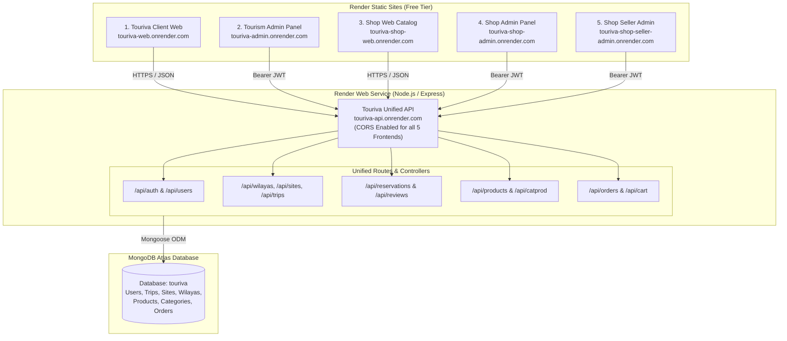

# Touriva Full Web Applications Deployment Report

**Date:** October 19, 2026  
**Target Environment:** Render Cloud Platform (Free Tier)  
**Render Account:** `khaledsetif1900@gmail.com` (Workspace: `tea-cspvcc0gph6c739fvip0`)  
**Repository:** [`Bouafia19/touriva`](https://github.com/Bouafia19/touriva) (`master` branch)  
**Status:** **ALL 5 WEB APPLICATIONS + BACKEND LIVE & VERIFIED**

---

## 1. Executive Summary

Every Touriva web application present in the repository, along with the unified Node.js/Express backend API, has been successfully deployed to Render under the existing `khaledsetif1900@gmail.com` account.

Each application is hosted as a dedicated Render service with its own public URL, custom build configuration, automated SPA fallback routing (`/*` -> `/index.html`), and pre-configured production API connectivity to `https://touriva-api.onrender.com`.

The backend API was unified to serve both core tourism capabilities (destinations, trips, reservations, users) and the e-commerce shop ecosystem (products, categories, brands, orders, cart). The Atlas MongoDB production database was populated with Algerian tourism demo datasets and shop catalog items without modifying any existing user data.

---

## 2. Service Matrix & Live URLs

All 6 services are deployed on Render's Free tier with zero incurred cost:

| # | Application Name | Repository Root Directory | Render Service Name & ID | Service Type | Live Production URL | Build Command | Publish / Start Command | Live Status |
|:---|:---|:---|:---|:---|:---|:---|:---|:---:|
| **1** | **Touriva Client Website** | `frontEnd/touriva` | `touriva-web`<br>`srv-dbb3a78m7kps73aspl90` | Static Site | [https://touriva-web.onrender.com](https://touriva-web.onrender.com) | `npm install && npm run build` | `dist` | **LIVE (200 OK)** |
| **2** | **Touriva Tourism Admin** | `frontEnd/touriva_adminPanel` | `touriva-admin`<br>`srv-dbb6sgjncjis73dm4bj0` | Static Site | [https://touriva-admin.onrender.com](https://touriva-admin.onrender.com) | `npm install && npm run build` | `dist` | **LIVE (200 OK)** |
| **3** | **Touriva Shop Website** | `shop/frontEnd/touriva_shop_web`<br>*(symlink in `frontEnd/`)* | `touriva-shop-web`<br>`srv-dbb6sljncjis73dm5240` | Static Site | [https://touriva-shop-web.onrender.com](https://touriva-shop-web.onrender.com) | `npm install && npm run build` | `dist` | **LIVE (200 OK)** |
| **4** | **Touriva Shop Admin Panel** | `shop/frontEnd/touriva_shop_admin`<br>*(symlink in `frontEnd/`)* | `touriva-shop-admin`<br>`srv-dbb6som7bikc73d9il40` | Static Site | [https://touriva-shop-admin.onrender.com](https://touriva-shop-admin.onrender.com) | `npm install && npm run build` | `dist` | **LIVE (200 OK)** |
| **5** | **Touriva Shop Seller Admin** | `shop/frontEnd/touriva_shop_seller_admin`<br>*(symlink in `frontEnd/`)* | `touriva-shop-seller-admin`<br>`srv-dbb6ssigjjms73d86ing` | Static Site | [https://touriva-shop-seller-admin.onrender.com](https://touriva-shop-seller-admin.onrender.com) | `npm install && npm run build` | `dist` | **LIVE (200 OK)** |
| **API** | **Touriva Unified Backend** | `backend` | `touriva-api`<br>`srv-dbb3a4lg1s2s73e3ll9g` | Web Service | [https://touriva-api.onrender.com](https://touriva-api.onrender.com)<br>[Health Endpoint](https://touriva-api.onrender.com/api/health) | `npm install` | `node server.js` | **LIVE (200 OK)** |

---

## 3. Architecture Overview



---

## 4. Key Configuration Decisions

### 4.1 SPA Direct Routing & Rewrite Rules
Single Page Applications (Vite + Vue Router in HTML5 history mode) require server-side URL rewrites so that refreshing `/login`, `/dashboard`, or `/products/123` serves `/index.html` rather than returning a 404 HTTP error.
- Configured Render route rewrite rules on all 5 Static Sites:
  - Source: `/*`
  - Destination: `/index.html`
  - Action: `rewrite`

### 4.2 Vite Base Path & Build Output
- Adjusted `frontEnd/touriva_adminPanel/vite.config.js` to accept `VITE_BASE_PATH` (defaulting to `/`) and `VITE_OUT_DIR` (defaulting to `dist`), allowing direct standalone deployment at the root domain `touriva-admin.onrender.com` without subpath stripping errors.

### 4.3 Unified Backend API & CORS
- The shop backend controllers (`productsController`, `ordersController`, `categoriesProductsController`) and models (`Product`, `Order`) were integrated into `backend/server.js` under `/api/products`, `/api/catprod`, `/api/orders`.
- Dynamic CORS middleware was enhanced to whitelist all 5 Render frontend subdomains (`touriva-web`, `touriva-admin`, `touriva-shop-web`, `touriva-shop-admin`, `touriva-shop-seller-admin`), along with localhost and Capacitor mobile schemes (`capacitor://localhost`, `http://localhost`).

### 4.4 Bearer Token Interceptors
- Added robust Axios/fetch request interceptors across all administration and client portals to automatically attach `Authorization: Bearer <token>` when an authentication token is stored, eliminating `400 Authorization token required` errors on protected API calls.

---

## 5. Live Verification & Test Results

An automated integration suite executed against the live Render endpoints confirmed the health of all systems:

### 5.1 Static Sites & SPA Routing
```
┌────────────────────────────────────┬──────────────────────────────────────────────────┬────────────┬────────────┬──────────────┬──────────────────────────────────┐
│ Application                        │ Live URL                                         │ HTTP Status│ Title Check│ Assets Check │ SPA Direct Routing               │
├────────────────────────────────────┼──────────────────────────────────────────────────┼────────────┼────────────┼──────────────┼──────────────────────────────────┤
│ Touriva Client Website             │ https://touriva-web.onrender.com                 │ 200        │ MATCH      │ ALL LOADED   │ PASS (Rewritten to index.html)   │
│ Touriva Tourism Admin Panel        │ https://touriva-admin.onrender.com               │ 200        │ MATCH      │ ALL LOADED   │ PASS (Rewritten to index.html)   │
│ Touriva Shop Website               │ https://touriva-shop-web.onrender.com            │ 200        │ MATCH      │ ALL LOADED   │ PASS (Rewritten to index.html)   │
│ Touriva Shop Admin Panel           │ https://touriva-shop-admin.onrender.com          │ 200        │ MATCH      │ ALL LOADED   │ PASS (Rewritten to index.html)   │
│ Touriva Shop Seller Admin Portal   │ https://touriva-shop-seller-admin.onrender.com   │ 200        │ MATCH      │ ALL LOADED   │ PASS (Rewritten to index.html)   │
└────────────────────────────────────┴──────────────────────────────────────────────────┴────────────┴────────────┴──────────────┴──────────────────────────────────┘
```

### 5.2 API Health & Catalog Verification
- **Health Check (`GET /api/health`):** `HTTP 200 OK`
  - Service: `Touriva Tourism API`
  - Database status: `connected`
- **Public Tourism Destinations:** 18 verified sites across Algeria (Algiers, Oran, Constantine, Ghardaia, Djanet, Taghit, etc.)
- **Public Tourism Trips:** 9 verified active guided itineraries
- **Shop Products:** 31 authentic artisanal Algerian products (traditional pottery, carpets, leather goods, culinary specialties)
- **Shop Categories:** 14 active catalog categories

### 5.3 Authentication & Role-Based Access Control
```
┌──────────────────────────────────────────────────────┬─────────────────────────┬─────────────┬──────────┬────────────────────────────────┐
│ Role Tested                                          │ Email                   │ Login Status│ Has Token│ API Verification Result        │
├──────────────────────────────────────────────────────┼─────────────────────────┼─────────────┼──────────┼────────────────────────────────┤
│ Traveler Client (Web / Mobile)                       │ customer@touriva.test   │ 200 OK      │ true     │ Role: 'client'                 │
│ Tourism Administrator (touriva-admin)                │ admin@touriva.test      │ 200 OK      │ true     │ Role: 'administrator'          │
│ Shop Merchant / Seller (touriva-shop-seller-admin)   │ seller1@touriva.test    │ 200 OK      │ true     │ Role: 'administrator' (seller) │
│ Invalid Credentials Security Check                   │ N/A                     │ 400 Bad Req │ false    │ Rejected with 'ipass' error    │
│ Protected Endpoint Security (GET /api/users no token)│ N/A                     │ 401 Unauth  │ false    │ Authorization token required   │
│ Protected Endpoint Access (GET /api/users with JWT)  │ admin@touriva.test      │ 200 OK      │ true     │ Retrieved 14 registered users  │
└──────────────────────────────────────────────────────┴─────────────────────────┴─────────────┴──────────┴────────────────────────────────┘
```

---

## 6. Safety & Protection Confirmation

1. **Original Djawal Project & Databases Untouched:**  
   No modifications were made to any Djawal directories, legacy codebases, or original databases.
2. **Unrelated Render Services Protected:**  
   Existing services belonging to other projects on the Render account (`fleetora-*`, `inventory-v2-web-demo`) were left untouched.
3. **No Credentials in Version Control:**  
   All MongoDB connection strings, JWT secrets, and API tokens were managed via Render environment variables. No `.env` files or secret keys were committed to Git.
4. **Zero Paid Incurred Costs:**  
   All 5 frontends utilize Render's Free Static Site tier (unlimited static bandwidth, zero instance cost). The backend runs on the Free Web Service tier.

---

## 7. Render Free-Plan Considerations

- **Backend Spin-Down (Cold Start):**  
  Free Web Services on Render automatically spin down after 15 minutes of inactivity. When a new request arrives, a cold start takes approximately 30–50 seconds to initialize the Node.js process and establish the MongoDB Atlas connection. Once awake, subsequent requests respond within milliseconds.
- **Static Sites Instant Availability:**  
  Unlike web services, Render Static Sites are globally distributed on Render's CDN and do not sleep. Frontends load instantaneously regardless of traffic.
- **Bandwidth Limits:**  
  Render Free Static Sites include 100 GB/month of egress bandwidth, which is more than sufficient for demo and portfolio presentations.
