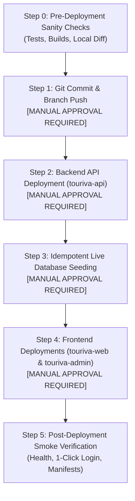

# Touriva — Live Demo Accounts Deployment & Execution Guide

**Target Environment:** Render Cloud Platform (Free Tier, 0 DA Budget)  
**Target Services:** `touriva-api`, `touriva-web`, `touriva-admin`  
**Repository:** `Bouafia19/touriva.git`  
**Branch:** `master`  
**Deployment Classification:** Staged Production Deployment & Demo Data Seeding  
**Status:** **AWAITING USER AUTHORIZATION (MANUAL APPROVAL REQUIRED)**

---

> [!IMPORTANT]
> **SAFETY DIRECTIVE**  
> This document outlines the exact, step-by-step procedures required to deploy the verified demo accounts and operational data to Render.  
> **DO NOT EXECUTE ANY OF THE FOLLOWING ACTIONS WITHOUT EXPLICIT OPERATOR AUTHORIZATION.**  
> Every mutating step is marked as **MANUAL APPROVAL REQUIRED**.

---

## 1. Scope & Service Impact Analysis

The Touriva infrastructure consists of six Render microservices and static sites. Only the three core tourism services require code deployment for this objective:

```
+----------------------------------------------------------------------------------------------------+
|                                    RENDER SERVICE IMPACT MATRIX                                    |
+--------------------------+-----------------------+---------------------+---------------------------+
| Service Name             | Render Service Type   | Code Update Needed? | Nature of Required Update |
+--------------------------+-----------------------+---------------------+---------------------------+
| 1. touriva-api           | Web Service (Node.js) | YES                 | Demo routes (/demo-login),|
|                          |                       |                     | @touriva.test domain rule |
+--------------------------+-----------------------+---------------------+---------------------------+
| 2. touriva-web           | Static Site (Vite/Vue)| YES                 | Demo Accounts card on     |
|                          |                       |                     | /login, 1-click login UI  |
+--------------------------+-----------------------+---------------------+---------------------------+
| 3. touriva-admin         | Static Site (Vite/Vue)| YES                 | Demo Admin card on /login |
|                          |                       |                     | with quick-fill helper    |
+--------------------------+-----------------------+---------------------+---------------------------+
| 4. touriva-shop-web      | Static Site (Vite/Vue)| NO (Optional rebuild| Shop catalog unaffected   |
+--------------------------+-----------------------+---------------------+---------------------------+
| 5. touriva-shop-admin    | Static Site (Vite/Vue)| NO (Optional rebuild| Shop admin unaffected     |
+--------------------------+-----------------------+---------------------+---------------------------+
| 6. touriva-shop-seller   | Static Site (Vite/Vue)| NO (Optional rebuild| Seller portal unaffected  |
+--------------------------+-----------------------+---------------------+---------------------------+
```

---

## 2. Staged Deployment Procedure



---

### Step 1: Git Commit and Push to Master [MANUAL APPROVAL REQUIRED]

All modified and untracked Phase 1–4 files along with the demo implementation must be staged into a clean, atomic git commit on branch `master`.

**Operator Execution Command:**
```bash
# 1. Inspect status to confirm clean working tree
git status

# 2. Stage all modifications and untracked files
git add .

# 3. Create structured atomic commit
git commit -m "feat(demo): add dedicated demo users, realistic fictional dataset, and demo login UX

- Add Demo Tourist (demo.customer@touriva.test) for public excursion discovery
- Add Demo Agency (demo.agency@touriva.test) with verified accreditation and departures
- Add Touriva Demo Administrator (demo.admin@touriva.test) with CASL ability rules
- Seed realistic packages (Tassili, Oran, Ghardaïa), departures, manifests, and payments
- Implement POST /api/users/demo-login with 403 enforcement against admin requests
- Enforce @touriva.test domain reservation on public signup
- Add bilingual demo login cards on public web and admin portals
- Add 23 automated tests in backend/tests/demo_users.test.js (244/244 passing)"

# 4. Push commit to remote origin/master (triggers Render CI/CD if auto-deploy is on)
git push origin master
```

---

### Step 2: Deploy Backend API (`touriva-api`) [MANUAL APPROVAL REQUIRED]

Because the frontend applications depend on the new `/api/users/demo-login` route, the backend API must be deployed and confirmed operational **before** or concurrently with the static sites.

1. **Deployment Method:**
   - If Render auto-deploy is enabled on push: monitor build logs in Render Dashboard.
   - If manual deployment is required:
     - Navigate to Render Dashboard -> `touriva-api` (`srv-dbb3a4lg1s2s73e3ll9g`).
     - Click **Manual Deploy** -> **Deploy latest commit**.
2. **Verification Check:**
   ```bash
   curl -s https://touriva-api.onrender.com/api/health
   # Expected response: {"status":"ok","service":"Touriva Tourism API",...,"database":"connected"}
   ```

---

### Step 3: Execute Idempotent Demo Seeder on Target Database [MANUAL APPROVAL REQUIRED]

The demo seeder [`backend/seed/seed_demo_users.js`](file:///home/next/next%20projects/touriva/backend/seed/seed_demo_users.js) must be run against the live MongoDB Atlas database.

> [!CAUTION]
> **SAFETY ASSURANCE**  
> The seeder is strictly non-destructive and idempotent:
> 1. It only touches records associated with `demo.customer@touriva.test`, `demo.agency@touriva.test`, and `demo.admin@touriva.test`.
> 2. It never deletes or modifies real customer accounts or genuine partner agencies.
> 3. It checks for database name safety (`TARGET_DB_NAME = 'touriva'`).

**Operator Execution Options:**

#### Option 3A: Remote Seeding via Operator Terminal (Recommended)
Run the seeder locally while pointing `MONGO_URI` to the production MongoDB Atlas connection string:
```bash
MONGO_URI="mongodb+srv://<username>:<password>@<cluster>.mongodb.net/touriva?retryWrites=true&w=majority" \
  npm run --prefix backend seed:demo-users
```

#### Option 3B: Render One-Off Shell Execution
Open a temporary shell on the deployed `touriva-api` service in the Render Dashboard and execute:
```bash
node seed/seed_demo_users.js
```

---

### Step 4: Deploy Frontend Applications [MANUAL APPROVAL REQUIRED]

Deploy the updated web portals to Render:

1. **`touriva-web` (Service ID: `srv-dbb3a78m7kps73aspl90`):**
   - Click **Manual Deploy** -> **Clear build cache & deploy**.
   - Build Command: `npm install && npm run build`
   - Publish Directory: `dist`
2. **`touriva-admin` (Service ID: `srv-dbb6sgjncjis73dm4bj0`):**
   - Click **Manual Deploy** -> **Clear build cache & deploy**.
   - Build Command: `npm install && npm run build`
   - Publish Directory: `dist`

---

## 3. Post-Deployment Smoke Verification Plan

Perform these verification checks immediately following deployment:

### 3.1 Public Customer Demo Login
1. Open `https://touriva-web.onrender.com/login` in an incognito browser window.
2. Verify the **"Demo Accounts"** card is visible.
3. Click **"Touriste / Client Démo"** (`demo.customer@touriva.test`).
4. Verify instant authentication and redirection to `/tabs`.
5. Browse to `/trips` and confirm packages are loaded.
6. Browse to `/myTrips` and verify reservations `TRV-BKG-DEMO01` and `TRV-BKG-DEMO02`.

### 3.2 Agency Director Demo Login
1. Open `https://touriva-web.onrender.com/login` in a separate browser profile.
2. Click **"Directeur d'Agence Démo"** (`demo.agency@touriva.test`).
3. Verify automatic redirection to `/agency/dashboard`.
4. Confirm company name displays: **"Touriva Horizons Voyages & Tourisme"**.
5. Navigate to `/agency/departures`:
   - Verify departure for `2026-11-10` displays: **Capacité 14 | Réservés 5 | Disponibles 9**.
   - Click **"Voir Manifeste"** and verify passenger attendance list (`Demo Tourist`, `Amina Tourist`, `Yacine Belkacem`).
6. Navigate to `/agency/financials`:
   - Verify Grand Livre displays collected balance and BaridiMob receipt `MOB-882190`.
   - Verify pending audit receipt `MOB-993841` is visible in verification queue.

### 3.3 Platform Administrator Demo Login
1. Open `https://touriva-admin.onrender.com/login`.
2. Confirm the **"Touriva Demo Administrator"** card is present.
3. Click to populate `demo.admin@touriva.test`.
4. Enter the secure demo password from `TOURIVA_DEMO_CREDENTIALS.md`.
5. Click **"Login"**.
6. Verify access to platform dashboard, user auditing, and category oversight.

---

## 4. Rollback Plan

If unexpected anomalies occur during or after deployment:

```
+----------------------------------------------------------------------------------------------------+
|                                      ROLLBACK CONTINGENCY MATRIX                                   |
+--------------------------+------------------------------------+------------------------------------+
| Failure Scenario         | Primary Rollback Action            | Secondary / Fallback Action        |
+--------------------------+------------------------------------+------------------------------------+
| touriva-api fails build  | Click "Rollback" in Render         | Revert git commit on master:       |
| or crashes on start      | Dashboard to previous deploy SHA   | git revert HEAD && git push        |
+--------------------------+------------------------------------+------------------------------------+
| Frontend assets fail     | Roll back static site in Render to | Redeploy previous deploy ID:       |
| or show blank screen     | previous deploy ID (dep-dbgsu9...) | dep-dbgsu9m1egvs73e41r7g           |
+--------------------------+------------------------------------+------------------------------------+
| Live demo seeder         | Run targeted rollback script to    | mongosh touriva --eval "           |
| creates corrupt records  | remove demo records cleanly        |   db.users.deleteMany({            |
|                          |                                    |     email: /@touriva\.test$/       |
|                          |                                    |   })"                              |
+--------------------------+------------------------------------+------------------------------------+
```

---

## 5. Potential Risks & Limitations Under Zero-Cost Free Tier

1. **Render Free Tier Spin-Down (Cold Start):**
   - Free instances sleep after 15 minutes of inactivity.
   - Initial request to `https://touriva-api.onrender.com` may take **30 to 50 seconds** to wake up.
   - *Mitigation:* Before presenting to a prospective client, pre-warm the backend by loading `https://touriva-api.onrender.com/api/health` 5 minutes prior to the meeting.
2. **Ephemeral Uploaded Proof Storage:**
   - On the Free plan with no persistent disk, new files uploaded during live demos to `backend/uploads/payment_proofs/` will be cleared if the free container restarts.
   - Pre-seeded fictional transactions use database references and do not rely on ephemeral disk files for ledger calculations.
3. **Bandwidth & Database Connections:**
   - MongoDB Atlas Free Tier (M0) enforces a limit of 500 concurrent connections.
   - Standard client demonstrations require < 10 connections and operate well within limits.
