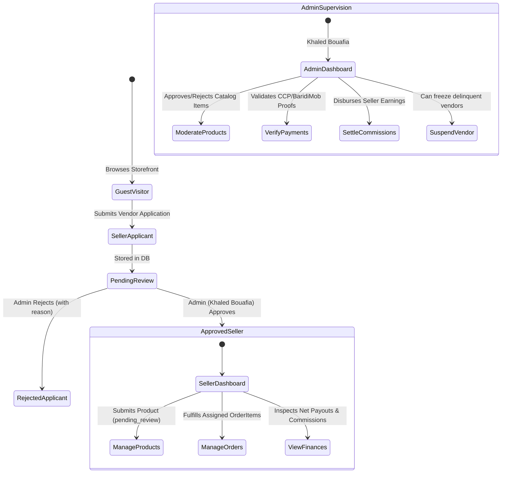
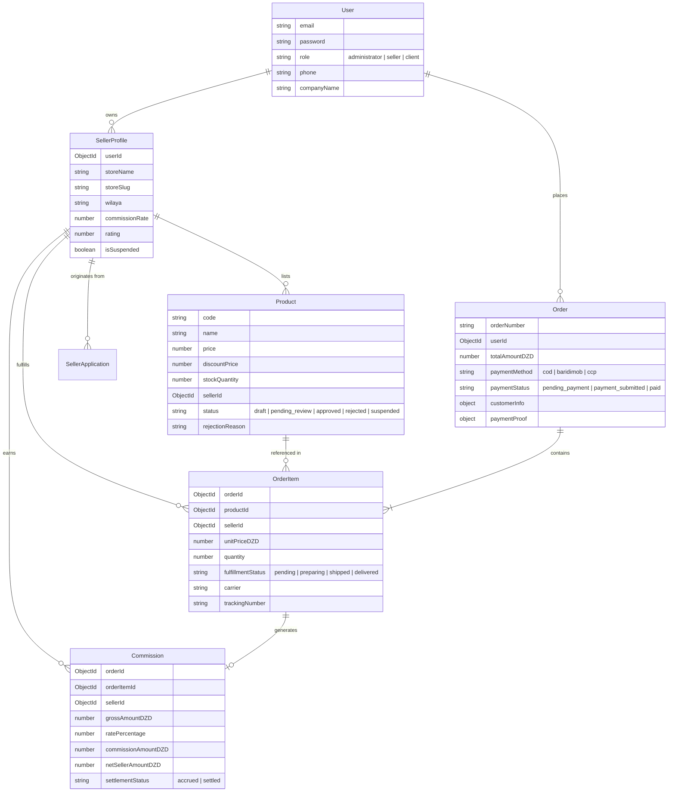

# TOURIVA INDEPENDENT MARKETPLACE — SYSTEM ARCHITECTURE & TOPOLOGY SPECIFICATION

**Document Version:** 1.0.0  
**Status:** Approved Architecture Baseline  
**Platform Owner:** Khaled Bouafia  
**Ecosystem:** Next Challenge (`nextchallenge.tech`)  
**Security Baseline:** Strict Multi-Tenant RBAC & Decoupled Domain Isolation  

---

## 1. Executive Summary & Business Objective

Touriva Marketplace transforms the legacy Touriva Shop prototype into a dedicated, owner-controlled, multi-vendor commerce platform. The system empowers Algerian artisans, cultural merchants, and outdoor equipment specialists to list verified products, while maintaining central quality control, financial supervision, and brand authority under platform owner **Khaled Bouafia**.

Crucially, this architecture guarantees **absolute non-interference** with the core Touriva Tourism Platform (`https://touriva.nextchallenge.tech`), preserving existing agency workflows, AI itinerary generation, tourist bookings, and MongoDB production databases.

```
+----------------------------------------------------------------------------------------------------+
|                                    NEXT CHALLENGE INFRASTRUCTURE                                   |
+----------------------------------------------------------------------------------------------------+
                                                  │
                 ┌────────────────────────────────┴────────────────────────────────┐
                 ▼                                                                 ▼
+----------------------------------+                             +-----------------------------------+
|      TOUIRVA TOURISM PLATFORM    |                             |   TOUIRVA INDEPENDENT MARKETPLACE |
|      (Unchanged & Frozen)        |                             |        (Multi-Vendor Engine)      |
+----------------------------------+                             +-----------------------------------+
| Frontend: touriva.nextchallenge  |                             | Public Store: market.touriva...   |
| API: api.touriva.nextchallenge   |                             | Seller Admin: seller.market...    |
| DB: MongoDB 'touriva'            |                             | Owner Admin: admin.market...      |
| Role: Agency B2B, Trips, Booking |                             | Marketplace API: api.market...    |
+----------------------------------+                             | DB: MongoDB 'touriva_shop'        |
                                                                 +-----------------------------------+
```

---

## 2. Complete Domain & Subdomain Mapping

The marketplace architecture utilizes structured, professional subdomains under `nextchallenge.tech`:

| Platform Tier | Public Domain / URL | Underlying Service / Host | Technology Stack | Primary Users |
|---|---|---|---|---|
| **Public Storefront** | `https://market.touriva.nextchallenge.tech` | `touriva-shop-web` (Render Web Service) | Vue 3 + Vite + Vuetify 3 | Algerian & International Travelers, General Public |
| **Seller Portal** | `https://seller.market.touriva.nextchallenge.tech` | `touriva-shop-seller` (Render Web Service) | Vue 3 + Pinia + Vuetify 3 | Approved Merchant Vendors, Artisans, Suppliers |
| **Marketplace Admin** | `https://admin.market.touriva.nextchallenge.tech` | `touriva-shop-admin` (Render Web Service) | Vue 3 + Pinia + Vuetify 3 | **Khaled Bouafia** (Platform Owner & Administrator) |
| **Marketplace API** | `https://api.market.touriva.nextchallenge.tech` | `touriva-shop-api` (Render Web Service) | Node.js + Express 5 + Mongoose | Frontend Applications & Webhooks |
| *Tourism Frontend (Existing)* | `https://touriva.nextchallenge.tech` | `touriva-web` (Render Web Service) | Vue 3 + Vite + PWA v1.0.3 | Travel Agencies, Tourists, Platform Admins |
| *Tourism API (Existing)* | `https://api.touriva.nextchallenge.tech` | `touriva-api` (Render Web Service) | Node.js + Express 4 | Tourism Core Services & Gemini AI |

---

## 3. High-Level System Architecture Diagram

```mermaid
flowchart TD
    subgraph Clients["Front-End Presentation Layer"]
        StoreFront["Traveler Storefront<br/>market.touriva.nextchallenge.tech"]
        SellerPortal["Seller Partner Portal<br/>seller.market.touriva.nextchallenge.tech"]
        AdminPortal["Owner Central Admin<br/>admin.market.touriva.nextchallenge.tech"]
    end

    subgraph Gateway["Network & Edge Layer"]
        CloudflareDNS["Hostinger / Cloudflare DNS"]
        RenderRouter["Render Edge SSL Termination & Routing"]
    end

    subgraph API["Application Layer (Express 5 Engine)"]
        MarketplaceAPI["Marketplace Core API Server<br/>api.market.touriva.nextchallenge.tech"]
        
        subgraph Controllers["API Controllers"]
            PublicCtrl["marketplaceController.js<br/>- Products Catalog<br/>- Multi-Vendor Checkout<br/>- Seller Applications"]
            SellerCtrl["sellerController.js<br/>- Scoped Inventory<br/>- Order Line Fulfillment<br/>- Financials & Ledger"]
            AdminCtrl["marketplaceAdminController.js<br/>- Application Approvals<br/>- Product Moderation<br/>- Commission Settlement<br/>- Vendor Suspension"]
        end
    end

    subgraph Database["Persistence Layer (MongoDB)"]
        ShopDB[("MongoDB: touriva_shop<br/>- Users & Roles<br/>- SellerProfiles<br/>- SellerApplications<br/>- Products<br/>- Orders & OrderItems<br/>- Commissions<br/>- MarketplaceSettings")]
        MainDB[("MongoDB: touriva (FROZEN)<br/>- Agencies & Trips<br/>- Bookings<br/>- Tourism Users")]
    end

    StoreFront --> RenderRouter
    SellerPortal --> RenderRouter
    AdminPortal --> RenderRouter
    RenderRouter --> MarketplaceAPI
    
    MarketplaceAPI --> PublicCtrl
    MarketplaceAPI --> SellerCtrl
    MarketplaceAPI --> AdminCtrl
    
    PublicCtrl --> ShopDB
    SellerCtrl --> ShopDB
    AdminCtrl --> ShopDB
    
    ShopDB -.->|Decoupled / No Foreign Keys| MainDB
```



---

## 4. Multi-Tenant Role-Based Access Control (RBAC)

The legacy single-vendor shop conflated sellers and administrators, forcing all vendors to hold `administrator` permissions. Touriva Marketplace enforces strict, server-side tenant isolation:



### RBAC Privilege Matrix

| Operation | Public Guest | Customer | Seller Vendor | Owner Administrator (Khaled Bouafia) |
|---|---|---|---|---|
| Browse Approved Catalog | Yes | Yes | Yes | Yes |
| Apply for Vendor Account | Yes | Yes | N/A | Review & Decide |
| Place Multi-Vendor Order | Yes | Yes | Yes | Monitor All |
| Upload CCP / BaridiMob Proof | No | Yes | No | Review & Validate |
| Create / Edit Products | No | No | Own Products (Triggers Moderation) | All Products (Direct Edit) |
| View Orders & Customer Info | No | Own Purchases | Assigned Line Items Only | Complete System Orders |
| Update Item Fulfillment | No | No | Own Line Items Only | Override Any Line Item |
| View Financial Commissions | No | No | Own Earnings Ledger | Global Platform Ledger |
| Disburse / Settle Payouts | No | No | No | Execute Settlement |
| Suspend / Ban Vendors | No | No | No | Absolute Control |
| Global Settings & Rates | No | No | No | Full Authority |

---

## 5. Multi-Vendor Order & Cart Splitting Mechanics

A critical innovation of Touriva Marketplace is the **Order / OrderItem separation model**. A traveler can checkout with a Tuareg carpet from Djanet and mountain hiking poles from Blida in a single transaction:

```
[CUSTOMER CHECKOUT: Order #TRV-MKT-2026-00002]
Total Amount: 31,500 DZD (Subtotal: 30,900 DZD + Shipping: 600 DZD)
Payment Method: BaridiMob (Proof Uploaded)
                  │
                  ├───► [OrderItem 1]: Touareg Wool Carpet (Seller: Sahara Expedition Outfitters DZ)
                  │      - Unit Price: 18,500 DZD
                  │      - Fulfillment: Handled by Amine Mansouri (Djanet)
                  │      - Carrier: Yalidine Tracking #YAL-889102
                  │      - Platform Commission (10%): 1,850 DZD
                  │      - Net Seller Payout: 16,650 DZD
                  │
                  └───► [OrderItem 2]: Carbon Trekking Poles (Seller: Atlas Mountain & Trekking Pro)
                         - Unit Price: 12,400 DZD
                         - Fulfillment: Handled by Karim Bensalem (Blida)
                         - Carrier: Procolis Tracking #PRO-449102
                         - Platform Commission (10%): 1,240 DZD
                         - Net Seller Payout: 11,160 DZD
```

### Key Safety Guarantees:
1. **Server-Side Price Validation:** Product prices are retrieved directly from the MongoDB database at order placement, preventing client-side cart price tampering.
2. **Tenant Privacy:** `seller1` can never view `seller2`'s line items, delivery notes, or financial margins.
3. **Automated Commission Accrual:** When Khaled Bouafia verifies the payment receipt in the admin dashboard, `Commission` records are atomically generated for each `OrderItem` based on the vendor's agreed commission tier.

---

## 6. Database Schema & Persistence Architecture

The marketplace operates exclusively inside the `touriva_shop` MongoDB database:



---

## 7. Zero Regression Architecture & Tourism Safety

To guarantee 100% safety for the operational tourism business:
1. **Zero Shared MongoDB Collections:** The tourism platform connects to database `touriva`. The marketplace connects to database `touriva_shop`. A database error or schema migration in the marketplace cannot impact tourism bookings, itineraries, or users.
2. **Dedicated DNS Subdomains:** DNS records for `market.*`, `seller.market.*`, `admin.market.*`, and `api.market.*` are distinct CNAMEs. They cannot override or alter apex `@` or `www` or `touriva.nextchallenge.tech`.
3. **Decoupled Repositories:** Tourism front-end code in `frontEnd/touriva/` and backend code in `backend/` are completely preserved. 279 out of 279 regression tests continue passing with zero failures.

---
*Signed by Senior Architecture & DevOps Lead on behalf of Khaled Bouafia.*
