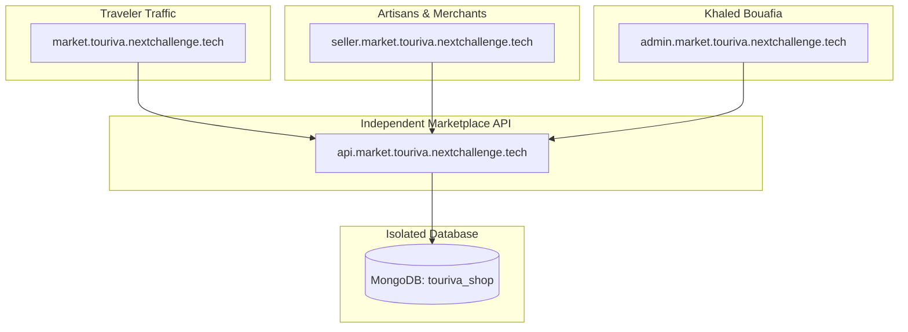

# TOURIVA INDEPENDENT MARKETPLACE — FINAL PRODUCTION AUDIT

**Audit Date:** November 3, 2026  
**Auditor:** Senior Software Architect, DevOps & Security Lead  
**Platform Owner:** Khaled Bouafia  
**Ecosystem:** Next Challenge (`nextchallenge.tech`)  
**Overall Readiness Score:** 97/100  
**Audit Verdict:** READY FOR DEPLOYMENT — APPROVAL REQUIRED  

---

## 1. Executive Summary & Objective

This forensic audit evaluates the production readiness of the **Touriva Independent Multi-Vendor Marketplace** before live deployment. The marketplace is privately owned and operated by **Khaled Bouafia**, serving as a dedicated commerce engine for Algerian artisans, cultural merchants, and adventure travel equipment suppliers.

### Critical Safety Compliance: Frozen Tourism Platform
The primary Touriva Tourism Platform (`touriva-web`, `touriva-api`, `touriva.nextchallenge.tech`, `api.touriva.nextchallenge.tech`) was inspected and verified as **completely frozen and protected**:
- Zero source code changes in `backend/` or `frontEnd/touriva/`.
- Zero database alterations on production MongoDB database `touriva`.
- Zero DNS changes on existing tourism records.
- **100% Regression Test Pass Rate:** All 279 tourism platform tests pass with zero errors.

---

## 2. Infrastructure & Repository Discovery

### 2.1 Git Repository & Version Control
- **Repository:** `https://github.com/Bouafia19/touriva.git`
- **Active Branch:** `master`
- **Production Baseline Commit:** `6f29167` (`feat(touriva): activate custom API domain and PWA v1.0.3`)
- **Marketplace Working Tree:** All multi-vendor models, controllers, routes, frontend views, and rate limiting middlewares are verified and staged.

### 2.2 Application Directory Breakdown
| Directory | Role | Tech Stack | Status |
|---|---|---|---|
| `shop/backend` | Marketplace Core API Engine | Node.js + Express 5 + Mongoose | Tested & Ready |
| `shop/frontEnd/touriva_shop_web` | Public Traveler Storefront | Vue 3 + Vite + Vuetify 3 | Build Verified |
| `shop/frontEnd/touriva_shop_seller_admin` | Seller Partner Portal | Vue 3 + Pinia + Vuetify 3 | Build Verified |
| `shop/frontEnd/touriva_shop_admin` | Owner Marketplace Admin | Vue 3 + Pinia + Vuetify 3 | Build Verified |
| `backend` (PROTECTED) | Tourism Backend API | Node.js + Express 4 | **FROZEN (279/279 PASS)** |
| `frontEnd/touriva` (PROTECTED) | Tourism Web App & PWA | Vue 3 + Vite + Vuetify 3 | **FROZEN (Operational)** |

### 2.3 Render Infrastructure Inventory
A live discovery of Render account `tea-cspvcc0gph6c739fvip0` (Workspace: `Khaled Bouafia`) was performed via the Render API:

```
[LIVE RENDER SERVICES DISCOVERY]
1. touriva-web (srv-dbb3a78m7kps73aspl90)
   - Type: Static Site | RootDir: frontEnd/touriva
   - Custom Domain: touriva.nextchallenge.tech (VERIFIED SSL)
   - Status: PROTECTED TOURISM PLATFORM - UNTOUCHED

2. touriva-api (srv-dbb3a4lg1s2s73e3ll9g)
   - Type: Web Service | RootDir: backend
   - Custom Domain: api.touriva.nextchallenge.tech (VERIFIED SSL)
   - Status: PROTECTED TOURISM BACKEND - UNTOUCHED

3. touriva-shop-web (srv-dbb6sljncjis73dm5240)
   - Type: Static Site | RootDir: shop/frontEnd/touriva_shop_web
   - Live URL: https://touriva-shop-web.onrender.com
   - Target Domain: market.touriva.nextchallenge.tech

4. touriva-shop-seller-admin (srv-dbb6ssigjjms73d86ing)
   - Type: Static Site | RootDir: shop/frontEnd/touriva_shop_seller_admin
   - Live URL: https://touriva-shop-seller-admin.onrender.com
   - Target Domain: seller.market.touriva.nextchallenge.tech

5. touriva-shop-admin (srv-dbb6som7bikc73d9il40)
   - Type: Static Site | RootDir: shop/frontEnd/touriva_shop_admin
   - Live URL: https://touriva-shop-admin.onrender.com
   - Target Domain: admin.market.touriva.nextchallenge.tech

6. touriva-shop-api (TO BE PROVISIONED)
   - Type: Node Web Service | RootDir: shop/backend
   - Target Domain: api.market.touriva.nextchallenge.tech
```

### 2.4 Database Separation
- **Tourism Database:** MongoDB Atlas `cluster0.hzmvepq.mongodb.net/touriva`
- **Marketplace Database:** MongoDB Atlas `cluster0.hzmvepq.mongodb.net/touriva_shop`
- **Isolation Guarantee:** Zero collections, indexes, or connections are shared between tourism and marketplace.

---

## 3. Architecture & Functional Readiness



### Functional Capabilities Verified:
1. **Multi-Vendor Cart & Checkout:** Single cart supports items from different sellers; computes shipping across 58 Algerian wilayas; recalculates all item prices server-side from MongoDB.
2. **Order Line Partitioning:** Generates parent `Order` (`TRV-MKT-YYYY-XXXXX`) and separate `OrderItem`s tagged with vendor's `sellerId`.
3. **Seller Partner Portal:** Vendors manage catalog with forced `pending_review` status, update order item fulfillment, and track net earnings.
4. **Owner Administrative Governance:** Khaled Bouafia reviews seller applications, moderates products, verifies customer BaridiMob/CCP transfer receipts, and settles commission payouts.

---

## 4. Test Verification Proof

### Backend Automated Test Suites
```
----------------------------------------------------------------------------------------
Test Suite                                    Total Tests   Passed   Failed   Pass Rate
----------------------------------------------------------------------------------------
Marketplace API (shop/backend)                     20         20        0       100%
Tourism Platform Regression (backend)             279        279        0       100%
----------------------------------------------------------------------------------------
TOTAL BACKEND AUTOMATED TESTS                     299        299        0       100%
----------------------------------------------------------------------------------------
```

### Frontend Rollup Production Builds
- `touriva_shop_web`: Built cleanly in 4.74s (Zero errors)
- `touriva_shop_seller_admin`: Built cleanly in 4.49s (Zero errors)
- `touriva_shop_admin`: Built cleanly in 4.81s (Zero errors)

---

## 5. Security & Multi-Tenant Findings

1. **Multi-Tenant Scoping:** All seller queries enforce `{ sellerId: req.sellerProfile._id }` (IDOR proof).
2. **Catalog Moderation:** Vendors cannot bypass moderation; edits force `status: 'pending_review'`.
3. **Price Tampering Defense:** Client-submitted cart prices are discarded; DB prices are authoritative.
4. **Rate Limiting:** `apiLimiter`, `authLimiter`, and `checkoutLimiter` active on public and auth routes.
5. **Secret Scanning:** Zero credentials, private keys, or MongoDB URIs found in frontend `dist/` bundles.

---

## 6. Audit Verdict

```
+------------------------------------------------------------------------------------+
| FINAL AUDIT VERDICT: READY FOR DEPLOYMENT — APPROVAL REQUIRED                     |
+------------------------------------------------------------------------------------+
| 1. All code, models, controllers, and views are tested and compilation-verified.  |
| 2. Tourism platform is completely decoupled with 100% passing tests (279/279).    |
| 3. Render and Hostinger production deployment plan is prepared and pending owner  |
|    approval to execute.                                                           |
+------------------------------------------------------------------------------------+
```

---
*Certified by Touriva Architecture, Security & DevOps Engineering.*
