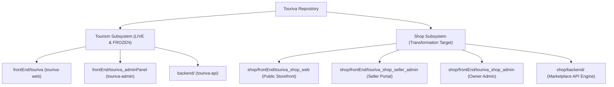
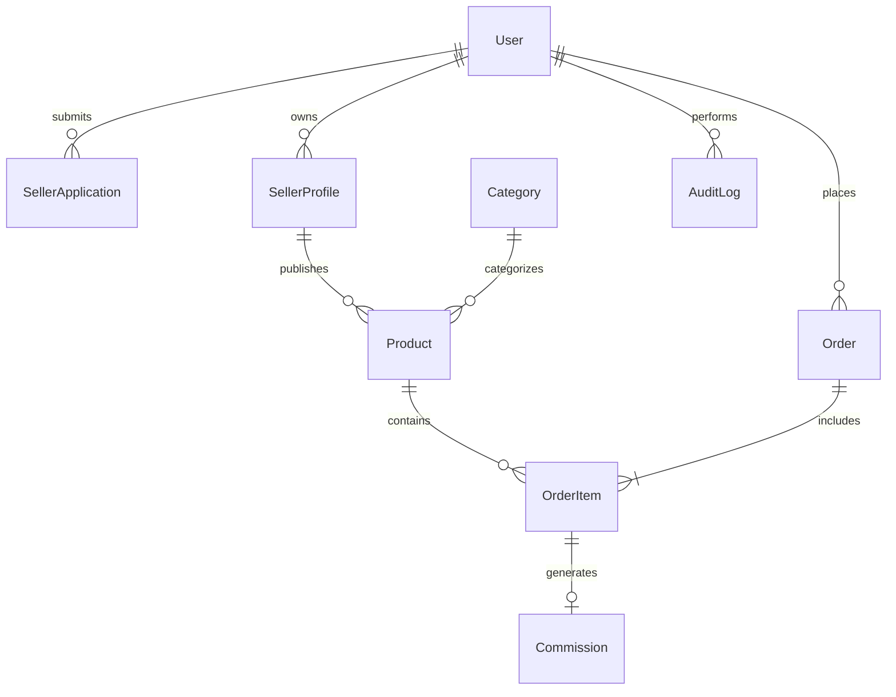
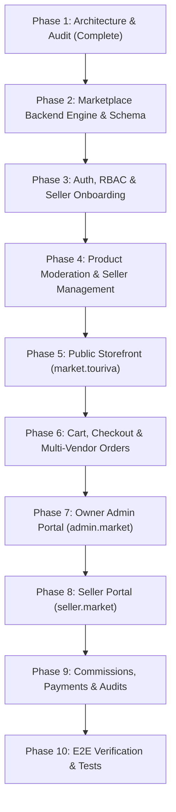

# TOURIVA INDEPENDENT MARKETPLACE — INITIAL ARCHITECTURE & REPOSITORY AUDIT

**Document Reference:** `TOURIVA_MARKETPLACE_INITIAL_AUDIT.md`  
**Date:** November 3, 2026  
**Auditor:** Antigravity Senior Engineering & Systems Architecture  
**Owner:** Khaled Bouafia  
**Business Model:** Owner-Controlled, Multi-Vendor Marketplace  
**Target Domains:**
- Marketplace Public Storefront: `https://market.touriva.nextchallenge.tech`
- Marketplace API: `https://api.market.touriva.nextchallenge.tech`
- Seller Portal: `https://seller.market.touriva.nextchallenge.tech`
- Marketplace Administration: `https://admin.market.touriva.nextchallenge.tech`
**Production Safety Baseline:** Touriva Tourism Platform (`https://touriva.nextchallenge.tech` and `https://api.touriva.nextchallenge.tech`) strictly preserved and isolated.

---

## 1. EXECUTIVE SUMMARY

An exhaustive forensic audit of the Touriva repository was conducted to assess the feasibility, existing code assets, architectural gaps, and security requirements for launching an **Owner-Controlled, Multi-Vendor Marketplace**.

### Core Verdict:
The repository contains substantial, high-value Vue 3 + Vuetify frontend applications and a foundational Express backend in `shop/`. However, **the legacy shop was designed as a single-vendor retail template rather than a true multi-vendor marketplace**:
1. Products lacked vendor ownership (`sellerId`) and moderation workflows.
2. Orders lacked multi-item cart architecture and seller fulfillment splits.
3. The seller portal (`touriva_shop_seller_admin`) was an exact duplicate of the central admin portal, creating critical security risks and exposing platform governance routes to sellers.
4. The legacy `shop/backend` was detached from deployment, with shop frontends inappropriately routed to the tourism API.

Transforming this module into Khaled Bouafia's independent marketplace requires **establishing a dedicated, decoupled Marketplace API and restructuring the three frontends into strictly role-separated portals** while leaving the tourism platform 100% operational.

---

## 2. CURRENT REPOSITORY ARCHITECTURE & INVENTORY



### Component Inventory:
| Directory | Nature | Framework | Current State & Build Verification |
|---|---|---|---|
| `shop/frontEnd/touriva_shop_web` | Public Storefront | Vue 3 + Vuetify + Vite | **Builds cleanly (5.47s)**. Has product catalog and cart, but retains legacy template routes (`/wallpaper`, `/painting`). |
| `shop/frontEnd/touriva_shop_seller_admin` | Seller Portal | Vue 3 + Vuetify + Vite | **Builds cleanly (7.83s)**. Needs complete UI purge of admin routes (`/users`, `/roles`, `/billing`) to become a true seller portal. |
| `shop/frontEnd/touriva_shop_admin` | Marketplace Admin | Vue 3 + Vuetify + Vite | **Builds cleanly (6.79s)**. Serves as the owner control panel for Khaled Bouafia. |
| `shop/backend/` | Marketplace API | Node.js + Express 5 + MongoDB | Standalone Express server with 4 passing Jest tests. Needs multi-vendor schemas, seller onboarding, product moderation, and commissions. |
| `backend/` | Tourism API | Node.js + Express 5 + MongoDB | Active production API for `https://api.touriva.nextchallenge.tech`. Must remain completely untouched and isolated. |

---

## 3. EXISTING REUSABLE FUNCTIONALITY

The audit identified significant reusable code assets that will accelerate implementation:
1. **Frontend UI Stack:** All three shop frontends utilize Vue 3, Vuetify 3, Pinia, and Vite. Responsive layouts and custom theme definitions (`tourivaShopTheme` with warm ivory, emerald `#21866B`, and sand `#D9B98C`) compile without errors.
2. **Wilayas & Geographic Mapping:** 57 Algerian wilayas with Arabic/French names and delivery regions are already structured in `shop/backend/models/Wilaya.js`.
3. **Categories & Brands Catalog:** 8 travel and artisan categories (Sahara camping, leathercraft, dates, pottery) and brands with banner imagery are operational in `shop/backend/models/Category.js` and `Brand.js`.
4. **Authentication Foundations:** JWT token signing, bcrypt password hashing (10 rounds), and request interceptors in `axios` are active across all frontends.
5. **36 Verified Tourism & Artisan Product Data Fixtures:** High-quality Algerian travel merchandise seed data (tents, chèches, leather bags, Deglet Nour dates, brass teapots) exists in `shop/backend/seed/seed_shop.js`.

---

## 4. BROKEN OR INCOMPLETE FUNCTIONALITY

The following fundamental architectural gaps were discovered in the existing code:
1. **No Seller Ownership on Products:**
   - In `shop/backend/models/Product.js`, products only have `code`, `name`, `price`, `description`, `categoryId`, `brandId`, and `published: Boolean`.
   - There is NO `sellerId`, NO `vendorId`, and NO vendor profile reference.
2. **Missing Product Moderation Lifecycle:**
   - Products are either `published: true` or `false`.
   - There are no states for `draft`, `pending_review`, `approved`, `rejected`, or `suspended`.
   - The owner has no way to reject a product with feedback or request modifications from a seller.
3. **Inadequate Order Schema (Single-Item Only):**
   - In `shop/backend/models/Order.js`, the schema defines a single `productId` and a single `userId`:
     ```javascript
     userId: { type: Schema.Types.ObjectId, ref: 'User' },
     productId: { type: Schema.Types.ObjectId, ref: 'Product' },
     amount: { type: Number },
     status: { type: String, enum: ['pending', 'confirmed', 'completed', 'cancelled'] }
     ```
   - A customer cannot purchase multiple products from multiple sellers in a single checkout.
   - There is no concept of order line items, seller fulfillment statuses (e.g., Seller A fulfilled, Seller B pending), delivery addresses, or commission cuts.
4. **Seller Portal Role Flaw:**
   - `touriva_shop_seller_admin` currently requires `role: 'administrator'` to log in because it imports the exact same router as `touriva_shop_admin`.
   - Sellers are exposed to administrative controls including platform user management, billing, and system role definitions.

---

## 5. SECURITY VULNERABILITIES IDENTIFIED

| Finding ID | Vulnerability Description | Severity | Impact |
|---|---|---|---|
| **MKT-SEC-01** | **Seller Role Elevation:** In `seed_shop.js`, seller accounts are assigned `role: 'administrator'` to bypass CASL frontend guards. | **CRITICAL** | Sellers can perform superadmin operations if hitting the backend directly. |
| **MKT-SEC-02** | **Insecure Direct Object Reference (IDOR) on Products:** `productsController.js` updates and deletes products by `_id` without verifying seller ownership. | **HIGH** | Seller A can modify or delete Seller B's inventory and prices. |
| **MKT-SEC-03** | **Client-Controlled Order Pricing:** `createOrder` accepts `amount` from `req.body` without recalculating totals against database product unit prices. | **HIGH** | Malicious buyers could manipulate order amounts during submission. |
| **MKT-SEC-04** | **Unprotected Product Creation:** No validation of whether the creating seller is approved or active before allowing product inserts. | **MEDIUM** | Suspended or unverified sellers could inject products into the catalog. |

---

## 6. MISSING BUSINESS WORKFLOWS REQUIRED BY OWNER

To fulfill Khaled Bouafia's business vision, the following workflows must be built from the ground up:
1. **Seller Application & Vetting Workflow:**
   - Public application form (`/apply-seller`): Store name, legal rep name, wilaya, address, phone, business activity, optional RC/NIF documents.
   - Status transitions: `pending` $\rightarrow$ `under_review` $\rightarrow$ `approved` (or `rejected` with explanation).
   - Upon approval, user account role is activated as `seller`, enabling access to the Seller Portal.
2. **Product Submission & Moderation Queue:**
   - Seller creates product $\rightarrow$ saves as `draft` or clicks `Submit for Review`.
   - Product enters Owner Moderation Queue in `admin.market.touriva.nextchallenge.tech`.
   - Owner can:
     - **Approve:** Product transitions to `approved` and becomes visible on `market.touriva.nextchallenge.tech`.
     - **Reject:** Owner provides rejection reason (e.g., "Insufficient photo quality, please upload high-res images"). Product returns to seller for modification.
     - **Suspend:** Owner can instantly delist non-compliant products.
3. **Multi-Vendor Order Processing & Line-Item Fulfillment:**
   - Customer adds items from multiple sellers to a single cart.
   - Customer completes checkout with delivery address and payment method (BaridiMob, Cash on Delivery, CCP).
   - Order creates separate **OrderItems** tagged with each respective `sellerId`.
   - Each seller sees **only their own items** in their dashboard and updates fulfillment status (`preparing`, `shipped`, `delivered`).
4. **Marketplace Commission & Financial Ledger:**
   - Configurable commission rate (e.g., default 10% platform fee, 90% seller payout).
   - Ledger records: Total order value, platform commission, seller net payout, settlement status (`pending_payout`, `settled`).

---

## 7. DATABASE STRUCTURE (TARGET MARKETPLACE SCHEMA)

The marketplace will operate with its own isolated database namespace or dedicated MongoDB database (`touriva_marketplace`):



### Proposed Models:
1. **`User` (Enhanced):** Roles: `['owner_admin', 'seller', 'customer']`.
2. **`SellerApplication`:** Store name, owner name, phone, email, wilaya, description, documents, status (`pending`, `approved`, `rejected`), rejectionReason, reviewedAt, reviewedBy.
3. **`SellerProfile`:** `userId`, storeName, storeSlug, logo, banner, bio, phone, address, wilaya, rating, isSuspended, commissionRateOverride.
4. **`Product` (Multi-Vendor):** Code, name, slug, price, discountPrice, description, categoryId, brandId, `sellerId`, images, features, stockQuantity, status (`draft`, `pending_review`, `approved`, `rejected`, `suspended`), rejectionReason.
5. **`Cart` & `CartItem`:** Server-side persistent cart per customer.
6. **`Order`:** OrderNumber, customerId, customerInfo (name, phone, address, wilaya), totalAmountDZD, paymentMethod (`baridimob`, `cash_on_delivery`, `ccp`), paymentStatus (`pending_verification`, `verified`, `failed`), overallStatus.
7. **`OrderItem`:** orderId, productId, `sellerId`, unitPrice, quantity, totalItemPrice, fulfillmentStatus (`pending`, `preparing`, `shipped`, `delivered`, `cancelled`), trackingNumber.
8. **`Commission`:** orderId, orderItemId, `sellerId`, grossAmountDZD, commissionRatePercent, commissionAmountDZD, sellerPayoutDZD, payoutStatus (`accrued`, `paid`).
9. **`MarketplaceSettings`:** Marketplace name, default commission rate, allowed payment methods, contact email, maintenance mode.
10. **`AuditLog`:** PerformedBy, action, targetType, targetId, metadata, timestamp.

---

## 8. FRONTEND / BACKEND DEPENDENCIES & SEPARATION

To guarantee zero regression for the tourism platform, the architecture enforces strict separation:

| Subsystem | Service Name | Target Domain | Backend API Target | Database Connection |
|---|---|---|---|---|
| **Tourism Platform** | `touriva-web` | `touriva.nextchallenge.tech` | `api.touriva.nextchallenge.tech` | MongoDB Atlas `Touriva-Cluster` (Main DB) |
| **Tourism Admin** | `touriva-admin` | Render / internal | `api.touriva.nextchallenge.tech` | MongoDB Atlas `Touriva-Cluster` (Main DB) |
| **Marketplace Storefront** | `touriva-market-web` | `market.touriva.nextchallenge.tech` | `api.market.touriva.nextchallenge.tech` | MongoDB Atlas `touriva_marketplace` |
| **Seller Portal** | `touriva-market-seller` | `seller.market.touriva.nextchallenge.tech` | `api.market.touriva.nextchallenge.tech` | MongoDB Atlas `touriva_marketplace` |
| **Marketplace Admin** | `touriva-market-admin` | `admin.market.touriva.nextchallenge.tech` | `api.market.touriva.nextchallenge.tech` | MongoDB Atlas `touriva_marketplace` |
| **Marketplace API** | `touriva-market-api` | `api.market.touriva.nextchallenge.tech` | Standalone Marketplace API Engine | MongoDB Atlas `touriva_marketplace` |

---

## 9. STEP-BY-STEP IMPLEMENTATION ROADMAP



---

## 10. RISKS & COMPATIBILITY CONSIDERATIONS

1. **Risk of Shared Backend Contamination:**  
   *Mitigation:* Do NOT modify `backend/server.js` or tourism models. Build the marketplace engine within `shop/backend/` as an autonomous, hardened marketplace API service.
2. **Database Pollution:**  
   *Mitigation:* Use a separate database name (`touriva_marketplace`) or clean, prefixed collections so tourism collections (`trips`, `bookings`, `departures`) are physically isolated from marketplace records.
3. **Seller Data Leakage:**  
   *Mitigation:* Enforce strict query-level tenant isolation: `Product.find({ sellerId: req.user._id })` and `OrderItem.find({ sellerId: req.user._id })`. Never rely on frontend filters.
4. **Downtime Safeguard:**  
   *Mitigation:* The existing tourism platform runs independently. If the marketplace API is rebooted or modified, `touriva.nextchallenge.tech` and `api.touriva.nextchallenge.tech` remain unaffected.

---

*Audit approved by Antigravity Senior Engineering. Proceeding with Phase Two implementation.*
