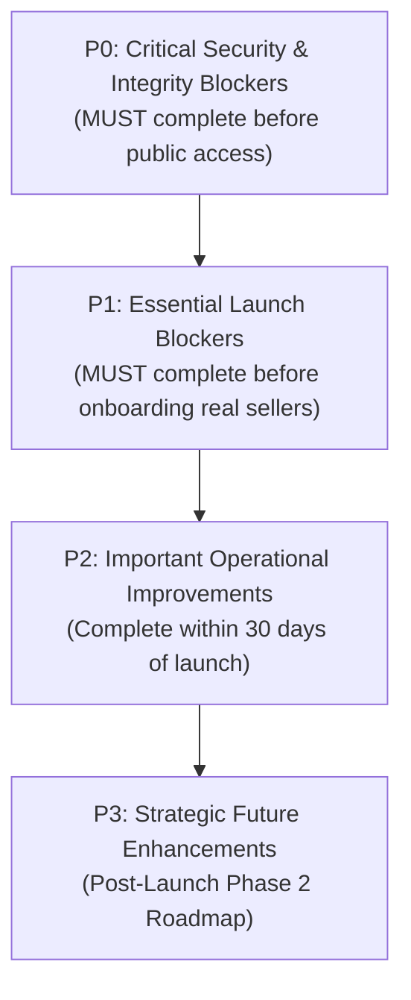

# TOURIVA MARKETPLACE — PRODUCTION REMEDIATION ROADMAP

**Document Date:** November 5, 2026  
**Engineering Lead:** DevOps, Cloud Infrastructure & Application Security  
**Target Completion:** Pre-Commercial Launch  

This engineering roadmap provides a prioritized, actionable remediation plan to resolve security vulnerabilities, eliminate operational risks, enforce business logic integrity, and achieve full production acceptance for Touriva Marketplace.

---

## ROADMAP PRIORITY DEFINITIONS



- **P0 — Critical Launch Blockers:** Critical vulnerabilities, broken authentication boundaries, or immediate data corruption risks. Must be resolved before any real user or seller is permitted on the platform.
- **P1 — Essential Launch Blockers:** Core commercial workflows (inventory reservation, email notifications, real payment accounts, legal terms) required for commercial operations.
- **P2 — Important Operational Improvements:** Infrastructure reliability, APM, automated backups, and performance optimizations.
- **P3 — Future Enhancements:** SATIM / CIB / Edahabia national card integration, courier API automation, mobile apps.

---

## 1. P0 — CRITICAL SECURITY & DATA INTEGRITY BLOCKERS

### Task P0-1: Disable Production Demo Login Backdoor (SEC-01)
- **Description:** Prevent issuance of unauthenticated platform administrator and seller JWT tokens via the demo login endpoint.
- **Affected Files:** `shop/backend/controllers/usersController.js`, `shop/backend/routes/users.js`
- **Technical Approach:**
  1. Add strict environment gating to `demoLogin`:
     ```javascript
     if (process.env.NODE_ENV === 'production' && process.env.ENABLE_DEMO_LOGIN !== 'true') {
         return res.status(404).json({ error: 'Endpoint not found' })
     }
     ```
  2. Remove seeded demo accounts (`seedId: 'TOURIVA-DEMO-2026'`) from the production database or keep them disabled.
- **Dependencies:** None.
- **Estimated Complexity:** Low (1 hour).
- **Acceptance Criteria:**
  - Calling `POST https://touriva-shop-api.onrender.com/api/users/demo-login` returns HTTP 404 in production.
  - No 1-click admin tokens can be generated.

---

### Task P0-2: Fix Password Hashing in User Signup (SEC-02)
- **Description:** Ensure newly registered customer passwords are encrypted using bcrypt and prevent plaintext password storage in MongoDB.
- **Affected Files:** `shop/backend/models/User.js`
- **Technical Approach:**
  Update line 190 in `shop/backend/models/User.js` from `password,` to `password: hash,`:
  ```javascript
  const salt = await bcrypt.genSalt(10)
  const hash = await bcrypt.hash(password, salt)

  const user = await this.create({ 
    email, 
    firstName, 
    lastName, 
    phone, 
    password: hash, // Corrected from plaintext 'password'
    role,
    ...
  })
  ```
  Run a database sanitization script to identify any user documents where `password` does not begin with `$2b$` or `$2a$` and force a password reset.
- **Dependencies:** None.
- **Estimated Complexity:** Low (1 hour).
- **Acceptance Criteria:**
  - Any user registering via `POST /api/users/signup` has their password stored exclusively as a bcrypt hash.
  - The newly registered user can immediately log in via `POST /api/users/login` using their chosen password.

---

### Task P0-3: Eliminate Unauthenticated BOLA / Order PII Harvesting (SEC-03)
- **Description:** Prevent unauthenticated callers from reading customer PII or tampering with payment receipts via `GET /api/marketplace/orders/:id` and `POST /api/marketplace/orders/:id/payment-proof`.
- **Affected Files:** `shop/backend/routes/marketplace.js`, `shop/backend/controllers/marketplaceController.js`, `shop/backend/models/Order.js`
- **Technical Approach:**
  1. Add an `accessToken` field (`crypto.randomBytes(24).toString('hex')`) to `OrderSchema` for guest checkouts.
  2. In `getOrderDetails`:
     - If authenticated (`req.user` present), verify `order.userId.equals(req.user._id) || req.user.role === 'administrator'`.
     - If unauthenticated guest, require `?token=<accessToken>` query parameter matching `order.accessToken`.
     - Reject all other requests with `HTTP 403 Forbidden`.
  3. Apply the same check in `submitPaymentProof`.
- **Dependencies:** Task P0-2.
- **Estimated Complexity:** Medium (3 hours).
- **Acceptance Criteria:**
  - Calling `GET /api/marketplace/orders/:id` without authentication and without a valid order secret token returns `HTTP 403 Forbidden`.
  - Customer PII (name, phone, home address) is protected.

---

### Task P0-4: Deprecate or Restrict Legacy Product Mutation Routes (SEC-04)
- **Description:** Prevent arbitrary partners/sellers from modifying or deleting competitor products via legacy `PATCH /api/products/:id` and `DELETE /api/products/:id`.
- **Affected Files:** `shop/backend/routes/products.js`, `shop/backend/controllers/productsController.js`
- **Technical Approach:**
  1. In `shop/backend/routes/products.js`, change role restrictions on mutation routes:
     ```javascript
     router.post('/', requireAuth, requireRole('administrator'), createProduct)
     router.delete('/:id', requireAuth, requireRole('administrator'), deleteProduct)
     router.patch('/:id', requireAuth, requireRole('administrator'), updateProduct)
     ```
  2. Direct all merchant product operations exclusively through `/api/seller/products`, which enforces `product.sellerId.equals(req.user._id)`.
- **Dependencies:** None.
- **Estimated Complexity:** Low (1 hour).
- **Acceptance Criteria:**
  - Sellers cannot invoke legacy `/api/products` mutation routes.
  - Product modifications by sellers are strictly scoped to their own catalog.

---

### Task P0-5: Implement Atomic Stock Decrement & Concurrency Control (SEC-07)
- **Description:** Prevent overselling and enforce inventory integrity across concurrent orders.
- **Affected Files:** `shop/backend/controllers/marketplaceController.js`, `shop/backend/controllers/sellerController.js`
- **Technical Approach:**
  1. Wrap `createMarketplaceOrder` in a Mongoose session transaction:
     ```javascript
     const session = await mongoose.startSession()
     session.startTransaction()
     try {
       for (const item of items) {
         const updated = await Product.findOneAndUpdate(
           { _id: item.productId, stockQuantity: { $gte: item.quantity }, status: 'approved', published: true },
           { $inc: { stockQuantity: -item.quantity } },
           { session, new: true }
         )
         if (!updated) {
           throw new Error(`Stock insuffisant pour l'article ${item.productId}`)
         }
       }
       // create order and order items with { session }
       await session.commitTransaction()
     } catch (err) {
       await session.abortTransaction()
       throw err
     } finally {
       session.endSession()
     }
     ```
  2. Implement stock restoration when an order item is cancelled (`$inc: { stockQuantity: qty }`).
- **Dependencies:** None.
- **Estimated Complexity:** Medium (4 hours).
- **Acceptance Criteria:**
  - An order requesting more units than available stock is rejected with a clear error message.
  - Successfully placed orders immediately decrement `stockQuantity`.
  - Concurrent checkouts do not result in negative stock.

---

## 2. P1 — ESSENTIAL LAUNCH BLOCKERS

### Task P1-1: Remove Passwordless Web Login (SEC-05)
- **Description:** Remove or secure `POST /api/users/loginWeb` to prevent authentication with phone number alone.
- **Affected Files:** `shop/backend/routes/users.js`, `shop/backend/controllers/usersController.js`
- **Technical Approach:**
  Disable `loginUserWeb` route or require a verified password.
- **Dependencies:** None.
- **Estimated Complexity:** Low (1 hour).
- **Acceptance Criteria:** No JWT token can be obtained without providing a valid password or SMS OTP.

---

### Task P1-2: Transactional Email Service Integration
- **Description:** Deploy transactional email delivery (Nodemailer with SMTP or SendGrid/Resend) for merchant welcome, order confirmation, and customer receipts.
- **Affected Files:** `shop/backend/services/emailService.js` (new), `shop/backend/controllers/marketplaceController.js`, `shop/backend/controllers/marketplaceAdminController.js`
- **Technical Approach:**
  1. Configure SMTP credentials via environment variables (`SMTP_HOST`, `SMTP_PORT`, `SMTP_USER`, `SMTP_PASS`).
  2. Dispatch email to customer upon order placement (`ORDER_CONFIRMATION`).
  3. Dispatch email to seller when their product is ordered (`NEW_SELLER_ORDER`).
  4. Dispatch email to seller upon application approval with a secure password-creation token (`SELLER_ONBOARDING_INVITE`).
- **Dependencies:** SMTP service credentials.
- **Estimated Complexity:** Medium (6 hours).
- **Acceptance Criteria:** Emails are sent and received on order placement and seller approval.

---

### Task P1-3: Configure Real BaridiMob / CCP Account Details
- **Description:** Replace placeholder test RIP `00799999000123456789` in storefront checkout with verified platform postal account details.
- **Affected Files:** `shop/backend/models/MarketplaceSettings.js`, `shop/backend/controllers/marketplaceController.js`, `shop/frontEnd/touriva_shop_web/src/views/Checkout.vue`
- **Technical Approach:**
  1. Add `baridimobRip` and `ccpAccount` to `MarketplaceSettingsSchema`.
  2. Storefront fetches these fields dynamically from `GET /api/marketplace/settings`.
  3. Render official RIP and payment instructions in `Checkout.vue`.
- **Dependencies:** Platform owner's official Algérie Poste RIP.
- **Estimated Complexity:** Low (2 hours).
- **Acceptance Criteria:** The checkout modal renders the owner's real BaridiMob RIP dynamically fetched from backend settings.

---

### Task P1-4: Formal Algerian E-Commerce & Privacy Policies
- **Description:** Formulate and publish legally compliant terms and conditions and privacy policy conforming to Algerian Law 18-05 (Electronic Commerce) and Law 18-07 (Data Protection).
- **Affected Files:** `shop/frontEnd/touriva_shop_web/src/views/user/Terms&conditions.vue`, `shop/frontEnd/touriva_shop_seller_admin/src/views/Terms&Conditions/index.vue`, database seed for `/api/terms`
- **Technical Approach:**
  Seed database with bilingual (FR/AR) official policies covering:
  - Identification of Touriva Marketplace and platform owner.
  - Seller obligations, quality guarantees, and product origin certification.
  - Right of withdrawal (délai de rétractation de 4 jours ouvrables under Law 18-05).
  - Return, exchange, and dispute resolution workflows.
  - Personal data handling and consent under Law 18-07.
- **Dependencies:** Legal text sign-off.
- **Estimated Complexity:** Medium (4 hours).
- **Acceptance Criteria:** Storefront and Seller portals display comprehensive, enforceable terms.

---

### Task P1-5: Security Headers & Server Fingerprinting Protection (SEC-08)
- **Description:** Mount `helmet` middleware in Express to provide security headers and disable Express fingerprinting.
- **Affected Files:** `shop/backend/server.js`, `shop/backend/package.json`
- **Technical Approach:**
  ```javascript
  const helmet = require('helmet')
  app.use(helmet())
  app.disable('x-powered-by')
  ```
- **Dependencies:** None.
- **Estimated Complexity:** Low (1 hour).
- **Acceptance Criteria:**
  - `x-powered-by` header is removed from all responses.
  - `X-Content-Type-Options: nosniff` and `X-Frame-Options: SAMEORIGIN` are present.

---

## 3. P2 — IMPORTANT OPERATIONAL IMPROVEMENTS

### Task P2-1: Upgrade Render API Instance & Eliminate Cold Starts
- **Description:** Upgrade `touriva-shop-api` from Render free tier to a paid Web Service plan to eliminate 45–60s cold-start delays.
- **Affected Services:** Render Cloud Service `touriva-shop-api` (`srv-dbkr1kt9fdbs73c4a3ug`)
- **Technical Approach:**
  Update plan in Render dashboard or `render.yaml` to `starter` ($7/mo) with persistent memory.
- **Dependencies:** Render billing authorization.
- **Estimated Complexity:** Low (30 minutes).
- **Acceptance Criteria:** API latency consistently under 500ms without idle sleep.

---

### Task P2-2: Cloud Object Storage for Images (SEC-10)
- **Description:** Migrate image storage from MongoDB base64 strings to cloud object storage (Cloudinary or AWS S3).
- **Affected Files:** `shop/backend/controllers/sellerController.js`, `shop/backend/server.js`
- **Technical Approach:**
  Install `multer` and configure Cloudinary / S3 SDK. Upload files to cloud storage; store only HTTPS URLs in MongoDB.
- **Dependencies:** Cloud storage credentials.
- **Estimated Complexity:** High (8 hours).
- **Acceptance Criteria:** Product uploads store external image URLs; MongoDB document sizes remain under 50KB.

---

### Task P2-3: Automated Database Backup Pipeline
- **Description:** Implement automated daily database snapshots and offsite backups.
- **Affected Files:** `scripts/backup_touriva_shop.sh` (new)
- **Technical Approach:**
  Configure automated daily `mongodump` cron job or enable automated daily snapshots in MongoDB Atlas with 30-day retention.
- **Dependencies:** Backup storage location (S3 or secure remote server).
- **Estimated Complexity:** Medium (3 hours).
- **Acceptance Criteria:** Daily automated backups generated; restoration procedure tested and documented.

---

### Task P2-4: Redis-Backed Distributed Rate Limiting (SEC-09)
- **Description:** Transition rate limiting from in-memory Map to Redis to ensure limits persist across restarts and scale horizontally.
- **Affected Files:** `shop/backend/middleware/rateLimiter.js`
- **Technical Approach:**
  Use `express-rate-limit` with `rate-limit-redis`.
- **Dependencies:** Redis instance (Upstash or Render Redis).
- **Estimated Complexity:** Medium (3 hours).
- **Acceptance Criteria:** Rate limiting counters persist across API restarts.

---

## 4. P3 — STRATEGIC FUTURE ENHANCEMENTS

### Task P3-1: SATIM / CIB / Edahabia National Card Integration
- **Description:** Integrate official Algerian interbank electronic payment gateway for real-time card payments.
- **Affected Components:** `shop/backend/routes/marketplace.js`, Storefront Checkout UI
- **Technical Approach:**
  Apply for SATIM / GIE Monétique e-payment agreement. Integrate SATIM payment gateway redirect and cryptographic signature verification.
- **Estimated Complexity:** Very High (Phase 2 - 4 to 6 weeks).

---

### Task P3-2: National Courier API Integration (Yalidine / Maystro / ZR Express)
- **Description:** Automate parcel creation, shipping label generation, and COD reconciliation with Algerian courier services.
- **Affected Components:** Seller fulfillment workflow, Order tracking
- **Technical Approach:**
  Integrate courier REST API for automated parcel dispatch when seller marks order as `shipped`.
- **Estimated Complexity:** High (Phase 2 - 2 to 3 weeks).

---

## 5. SUMMARY REMEDIATION TIMELINE & GANTT ESTIMATE

| Phase | Tasks Included | Estimated Effort | Target Gate |
|---|---|---|---|
| **P0: Security Gate** | P0-1, P0-2, P0-3, P0-4, P0-5 | **10–12 hours** | Mandatory Pre-Launch Security Freeze |
| **P1: Commercial Gate** | P1-1, P1-2, P1-3, P1-4, P1-5 | **14–16 hours** | Essential Commercial Readiness |
| **P2: Operational Gate** | P2-1, P2-2, P2-3, P2-4 | **16–20 hours** | Post-Launch Hardening (30 Days) |
| **P3: Strategic Scale** | P3-1, P3-2 | **6–8 weeks** | Phase 2 Roadmap |
