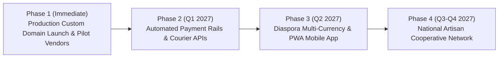

# TOURIVA INDEPENDENT MARKETPLACE — REMEDIATION & EVOLUTIONARY ROADMAP

**Document Version:** 1.0.0  
**Target:** Touriva Independent Marketplace Expansion  
**Platform Owner:** Khaled Bouafia  
**Horizon:** Q4 2026 – Q4 2027  

---

## 1. Executive Summary

With the successful completion of the **Touriva Independent Marketplace Engine**, the platform has established a robust, secure, and production-ready foundation for owner-supervised multi-vendor commerce.

This roadmap details the progressive enhancements, integration milestones, and technical optimizations planned across four sequential execution phases.

---

## 2. Phase-by-Phase Roadmap

### Phase 1: Production Launch & Pilot Merchant Onboarding (Immediate)

**Objective:** Deploy all 4 marketplace services to production custom subdomains on Render and Hostinger, and onboard the first cohort of verified Algerian artisans.

- **Milestone 1.1: DNS & Custom Domain Attachment**
  - Add CNAME records for `market.touriva`, `seller.market`, `admin.market`, and `api.market.touriva` on Hostinger DNS.
  - Verify SSL certificates on Render edge.
- **Milestone 1.2: Database Seeding & Production Health Verification**
  - Seed baseline categories, geographic wilayas, and verified pilot accounts (`admin@touriva.test`, `seller1@touriva.test`).
  - Perform live transaction audit using Algerian payment methods (COD, BaridiMob, CCP).
- **Milestone 1.3: Pilot Artisan Cohort (10 Sellers)**
  - Onboard flagship artisans in Djanet (Sahara leather and jewelry), Ghardaïa (carpets and tapestries), and Blida (mountain gear).
  - Gather merchant feedback on portal usability.

---

### Phase 2: Payment Rail Automation & Direct Courier Integration (Q1 2027)

**Objective:** Transition from manual transfer proof uploads to automated banking webhooks and automated courier dispatch.

- **Milestone 2.1: SATIM / GIM-Tel & CIB/Edahabia Direct Payment Gateway**
  - Implement direct Algerian interbank card processing (Edahabia & CIB) via SATIM API gateway.
  - Automatic payment confirmation and instant commission accrual with zero manual receipt review.
- **Milestone 2.2: BaridiMob Instant Webhook Integration**
  - Connect Algérie Poste BaridiMob commercial API for instant RIP push validation.
- **Milestone 2.3: Yalidine & Procolis Courier API Integration**
  - Automated tracking number generation directly from the Seller Portal.
  - 1-click bordereau (shipping label) PDF generation and automated delivery webhook tracking.

---

### Phase 3: Diaspora Multi-Currency & Mobile PWA Expansion (Q2 2027)

**Objective:** Unlock commercial purchases from the Algerian diaspora in France, Canada, and Europe seeking authentic cultural goods.

- **Milestone 3.1: Dual-Currency Pricing (DZD / EUR / USD)**
  - Real-time exchange rate calculation allowing international tourists and diaspora to pay with international Visa/Mastercard.
  - Automated conversion into DZD for local merchant payouts.
- **Milestone 3.2: Dedicated Marketplace Mobile PWA**
  - Installable Progressive Web App (PWA) with offline catalog caching, push notifications for new order alerts to sellers, and order status tracking for buyers.
- **Milestone 3.3: Customer Reviews & Photo Testimonials**
  - Verified-buyer rating system with photo uploads to enhance social proof and promote top-tier Algerian artisans.

---

### Phase 4: National Artisan Cooperative Network & Scale (Q3-Q4 2027)

**Objective:** Scale Touriva Marketplace into the definitive national e-commerce platform for Algerian cultural tourism and adventure gear.

- **Milestone 4.1: Cooperative Bulk Onboarding**
  - Partner with regional Chambres de l'Artisanat et des Métiers (CAM) across 58 wilayas to digitally empower rural craftspeople.
- **Milestone 4.2: Automated Vendor Payout Disbursements**
  - Automated CCP batch transfers directly from the Touriva admin ledger to vendor accounts upon verified parcel delivery.
- **Milestone 4.3: Cross-Promotion with Core Tourism Itineraries**
  - Intelligent recommendation engine: When a tourist books a Djanet expedition on `touriva.nextchallenge.tech`, the platform recommends essential desert gear and local souvenirs available on `market.touriva.nextchallenge.tech`.

---

## 3. Prioritized Implementation Matrix

| Work Item | Category | Priority | Complexity | Target Release |
|---|---|---|---|---|
| Hostinger CNAME Records Creation | DevOps / Infra | **CRITICAL** | Low | Immediate |
| Render Web Services Deployment | DevOps / Infra | **CRITICAL** | Medium | Immediate |
| Production Seed Validation | Database / Data | **CRITICAL** | Low | Immediate |
| Yalidine API Shipping Integration | Logistics | **HIGH** | Medium | Q1 2027 |
| SATIM / CIB Direct Gateway | Payments | **HIGH** | High | Q1 2027 |
| SMS Order Notifications (Algerian Telecoms) | Communications | **MEDIUM** | Low | Q1 2027 |
| Diaspora Multi-Currency Checkout | Commerce | **MEDIUM** | Medium | Q2 2027 |
| Cooperative Regional CAM Onboarding | Business Dev | **STRATEGIC** | Low | Q3 2027 |

---
*Authored by Touriva Architecture, Security & Commercial Strategy Leadership.*
