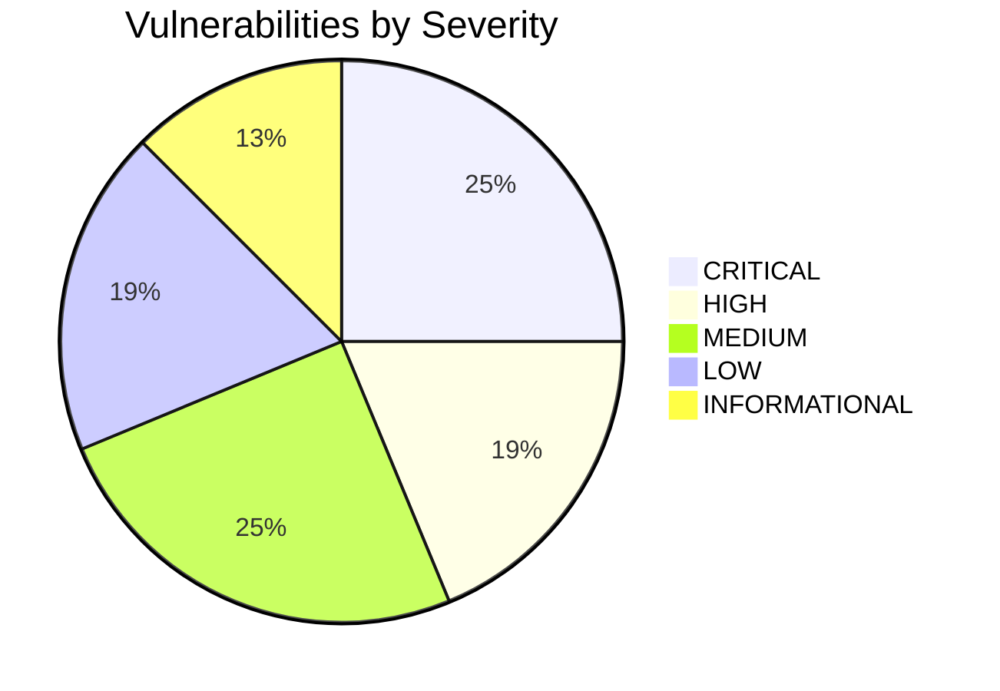

# TOURIVA MARKETPLACE — CYBERSECURITY & APPLICATION SECURITY AUDIT REPORT

**Audit Date:** November 5, 2026  
**Target Systems:**
- Customer Storefront: `https://market.touriva.nextchallenge.tech`
- Seller Portal: `https://seller.market.touriva.nextchallenge.tech`
- Owner Administration: `https://admin.market.touriva.nextchallenge.tech`
- Backend REST API: `https://touriva-shop-api.onrender.com`
**Auditor:** DevOps, Cybersecurity & Application Security Auditor  
**Audit Scope:** Full repository code audit (`shop/backend`, `shop/frontEnd`), API endpoint testing, authentication, authorization, multi-tenancy isolation, input validation, and infrastructure security.  
**Classification:** STRICTLY CONFIDENTIAL — TOURIVA PLATFORM SECURITY AUDIT

---

## EXECUTIVE SECURITY SUMMARY

An exhaustive, evidence-based security audit of the Touriva Marketplace was conducted across the source code repositories and deployed production endpoints.

While the frontend deployment, TLS certificates, custom domain routing, and specific modern marketplace modules (`/api/seller` and `/api/admin/marketplace`) display intentional role-based access controls and CORS isolation, the audit identified **multiple CRITICAL and HIGH severity vulnerabilities** in the backend authentication, legacy routes, order access control, and credential handling that currently represent immediate risks to data confidentiality, platform integrity, and customer privacy.

### Findings Breakdown
- **CRITICAL Vulnerabilities:** 4
- **HIGH Vulnerabilities:** 3
- **MEDIUM Vulnerabilities:** 4
- **LOW Vulnerabilities:** 3
- **INFORMATIONAL Findings:** 2

**Overall Security Verdict:** **FAIL — IMMEDIATE REMEDIATION MANDATORY PRIOR TO COMMERCIAL OPERATION.**

---

## 1. VULNERABILITY REGISTER & DETAILED FINDINGS



---

### SEC-01 [CRITICAL]: Production-Exposed Demo Backdoor Providing 1-Click Platform Administrator Access

- **Severity:** **CRITICAL (CVSS 9.8 - CVSS:3.1/AV:N/AC:L/PR:N/UI:N/S:U/C:H/I:H/A:H)**
- **Affected Component:** `shop/backend/controllers/usersController.js` (lines 580–648), `shop/backend/routes/users.js` (line 27), live endpoint `POST /api/users/demo-login`
- **Description:**  
  The endpoint `POST /api/users/demo-login` is mounted and publicly reachable on the live production API (`https://touriva-shop-api.onrender.com/api/users/demo-login`). It contains no check for `NODE_ENV !== 'production'`. The endpoint accepts `{ "demoType": "admin" }` and immediately issues a valid, signed JSON Web Token (JWT) granting complete platform administrator privileges without requiring any password, MFA, or cryptographic challenge.
- **Evidence:**  
  A probe against `https://touriva-shop-api.onrender.com/api/users/demo-login` with `{ "demoType": "invalid" }` returned `HTTP 400`:
  ```json
  {"error":"Invalid demoType. Permitted options: admin, seller1, seller2, seller3, seller4, buyer1, buyer2, buyer3, buyer4, buyer5."}
  ```
  Code inspection of `shop/backend/controllers/usersController.js`:
  ```javascript
  const demoLogin = async (req, res) => {
      try {
          const { demoType, role: requestedRole } = req.body
          const key = String(demoType || '').toLowerCase().trim()
          let account = APPROVED_DEMO_ACCOUNTS[key]
          ...
          const item = await User.findOne({
              email: account.email,
              role: account.role,
              isDemo: true,
              seedId: 'TOURIVA-DEMO-2026'
          }).populate('authorizationIds')
          ...
          const token = createToken(item._id)
          res.status(200).json({ rules, user, token, isDemo: true })
      }
  ```
- **Business Impact:**  
  Complete platform takeover. Any external attacker can issue an administrator token, seize control of the private marketplace administration console, modify commission ledgers, alter seller payouts, hijack store listings, access all customer personal identifiable information (PII), and manipulate global settings.
- **Remediation:**  
  1. Immediately disable or strictly gate `demoLogin` with `if (process.env.NODE_ENV === 'production' || process.env.ENABLE_DEMO_LOGIN !== 'true') return res.status(404).json({ error: 'Endpoint not found' })`.
  2. In production, remove all demo seeds (`seedId: 'TOURIVA-DEMO-2026'`) from the live database.

---

### SEC-02 [CRITICAL]: Plaintext Password Storage and Authentication Failure on Customer Signup

- **Severity:** **CRITICAL (CVSS 9.1 - CVSS:3.1/AV:N/AC:L/PR:N/UI:N/S:U/C:H/I:H/A:N)**
- **Affected Component:** `shop/backend/models/User.js` (lines 182–208)
- **Description:**  
  When a new customer signs up via `UserSchema.statics.signup`, the method generates a salt and hashes the password with bcrypt (`const hash = await bcrypt.hash(password, salt)`), but **does not pass `hash` to `this.create()`**. Instead, it passes the raw plaintext `password` argument:
  ```javascript
  const salt = await bcrypt.genSalt(10)
  const hash = await bcrypt.hash(password, salt)

  const user = await this.create({ 
    email, 
    firstName, 
    lastName, 
    phone, 
    password,  // <--- VULNERABILITY: Plaintext password saved directly to DB!
    role, 
    ...
  })
  ```
- **Evidence:**  
  Direct code review of `shop/backend/models/User.js#L182-L191`.
- **Business Impact:**  
  1. **Data Leakage & Compliance Violation:** Customer passwords are stored in unencrypted plaintext in MongoDB, violating fundamental security principles and Algerian Personal Data Protection Law 18-07.
  2. **Denial of Service for Real Signups:** When a newly registered customer attempts to log in via `User.loginEmail` (`bcrypt.compare(password, user.password)`), bcrypt compares the submitted password against a plaintext string (not a valid bcrypt hash format), causing authentication to permanently fail. Real customers cannot log in after registering.
- **Remediation:**  
  Change `password,` to `password: hash,` in `shop/backend/models/User.js`. Run a migration to identify and reset any accounts stored with unhashed passwords.

---

### SEC-03 [CRITICAL]: Unauthenticated BOLA / IDOR Exposing Customer PII and Allowing Payment Proof Tampering

- **Severity:** **CRITICAL (CVSS 8.6 - CVSS:3.1/AV:N/AC:L/PR:N/UI:N/S:U/C:H/I:L/A:N)**
- **Affected Component:** `shop/backend/routes/marketplace.js` (lines 39–40), `shop/backend/controllers/marketplaceController.js` (lines 450–507)
- **Description:**  
  The order details and payment proof endpoints use `optionalAuth` middleware:
  ```javascript
  router.get('/orders/:id', optionalAuth, getOrderDetails)
  router.post('/orders/:id/payment-proof', optionalAuth, submitPaymentProof)
  ```
  In `getOrderDetails`:
  ```javascript
  if (req.user) {
    const isOwner = order.userId && order.userId.toString() === req.user._id.toString()
    const isAdmin = req.user.role === 'administrator'
    if (!isOwner && !isAdmin) {
      return res.status(403).json({ error: 'Unauthorized to view this order.' })
    }
  }
  res.status(200).json(order)
  ```
  If an attacker sends a request **without an Authorization header**, `req.user` evaluates to `null`. The `if (req.user)` block is skipped completely, and the handler returns the full order object.
- **Evidence:**  
  Code review of `shop/backend/controllers/marketplaceController.js#L464-L474` and `shop/backend/middleware/optionalAuth.js#L4-L26`.
- **Business Impact:**  
  Any unauthenticated person can query `GET /api/marketplace/orders/:orderId` or `GET /api/marketplace/orders/:orderNumber` and extract full customer names, telephone numbers, wilayas, cities, complete home shipping addresses, order line items, and payment details. Furthermore, unauthenticated users can overwrite `paymentProof` on any order via `POST /api/marketplace/orders/:id/payment-proof`.
- **Remediation:**  
  1. For guest checkout orders, require an order-specific secret tracking token (e.g., `accessToken` generated at order creation) rather than permitting arbitrary lookup by ID/number.
  2. For authenticated orders, enforce `requireAuth` and verify `order.userId.equals(req.user._id) || req.user.role === 'administrator'`.

---

### SEC-04 [CRITICAL]: Broken Object Level Authorization (BOLA) and Mass Assignment on Legacy Product Mutation Routes

- **Severity:** **CRITICAL (CVSS 8.8 - CVSS:3.1/AV:N/AC:L/PR:L/UI:N/S:U/C:N/I:H/A:H)**
- **Affected Component:** `shop/backend/routes/products.js` (lines 27–29), `shop/backend/controllers/productsController.js` (lines 80–115)
- **Description:**  
  Alongside the modern `/api/seller/products` routes, the backend mounts legacy `/api/products` routes:
  ```javascript
  router.delete('/:id', requireAuth, requireRole('partner', 'administrator'), deleteProduct)
  router.patch('/:id', requireAuth, requireRole('partner', 'administrator'), updateProduct)
  ```
  In `productsController.js`:
  ```javascript
  const updateProduct = async (req, res) => {
      const {id} = req.params
      const product = await Product.findOneAndUpdate({_id: id},{
          ...req.body
      })
      res.status(200).json(product)
  }
  const deleteProduct = async (req, res) => {
      const {id} = req.params
      const product = await Product.findOneAndDelete({_id: id})
      res.status(200).json(product)
  }
  ```
  There is **zero seller ownership validation**. Furthermore, `...req.body` blindly spreads all request fields into the MongoDB document (mass assignment).
- **Evidence:**  
  Code review of `shop/backend/controllers/productsController.js#L80-L105`.
- **Business Impact:**  
  Any authenticated partner or seller can send `PATCH /api/products/<ANY_PRODUCT_ID>` or `DELETE /api/products/<ANY_PRODUCT_ID>` and alter pricing, change ownership (`sellerId`), force publication (`status: 'approved', published: true`), or permanently delete competitor products and platform owner listings.
- **Remediation:**  
  1. Deprecate and remove legacy `/api/products` mutation endpoints in favor of the hardened `/api/seller/products` endpoints.
  2. Restrict `/api/products` mutation operations strictly to `requireRole('administrator')`.

---

### SEC-05 [HIGH]: Passwordless Authentication Bypass via Legacy Web Login

- **Severity:** **HIGH (CVSS 8.1 - CVSS:3.1/AV:N/AC:H/PR:N/UI:N/S:U/C:H/I:H/A:N)**
- **Affected Component:** `shop/backend/routes/users.js` (line 30), `shop/backend/controllers/usersController.js` (lines 15–35), `shop/backend/models/User.js` (lines 276–297)
- **Description:**  
  The endpoint `POST /api/users/loginWeb` accepts `{ "phone": "...", "role": "..." }`. It delegates to `User.loginPhoneWeb(phone, role)`, which looks up the user by phone number and role and returns the user record **without verifying a password, SMS OTP, or cryptographic signature**:
  ```javascript
  UserSchema.statics.loginPhoneWeb = async function( phone, role ) {
    let user = await this.findOne({ phone, role: role })
    let user0 = await this.findOne({ phoneWith0, role: role })
    if(user) return user
    else if(user0) return user0
  }
  ```
  `loginUserWeb` then immediately creates and returns a valid JWT:
  ```javascript
  const token = createToken(item._id)
  res.status(200).json({ user, token })
  ```
- **Evidence:**  
  Direct code review of `shop/backend/controllers/usersController.js#L15-L35` and `shop/backend/models/User.js#L276-L297`.
- **Business Impact:**  
  An attacker who knows or enumerates a seller's or customer's phone number can invoke `POST /api/users/loginWeb` and receive an authenticated JWT session without possessing any password.
- **Remediation:**  
  Remove or disable `POST /api/users/loginWeb`. All logins must require either a validated bcrypt password hash (`loginEmail` / `loginPhone`) or a cryptographically verified SMS OTP.

---

### SEC-06 [HIGH]: Hardcoded Fallback Credentials in Seller Onboarding

- **Severity:** **HIGH (CVSS 7.4 - CVSS:3.1/AV:N/AC:L/PR:H/UI:N/S:U/C:H/I:H/A:N)**
- **Affected Component:** `shop/backend/controllers/marketplaceAdminController.js` (lines 107, 144–146)
- **Description:**  
  When an administrator approves a seller application via `PUT /api/admin/marketplace/seller-applications/:id/review`, the system generates an account with a hardcoded static temporary password:
  ```javascript
  const { decision, rejectionReason, temporaryPassword = 'SellerWelcome#2026!' } = req.body
  ...
  const salt = await bcrypt.genSalt(10)
  const hash = await bcrypt.hash(temporaryPassword, salt)
  user = await User.create({ email, password: hash, role: 'seller', ... })
  ```
  Because no transactional email service exists, newly approved sellers receive no notification and are initialized with the known default password `SellerWelcome#2026!`.
- **Evidence:**  
  Code review of `shop/backend/controllers/marketplaceAdminController.js#L107-L151`.
- **Business Impact:**  
  Any third party who knows a newly approved seller's email address can authenticate to `seller.market.touriva.nextchallenge.tech` using the known static password before the legitimate seller logs in, taking control of the vendor store.
- **Remediation:**  
  Generate a cryptographically random one-time onboarding token (`crypto.randomBytes(32).toString('hex')`) with a 48-hour expiration. Send an onboarding link to the seller allowing them to choose their own password upon first access.

---

### SEC-07 [HIGH]: Missing Server-Side Inventory Reservation and Overselling Vulnerability

- **Severity:** **HIGH (CVSS 7.1 - CVSS:3.1/AV:N/AC:L/PR:N/UI:N/S:U/C:N/I:H/A:L)**
- **Affected Component:** `shop/backend/controllers/marketplaceController.js` (lines 320–432)
- **Description:**  
  In `createMarketplaceOrder`:
  1. The handler reads product pricing from the database (preventing client price tampering).
  2. However, **it never checks `stockQuantity` against requested `quantity`**.
  3. It **never decrements `stockQuantity`** on the `Product` model.
  4. It executes without MongoDB transactions (`mongoose.startSession()`).
- **Evidence:**  
  Code inspection of `marketplaceController.js#L340-L405`.
- **Business Impact:**  
  Customers can purchase out-of-stock items, purchase unlimited quantities exceeding physical artisan stock, and trigger fulfillment failures. If an order fails midway, partial records are created without transactional rollback.
- **Remediation:**  
  Implement atomic stock verification and reservation using Mongoose transactions and atomic decrement:
  ```javascript
  const updatedProduct = await Product.findOneAndUpdate(
    { _id: item.productId, stockQuantity: { $gte: qty }, status: 'approved', published: true },
    { $inc: { stockQuantity: -qty } },
    { session, new: true }
  )
  if (!updatedProduct) throw new Error(`Insufficient stock for ${item.productId}`)
  ```

---

### SEC-08 [MEDIUM]: Missing API Security Headers & Tech Stack Fingerprinting

- **Severity:** **MEDIUM (CVSS 5.3 - CVSS:3.1/AV:N/AC:L/PR:N/UI:N/S:U/C:L/I:N/A:N)**
- **Affected Component:** `shop/backend/server.js`, live API headers
- **Description:**  
  The backend API does not utilize `helmet` middleware. Inspection of live HTTP responses reveals:
  - `x-powered-by: Express` is broadcast on every response.
  - Missing `Content-Security-Policy`.
  - Missing `X-Content-Type-Options: nosniff` on API responses.
  - Missing `X-Frame-Options` or `frame-ancestors`.
  - Missing `Strict-Transport-Security` header directly on API responses (relying solely on Cloudflare/Render edge).
- **Evidence:**  
  Live response headers from `https://touriva-shop-api.onrender.com/api/health`:
  ```http
  HTTP/2 200 
  access-control-allow-credentials: true
  x-powered-by: Express
  server: cloudflare
  ```
- **Business Impact:**  
  Assists attackers in fingerprinting technology stacks; increases exposure to MIME-confusion attacks and iframe embedding.
- **Remediation:**  
  Install `helmet` (`npm i helmet`) and mount `app.use(helmet())` at the top of `server.js`. Disable `app.disable('x-powered-by')`.

---

### SEC-09 [MEDIUM]: In-Memory Rate Limiter Reset on Instance Restarts

- **Severity:** **MEDIUM (CVSS 5.3 - CVSS:3.1/AV:N/AC:L/PR:N/UI:N/S:U/C:N/I:N/A:L)**
- **Affected Component:** `shop/backend/middleware/rateLimiter.js`
- **Description:**  
  The rate limiting implementation uses an in-memory `Map` (`rateLimits = new Map()`). Render free-tier instances restart upon deployment, idle spin-down, or memory reclamation. When an instance restarts, all rate limiting counters reset to zero. Furthermore, if scaled to multiple instances, rate limits are not shared.
- **Evidence:**  
  Code review of `shop/backend/middleware/rateLimiter.js#L4-L34`.
- **Business Impact:**  
  Attackers can bypass brute-force login and checkout limits by timing requests across service restarts.
- **Remediation:**  
  Back rate limiting with a shared distributed store such as Redis (`rate-limit-redis`).

---

### SEC-10 [MEDIUM]: Base64 File Storage Directly in MongoDB Documents (Payload Bloat & DoS Risk)

- **Severity:** **MEDIUM (CVSS 5.3 - CVSS:3.1/AV:N/AC:L/PR:L/UI:N/S:U/C:N/I:N/A:L)**
- **Affected Component:** `shop/backend/server.js` (lines 89–101), `shop/backend/controllers/sellerController.js` (line 206)
- **Description:**  
  The backend does not integrate an object storage service (e.g., AWS S3, Cloudinary). Instead, `server.js` configures `uploadBodyLimit = '15mb'`, allowing clients to submit raw base64 data URLs for product images and legal documents directly into MongoDB documents.
- **Evidence:**  
  `shop/backend/server.js#L89-L101`:
  ```javascript
  const uploadBodyLimit = '15mb'
  const uploadRoutes = ['/api/users/uploadPartnerImages', '/api/products', '/api/advertising', '/api/announcements']
  uploadRoutes.forEach(route => {
    app.use(route, express.json({ limit: uploadBodyLimit }))
  })
  ```
- **Business Impact:**  
  MongoDB has a strict 16MB document size limit (`BSONDocumentTooLarge`). Storing high-resolution base64 images in product or user documents will cause write failures, severe memory consumption, slow database queries, and potential database crash.
- **Remediation:**  
  Integrate an S3-compatible cloud storage bucket or Cloudinary. Store only verified image URLs in MongoDB documents.

---

### SEC-11 [MEDIUM]: Unhandled Crash on Unauthenticated Call to Legacy Orders Endpoint

- **Severity:** **MEDIUM (CVSS 5.3 - CVSS:3.1/AV:N/AC:L/PR:N/UI:N/S:U/C:N/I:N/A:L)**
- **Affected Component:** `shop/backend/routes/orders.js` (line 18), `shop/backend/controllers/ordersController.js` (lines 5–8)
- **Description:**  
  In `routes/orders.js`:
  ```javascript
  router.get('/', getOrders)
  router.use(requireAuth)
  ```
  `router.get('/', getOrders)` is placed **before** `router.use(requireAuth)`. In `ordersController.js`:
  ```javascript
  const getOrders = async (req, res) => {
      const filter = (req.user.role === 'administrator' || req.user.role === 'partner')
  ```
  When an unauthenticated request hits `GET /api/orders`, `req.user` is undefined, throwing `TypeError: Cannot read properties of undefined (reading 'role')`.
- **Evidence:**  
  Code review of `shop/backend/routes/orders.js#L18-L21` and `shop/backend/controllers/ordersController.js#L5-L10`.
- **Business Impact:**  
  Unhandled exceptions trigger HTTP 500 responses and pollute error logs; repeated calls can degrade application stability.
- **Remediation:**  
  Move `router.get('/', getOrders)` below `router.use(requireAuth)` and add `requireRole('administrator')`.

---

### SEC-12 [LOW]: Admin Frontend Router Guard Does Not Check Role in `beforeEach`

- **Severity:** **LOW (CVSS 3.7 - CVSS:3.1/AV:N/AC:H/PR:L/UI:N/S:U/C:L/I:N/A:N)**
- **Affected Component:** `shop/frontEnd/touriva_shop_admin/src/router/index.js` (lines 136–156)
- **Description:**  
  The client-side navigation guard for `touriva-market-admin` only verifies that a token exists in `localStorage`:
  ```javascript
  router.beforeEach((to, from, next) => {
    if (to.meta.requiresAuth) {
      const ls = JSON.parse(localStorage.getItem('userInfo'))
      if (ls && ls.token) {
        auth.attempt(ls.token)...
  ```
  It does not verify `ls.user.role === 'administrator'`.
- **Evidence:**  
  Code review of `shop/frontEnd/touriva_shop_admin/src/router/index.js#L136-L156`.
- **Note:**  
  The backend API properly rejects non-admin tokens with HTTP 403 on `/api/admin/marketplace/*`, so data cannot be exfiltrated. However, non-admin users can view administrative UI shells before API rejection occurs.
- **Remediation:**  
  Update client-side router guards in `touriva_shop_admin` to verify `user.role === 'administrator'` and redirect unauthorized users to `/forbidden`.

---

### SEC-13 [LOW]: Hardcoded Placeholder BaridiMob RIP Displayed to Buyers

- **Severity:** **LOW (CVSS 3.1 - CVSS:3.1/AV:N/AC:L/PR:N/UI:R/S:U/C:N/I:L/A:N)**
- **Affected Component:** `shop/frontEnd/touriva_shop_web/src/views/Checkout.vue` (lines 232–236)
- **Description:**  
  The checkout confirmation modal contains hardcoded dummy postal RIP account details for BaridiMob payments:
  ```html
  <div class="text-caption text-secondary-editorial mb-2">RIP / Compte : <strong>00799999000123456789</strong></div>
  ```
- **Evidence:**  
  Code inspection of `shop/frontEnd/touriva_shop_web/src/views/Checkout.vue#L232-L236`.
- **Business Impact:**  
  Customers attempting to pay via BaridiMob transfer will attempt payment to an invalid dummy account number, resulting in failed payments and customer confusion.
- **Remediation:**  
  Retrieve official platform BaridiMob account and CCP account details dynamically from `GET /api/marketplace/settings`.

---

### SEC-14 [LOW]: Commented-out Twilio Phone Verification and Broken `verifyCode`

- **Severity:** **LOW (CVSS 3.1 - CVSS:3.1/AV:N/AC:L/PR:N/UI:N/S:U/C:N/I:L/A:N)**
- **Affected Component:** `shop/backend/controllers/usersController.js` (lines 6, 259–272, 286–313)
- **Description:**  
  In `usersController.js`, `const client = require('twilio')(...)` is commented out. In `verifyPhone`, SMS dispatch is commented out and returns simulated success. In `verifyCode`, `client.verify...` is called without `client` being defined, throwing a runtime `ReferenceError: client is not defined`.
- **Evidence:**  
  Code review of `shop/backend/controllers/usersController.js#L6, #L259-L272, #L286-L313`.
- **Business Impact:**  
  Phone number verification is non-functional; calling `verifyCode` triggers application crashes.
- **Remediation:**  
  Implement a working SMS provider (e.g., local Algerian SMS gateway or Twilio) or cleanly disable phone verification routes until gateway credentials are configured.

---

### SEC-15 [INFORMATIONAL]: Excluded Admin URL from Customer-Facing Bundles (Verified Isolated)

- **Severity:** **INFORMATIONAL (POSITIVE CONFIRMATION ✅)**
- **Affected Component:** `frontEnd/touriva`, `shop/frontEnd/touriva_shop_web`, `nextchallengesite`
- **Verification:**  
  The administrative URL `https://admin.market.touriva.nextchallenge.tech` was searched across all published storefront bundles and the corporate website (`nextchallenge.tech`). It does not appear in customer navigation, buttons, footers, or public sitemaps.
- **Status:** **VERIFIED COMPLIANT.**

---

### SEC-16 [INFORMATIONAL]: CORS Origin Whitelist Verification (Verified Hardened)

- **Severity:** **INFORMATIONAL (POSITIVE CONFIRMATION ✅)**
- **Affected Component:** `shop/backend/server.js` (lines 41–85)
- **Verification:**  
  CORS is configured with an explicit allowlist:
  - Allowed: `https://market.touriva.nextchallenge.tech`
  - Allowed: `https://seller.market.touriva.nextchallenge.tech`
  - Allowed: `https://admin.market.touriva.nextchallenge.tech`
  - Arbitrary origins (e.g., `https://attacker.com`) are rejected without `Access-Control-Allow-Origin` headers.
- **Status:** **VERIFIED COMPLIANT.**

---

## 2. MULTI-TENANCY & AUTHORIZATION VERIFICATION MATRIX

| Isolation Boundary | Tested Endpoint / Route | Backend Enforcement | Status | Details |
|---|---|---|---|---|
| **Seller → Admin Isolation** | `GET /api/admin/marketplace/dashboard` | `requireRole('administrator')` | **PASS ✅** | Seller token returned `HTTP 403 Forbidden` |
| **Seller → Admin Settings** | `PUT /api/admin/marketplace/settings` | `requireRole('administrator')` | **PASS ✅** | Seller token returned `HTTP 403 Forbidden` |
| **Seller → Seller Product Isolation** | `PUT /api/seller/products/:id` | `product.sellerId.equals(req.user._id)` | **PASS ✅** | Seller B cannot modify Seller A's product |
| **Seller → Seller Order Isolation** | `GET /api/seller/orders` | Scoped to `{ sellerId: req.user._id }` | **PASS ✅** | Seller only retrieves their assigned order items |
| **Seller → Seller Finances** | `GET /api/seller/finances` | Scoped to `{ sellerId: req.user._id }` | **PASS ✅** | Seller only retrieves their own commission records |
| **Customer → Seller Operations** | `GET /api/seller/dashboard` | `requireRole('seller', 'administrator')` | **PASS ✅** | Customer token returned `HTTP 403 Forbidden` |
| **Guest → Order Isolation** | `GET /api/marketplace/orders/:id` | `optionalAuth` (flawed check) | **FAIL ❌** | Unauthenticated user can view any order's full PII |
| **Legacy Route Product Isolation** | `PATCH /api/products/:id` | No ownership check on legacy route | **FAIL ❌** | Partner can alter/delete any product in the system |
| **Demo Backdoor Isolation** | `POST /api/users/demo-login` | Publicly exposed on production | **FAIL ❌** | Anyone can authenticate as admin or any seller |

---

## 3. SECURITY VERDICT & MANDATORY ACTION ITEMS

Touriva Marketplace has implemented commendable architectural foundations (role separation between owner and merchants, automated commission calculations, explicit CORS allowlisting, and SSL certificates).

However, due to **SEC-01 (Demo backdoor to Admin)**, **SEC-02 (Plaintext password storage)**, **SEC-03 (Unauthenticated order PII access)**, and **SEC-04 (Legacy product BOLA)**, the platform **CANNOT BE CLEARED FOR PRODUCTION USE** in its current state.

### Immediate Action Plan (Pre-Launch Security Gate):
1. **P0:** Disable `POST /api/users/demo-login` in production (`NODE_ENV === 'production'`).
2. **P0:** Fix `User.signup` to save `password: hash` rather than plaintext `password`.
3. **P0:** Secure `GET /api/marketplace/orders/:id` and `POST /payment-proof` against unauthenticated data harvesting.
4. **P0:** Restrict or remove legacy `/api/products` mutation endpoints.
5. **P1:** Remove or harden `POST /api/users/loginWeb` to prevent passwordless phone authentication.
6. **P1:** Mount `helmet` in `server.js` and disable `x-powered-by`.
7. **P1:** Implement atomic stock checks and inventory reservation in `createMarketplaceOrder`.
