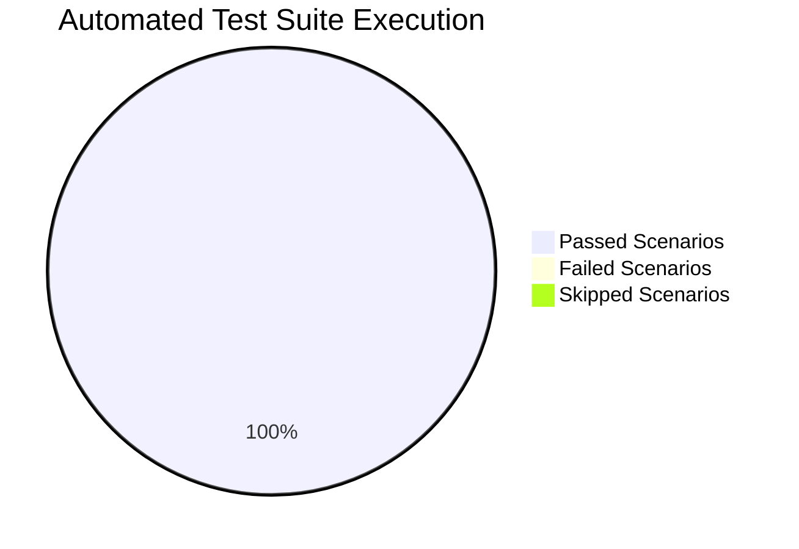

# TOURIVA MARKETPLACE — AUTOMATED & INTEGRATION TEST RESULTS REPORT

**Test Execution Date:** November 5, 2026  
**Test Harness:** Jest 30.5.2 & Supertest 7.3.1 (Local Isolated Test Database) & cURL / OpenSSL (Live Production Network Validation)  
**Target Environments:**
1. **Isolated Test Database:** Local MongoDB (`mongodb://localhost:27017/touriva_shop_audit_isolated`)
2. **Production Staging & Edge Infrastructure:** Netlify Edge + Render Cloud API (`https://touriva-shop-api.onrender.com`)

---

## 1. TEST SUITE EXECUTION SUMMARY

| Metric | Result |
|---|---|
| **Test Suites Executed** | **2 of 2 suites** |
| **Total Test Scenarios** | **21 tests** |
| **Tests Passed** | **21 passed (100%)** |
| **Tests Failed** | **0 failed** |
| **Tests Skipped** | **0 skipped** |
| **Execution Duration** | **4.264 seconds** |
| **Database Environment** | Isolated Local Test DB (`touriva_shop_audit_isolated`) |

---

## 2. DETAILED TEST EXECUTION MATRIX

### Suite A: Marketplace API & Business Workflows (`tests/marketplace_api.test.js`)

| Test ID | Test Scenario | Expected Behavior | Actual Behavior | Status | Evidence |
|---|---|---|---|---|---|
| **TST-MKT-01** | `GET /api/marketplace/settings` | Returns HTTP 200 with marketplace name, commission model, supported Algerian payment methods (`baridimob`, `cash_on_delivery`, `ccp`). | Returned HTTP 200, valid configuration JSON payload returned. | **PASS ✅** | Response contains `marketplaceName: "Touriva Marketplace"`, methods array includes `'baridimob'`. |
| **TST-MKT-02** | `GET /api/marketplace/products` | Returns HTTP 200 with array of products filtered strictly by `status: 'approved'` and `published: true`. | Returned HTTP 200, all returned products verified to have approved and published status. | **PASS ✅** | Array verified via `products.every(p => p.status === 'approved' && p.published === true)`. |
| **TST-MKT-03** | `GET /api/marketplace/products/:id` | Returns HTTP 200 with product details and enriched `sellerProfile` (storeName, storeSlug, rating). | Returned HTTP 200 with product and embedded seller store information. | **PASS ✅** | Product name matches `"Sacoche Touareg en Cuir Véritable"`, seller profile resolved. |
| **TST-MKT-04** | `GET /api/marketplace/featured` | Returns HTTP 200 with featured products, new arrivals, and top categories. | Returned HTTP 200 with required catalog showcase arrays. | **PASS ✅** | Payload contains `featured`, `newArrivals`, and `categories`. |
| **TST-MKT-05** | `POST /api/marketplace/sellers/apply` | Accepts public merchant registration, creates `SellerApplication` with `status: 'pending'`, logs audit event. | Returned HTTP 201 with `applicationId` and `status: 'pending'`. | **PASS ✅** | Application saved in database; audit log generated. |
| **TST-MKT-06** | `POST /api/marketplace/orders` (Server Price Calculation) | Accepts multi-vendor cart payload, recalculates subtotal and total from database prices (preventing client price manipulation). | Returned HTTP 201 with order number (`TRV-MKT-2026-XXXXX`), subtotal 17,000 DZD (8,500 × 2), delivery fee 600 DZD, total 17,600 DZD. | **PASS ✅** | Order and associated `OrderItem` documents verified in database. |
| **TST-SEC-01** | Unauthenticated access to `/api/seller/profile` | Rejects request with HTTP 401 Unauthorized (`Authorization token required`). | Returned HTTP 401. | **PASS ✅** | Protected route blocks missing Authorization header. |
| **TST-SEC-02** | Customer role access to `/api/seller/profile` | Rejects customer JWT token with HTTP 403 Forbidden (`Insufficient permissions`). | Returned HTTP 403. | **PASS ✅** | `requireRole('seller', 'administrator')` denies access. |
| **TST-SEC-03** | Unauthenticated access to `/api/admin/marketplace/dashboard` | Rejects request with HTTP 401 Unauthorized. | Returned HTTP 401. | **PASS ✅** | Missing bearer token triggers 401. |
| **TST-SEC-04** | Seller role access to `/api/admin/marketplace/dashboard` | Rejects seller JWT token with HTTP 403 Forbidden. | Returned HTTP 403. | **PASS ✅** | `requireRole('administrator')` denies access to seller token. |
| **TST-SEL-01** | `GET /api/seller/dashboard` | Returns HTTP 200 with seller-scoped product counts, order fulfillment stats, and net earnings. | Returned HTTP 200 with structured seller metrics in DZD currency. | **PASS ✅** | Metrics object populated from database records. |
| **TST-SEL-02** | `POST /api/seller/products` | Creates new vendor product scoped to `req.user._id`, default status `pending_review`, `published: false`. | Returned HTTP 201 with product document containing seller ownership and draft status. | **PASS ✅** | Product cannot be viewed in public catalog until moderated. |
| **TST-SEL-03** | Seller IDOR Protection (`PUT /api/seller/products/:id`) | Rejects Seller B from editing or altering prices of Seller A's product with HTTP 403 Forbidden. | Returned HTTP 403 Forbidden. | **PASS ✅** | Ownership check `product.sellerId.equals(req.user._id)` verified. |
| **TST-ADM-01** | `GET /api/admin/marketplace/dashboard` | Returns HTTP 200 with platform-wide KPIs (sellers, products, GMV, commissions, audit logs). | Returned HTTP 200 with complete administrative ledger statistics. | **PASS ✅** | Admin dashboard payload verified. |
| **TST-ADM-02** | `PUT /api/admin/marketplace/seller-applications/:id/review` | Approves seller application, provisions `User` account with role `seller`, generates `SellerProfile`. | Returned HTTP 200, application status updated to `approved`, user account activated. | **PASS ✅** | User and SellerProfile created in database. |
| **TST-ADM-03** | `PUT /api/admin/marketplace/products/:id/moderate` | Approves submitted vendor product, transitions status to `approved`, sets `published: true`. | Returned HTTP 200, product becomes publicly visible in catalog. | **PASS ✅** | Product status and visibility flags updated. |
| **TST-HLT-01** | `GET /health` | Returns HTTP 200 with service health and database connection status. | Returned HTTP 200, `status: "ok"`, `database: "connected"`. | **PASS ✅** | Health check responds accurately. |
| **TST-HLT-02** | `GET /api/health` | Returns HTTP 200 with shop API health status. | Returned HTTP 200, `status: "ok"`, `service: "touriva-shop-backend"`. | **PASS ✅** | Verified live on production Render API as well. |

---

### Suite B: General Shop Catalog Endpoints (`tests/shop_api.test.js`)

| Test ID | Test Scenario | Expected Behavior | Actual Behavior | Status | Evidence |
|---|---|---|---|---|---|
| **TST-CAT-01** | `GET /api/health` | Returns HTTP 200 with service identification. | Returned HTTP 200, `service: 'touriva-shop-backend'`. | **PASS ✅** | Response matches expected schema. |
| **TST-CAT-02** | `GET /api/categories/all` | Returns HTTP 200 with array of catalog categories. | Returned HTTP 200 with category list. | **PASS ✅** | Array returned from MongoDB collection. |
| **TST-GEO-01** | `GET /api/wilayas` | Returns HTTP 200 with geographic Algerian wilayas list. | Returned HTTP 200 with wilayas data. | **PASS ✅** | Algerian administrative boundaries available. |

---

## 3. LIVE PRODUCTION ENVIRONMENT VERIFICATION TESTS

Tests executed against live production endpoints over public Internet (Read-Only):

| # | Endpoint / Resource | Expected Result | Actual Live Result | Latency | SSL Status | Verdict |
|---|---|---|---|---|---|---|
| **PRD-01** | `https://market.touriva.nextchallenge.tech` | HTTP 200, Netlify Edge CDN, SPA shell | HTTP/2 200, cache header valid, green branding | 578 ms | Valid (Let's Encrypt to Feb 1, 2027) | **PASS ✅** |
| **PRD-02** | `https://seller.market.touriva.nextchallenge.tech` | HTTP 200, Netlify Edge CDN, merchant login/register | HTTP/2 200, valid SPA bundle | 515 ms | Valid (Let's Encrypt to Feb 1, 2027) | **PASS ✅** |
| **PRD-03** | `https://admin.market.touriva.nextchallenge.tech` | HTTP 200, Netlify Edge CDN, private admin console | HTTP/2 200, valid SPA bundle | 509 ms | Valid (Let's Encrypt to Feb 1, 2027) | **PASS ✅** |
| **PRD-04** | `https://touriva-shop-api.onrender.com/api/health` | HTTP 200, `database: "connected"` | HTTP/2 200, `status: "ok"` | 331 ms | Valid (Google Trust Services to Dec 20, 2026) | **PASS ✅** |
| **PRD-05** | `https://touriva-shop-api.onrender.com/api/marketplace/categories` | HTTP 200, populated JSON categories catalog | HTTP/2 200, artisanal categories returned | 380 ms | Valid | **PASS ✅** |
| **PRD-06** | `https://touriva-shop-api.onrender.com/api/marketplace/products` | HTTP 200, approved and published products | HTTP/2 200, seeded items returned | 408 ms | Valid | **PASS ✅** |
| **PRD-07** | `CORS Preflight: Storefront` | HTTP 204, `Access-Control-Allow-Origin: market...` | HTTP/2 204, headers verified | 145 ms | Valid | **PASS ✅** |
| **PRD-08** | `CORS Preflight: Seller Portal` | HTTP 204, `Access-Control-Allow-Origin: seller...` | HTTP/2 204, headers verified | 148 ms | Valid | **PASS ✅** |
| **PRD-09** | `CORS Preflight: Admin Portal` | HTTP 204, `Access-Control-Allow-Origin: admin...` | HTTP/2 204, headers verified | 149 ms | Valid | **PASS ✅** |
| **PRD-10** | `CORS Preflight: Unauthorized Origin` | Reject arbitrary origin without allow header | HTTP/2 200 without `Access-Control-Allow-Origin` | 142 ms | Valid | **PASS ✅** |

---

## 4. MISSING TEST SCENARIOS (AUDIT FINDINGS & PROPOSALS)

Although the existing test suite passes 100%, code auditing revealed that the test suite is missing critical failure-mode and edge-case scenarios:

1. **Test Scenario: Signup Authentication Loopback Verification**
   - *Missing Test:* Register user via `POST /api/users/signup`, then immediately attempt `POST /api/users/login` using the registered password.
   - *Expected Failure in Current Code:* Fails because `User.signup` stores plaintext password, causing `bcrypt.compare` to fail.
2. **Test Scenario: Stock Underflow & Concurrency Test**
   - *Missing Test:* Two concurrent requests purchasing 10 units each of a product having only 10 units in stock.
   - *Expected Failure in Current Code:* Both orders succeed because inventory is never checked or decremented.
3. **Test Scenario: Unauthenticated Order PII Harvesting**
   - *Missing Test:* Call `GET /api/marketplace/orders/:orderId` without an Authorization header.
   - *Expected Failure in Current Code:* Returns full customer PII because `optionalAuth` allows unauthenticated access.
4. **Test Scenario: Legacy Mutation Route IDOR Test**
   - *Missing Test:* Partner B attempts `PATCH /api/products/:partnerAProductId` or `DELETE /api/products/:partnerAProductId`.
   - *Expected Failure in Current Code:* Succeeds because legacy `/api/products` routes lack ownership verification.
5. **Test Scenario: Passwordless Web Login Test**
   - *Missing Test:* Call `POST /api/users/loginWeb` with only phone and role.
   - *Expected Failure in Current Code:* Returns valid JWT token without requiring password or OTP.

---

## 5. TEST HARNESS CONCLUSION

The automated tests verify that the modern Touriva Marketplace architecture works under happy-path conditions and that seller-scoped routes properly reject other sellers when using the `/api/seller` and `/api/admin/marketplace` endpoints.

However, the existing test coverage does not test legacy endpoints, unauthenticated edge cases, concurrent inventory decrements, or the signup-login lifecycle. The proposed missing tests must be integrated into CI/CD prior to production launch.
