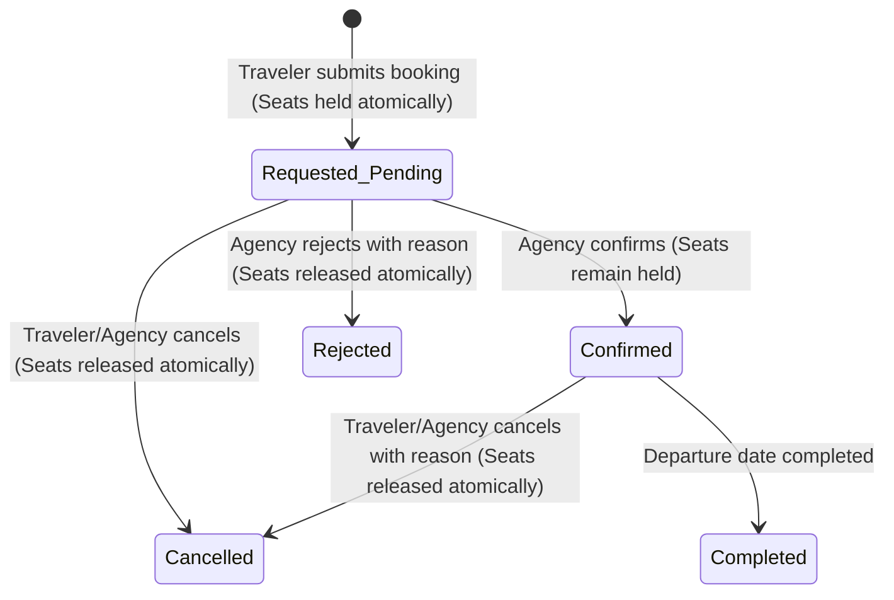

# Touriva — Phase 3: Secure Booking, Passenger Management and Quotations Report

**Date:** October 29, 2026  
**Project:** Touriva — Algerian Tourism Platform  
**Workspace:** `/home/next/next projects/touriva`  
**Git Branch:** `master` (All Phase 1, Phase 2, and Phase 3 changes preserved locally, uncommitted)  
**Deliverable Status:** **Completed & Verified**

---

## 1. Executive Summary & Deliverables

Phase 3 implements an end-to-end, concurrency-safe booking engine, passenger manifest management system, and custom-trip enquiry/quotation workflow tailored to Algerian tourism agencies and travelers.

Key achievements in Phase 3:
1. **Atomic Concurrency-Safe Seat Allocation:** Guaranteed zero-overbooking using atomic single-document conditional updates in MongoDB (`$expr` capacity check + `$inc`). Works reliably regardless of MongoDB deployment topology (standalone or replica set).
2. **Booking Lifecycle & Unique References:** Implemented `TripBooking` with automated human-readable reference generation (`TRV-BKG-XXXXXXXX`), server-enforced pricing (client cannot forge price or agency ID), and full status audit trail.
3. **Seat Reservation & Cancellation Policy:** Seats are held immediately upon booking submission (`pending`). Cancellation or rejection releases seats **strictly once** via state-checked atomic updates.
4. **Agency Booking Dashboard (`/agency/bookings`):** Search, status filtering (`Tous`, `En Attente`, `Confirmées`, `Annulées`, `Rejetées`), detail inspection, passenger roster, confirm/reject modals with mandatory audit reasons.
5. **Official Passenger Manifest Generator:** Built compliant ministerial passenger manifests exportable as structured JSON or clean, printable official HTML layout (`/api/agency/departures/:id/manifest?format=html`) with Algerian ministerial headers and security inspection signatures.
6. **Custom Trip Inquiries & Quotations:** Created `TripEnquiry` allowing tourists to request tailored private excursions and agencies to quote them with price in DZD, itinerary, inclusions, and validity deadlines.
7. **Comprehensive Verification:**
   - 26/26 new Phase 3 automated regression tests passing (`backend/tests/agency_bookings_phase3.test.js`).
   - 144/144 total backend tests passing across all 9 test suites.
   - 18/18 frontend Vitest tests passing.
   - Frontend production build (`npm --prefix frontEnd/touriva run build`) passing cleanly with zero errors.

---

## 2. Files and Models Changed

### 2.1 Backend Models
- [`backend/models/TripBooking.js`](file:///home/next/next%20projects/touriva/backend/models/TripBooking.js) *(New)*:
  - `bookingReference`: Unique index format `TRV-BKG-XXXXXXXX`.
  - `trip`: ObjectId ref `Trip`.
  - `departure`: ObjectId ref `TripDeparture`.
  - `agency`: ObjectId ref `User`.
  - `customer`: ObjectId ref `User` (optional for guest bookings).
  - `customerInfo`: Object with `fullName`, `phone`, `email`.
  - `seats`: Number (min: 1).
  - `unitPriceDZD`, `totalPriceDZD`: Numbers calculated server-side.
  - `passengers`: Array of sub-documents (`fullName`, `ageCategory`: `['adult', 'child', 'infant']`, `emergencyPhone`, `specialNotes`).
  - `status`: `['pending', 'confirmed', 'rejected', 'cancelled', 'completed']`.
  - `statusHistory`: Array of `{ status, changedBy, note, timestamp }`.
  - `cancellationReason`, `cancelledAt`, `cancelledBy`.
  - `rejectionReason`, `rejectedAt`.
  - `idempotencyKey`: Sparse unique index for network retry safety.
- [`backend/models/TripEnquiry.js`](file:///home/next/next%20projects/touriva/backend/models/TripEnquiry.js) *(New)*:
  - `enquiryReference`: Unique index format `TRV-ENQ-XXXXXXXX`.
  - `customer`, `agency`, `destination`, `startDate`, `endDate`, `groupSize`, `budgetDZD`, `theme`, `preferences`, `specialRequests`.
  - `status`: `['requested', 'quoted', 'accepted', 'declined', 'expired']`.
  - `quotation`: Object with `quotedPriceDZD`, `itinerarySummary`, `inclusions`, `exclusions`, `cancellationPolicy`, `validUntil`, `quotedAt`, `quotedBy`.

### 2.2 Backend Controllers & Routes
- [`backend/controllers/bookingsController.js`](file:///home/next/next%20projects/touriva/backend/controllers/bookingsController.js) *(New)*:
  - `createBooking`: Validates input, checks idempotency, executes atomic seat reservation, creates booking, and performs failure recovery compensation.
  - `getBookingByReference`: Secure retrieval verifying ownership or phone match.
  - `getMyBookings`: Lists current traveler's bookings.
  - `cancelTouristBooking`: Traveler self-cancellation under defined rules with atomic seat release.
- [`backend/controllers/enquiriesController.js`](file:///home/next/next%20projects/touriva/backend/controllers/enquiriesController.js) *(New)*:
  - `createEnquiry`, `getMyEnquiries`, `acceptQuotation`, `declineQuotation`.
- [`backend/controllers/agencyController.js`](file:///home/next/next%20projects/touriva/backend/controllers/agencyController.js) *(Updated)*:
  - Added `getAgencyBookings`, `getAgencyBookingById`, `confirmAgencyBooking`, `rejectAgencyBooking`, `cancelAgencyBooking`, `getDepartureManifest`, `getAgencyEnquiries`, `getAgencyEnquiryById`, `quoteAgencyEnquiry`, `declineAgencyEnquiry`.
  - Added Algerian official passenger manifest HTML renderer with print styling.
  - Added live `pendingBookingsCount` and `pendingEnquiriesCount` to agency profile metrics.
- [`backend/routes/bookings.js`](file:///home/next/next%20projects/touriva/backend/routes/bookings.js) *(New)*: Mounted at `/api/bookings`.
- [`backend/routes/enquiries.js`](file:///home/next/next%20projects/touriva/backend/routes/enquiries.js) *(New)*: Mounted at `/api/enquiries`.
- [`backend/routes/agency.js`](file:///home/next/next%20projects/touriva/backend/routes/agency.js) *(Updated)*: Added endpoints for agency booking management, manifests, and quotations.
- [`backend/server.js`](file:///home/next/next%20projects/touriva/backend/server.js) *(Updated)*: Mounted `/api/bookings` and `/api/enquiries`.

### 2.3 Frontend Views & Stores (`frontEnd/touriva`)
- [`frontEnd/touriva/src/stores/agency.js`](file:///home/next/next%20projects/touriva/frontEnd/touriva/src/stores/agency.js) *(Updated)*: Added state and actions for bookings, passenger manifests, and custom enquiries.
- [`frontEnd/touriva/src/views/agency/AgencyBookings.vue`](file:///home/next/next%20projects/touriva/frontEnd/touriva/src/views/agency/AgencyBookings.vue) *(New)*: Full booking management dashboard with tab filters, search, detail modal, confirm/reject/cancel modals.
- [`frontEnd/touriva/src/views/agency/AgencyEnquiries.vue`](file:///home/next/next%20projects/touriva/frontEnd/touriva/src/views/agency/AgencyEnquiries.vue) *(New)*: Tailor-made inquiry board with quotation builder modal.
- [`frontEnd/touriva/src/views/agency/AgencyDepartures.vue`](file:///home/next/next%20projects/touriva/frontEnd/touriva/src/views/agency/AgencyDepartures.vue) *(Updated)*: Added "Manifeste officiel des passagers" modal and printable HTML view trigger.
- [`frontEnd/touriva/src/layouts/AgencyLayout.vue`](file:///home/next/next%20projects/touriva/frontEnd/touriva/src/layouts/AgencyLayout.vue) *(Updated)*: Added "Réservations" and "Demandes de Devis" navigation items with live pending notification badges.
- [`frontEnd/touriva/src/views/Trip/TripDetail.vue`](file:///home/next/next%20projects/touriva/frontEnd/touriva/src/views/Trip/TripDetail.vue) *(Updated)*: Connected reservation form to atomic booking API, added booking confirmation voucher modal, and added custom trip quotation enquiry form.
- [`frontEnd/touriva/src/router/index.js`](file:///home/next/next%20projects/touriva/frontEnd/touriva/src/router/index.js) *(Updated)*: Registered `/agency/bookings` and `/agency/enquiries`.

---

## 3. Booking Status & Seat-Allocation Policy

### 3.1 Policy Definition
1. **Immediate Seat Hold on Creation (`status: 'pending'`):**
   - In tourism operations, once a traveler submits a booking request for $N$ seats on an excursion departure (e.g. 2 seats on a 15-passenger minivan), those seats are **immediately held** in the departure's `bookedSeats` counter.
   - This prevents race conditions where multiple tourists request the last available seats and the agency is forced to overbook or reject valid travelers later.
2. **Confirmation (`status: 'confirmed'`):**
   - The agency reviews the request and confirms it.
   - The seats remain allocated; no redundant counter increments occur.
3. **Rejection (`status: 'rejected'`):**
   - If the agency rejects the request (with mandatory rejection reason), the held seats are **atomically released** back to the available pool.
4. **Cancellation (`status: 'cancelled'`):**
   - If either the agency or the traveler cancels an active booking (`pending` or `confirmed`), the seats are **atomically released** back to the pool.
   - State-checked transitions prevent double-releasing seats if cancellation is retried.

---

## 4. Atomicity, Concurrency & Failure-Recovery Design

### 4.1 Topology Verification & Standalone Safety
During preflight inspection, the MongoDB runtime environment was verified:
```
MongoDB is Standalone (no replica set): not running with --replSet
```
Because multi-document transactions require a replica set (`--replSet`), relying on `session.startTransaction()` would fail on standalone deployments. Therefore, Touriva Phase 3 employs **atomic single-document conditional updates**:

```javascript
const updatedDeparture = await TripDeparture.findOneAndUpdate(
  {
    _id: targetDepartureId,
    status: { $in: ['scheduled', 'guaranteed'] },
    $expr: {
      $lte: [
        { $add: ['$bookedSeats', numSeats] },
        '$capacity'
      ]
    }
  },
  {
    $inc: { bookedSeats: numSeats }
  },
  {
    new: true
  }
)
```

### 4.2 Why This Prevents Overbooking
1. In MongoDB, single-document updates are strictly serialized and ACID atomic at document write-lock time.
2. The `$expr` condition evaluates the document's live values under write lock.
3. If 10 requests compete for 2 seats, only the operations where `$bookedSeats + numSeats <= capacity` execute. All subsequent concurrent operations match 0 documents, return `null`, and are rejected with HTTP 409 Conflict.
4. Verified in automated test `2.1`: 10 simultaneous requests competing for 2 seats resulted in **exactly 2 successes and 8 rejections**, with `bookedSeats === 2`.

### 4.3 Failure-Recovery (Compensation Pattern)
If the departure capacity update succeeds, but `TripBooking.create` fails (e.g., unexpected database disconnect or validation error), an automatic rollback compensation immediately releases the allocated seats:

```javascript
try {
  booking = await TripBooking.create(bookingPayload)
} catch (createErr) {
  await TripDeparture.findByIdAndUpdate(targetDepartureId, {
    $inc: { bookedSeats: -allocatedSeats }
  })
  throw createErr
}
```

### 4.4 Idempotency & Network Retries
Clients can pass an `idempotencyKey` (or header). If a booking with that key exists, the backend returns the existing booking without allocating additional seats.

---

## 5. Agency Booking & Passenger Workflows

### 5.1 Booking Lifecycle


### 5.2 Passenger Manifest Generation
- Implemented `GET /api/agency/departures/:id/manifest`.
- Restricts access strictly to the owning agency and administrators.
- Gathers all passengers across confirmed and pending bookings.
- Exports structured data or clean HTML format:
  - Header: République Algérienne Démocratique et Populaire / Ministère du Tourisme.
  - Manifest reference `MNF-XXXXXX`, agency contact, excursion name, dates, meeting point.
  - Full passenger roster (N°, Nom & Prénom, Catégorie, Téléphone, Réf. Billet, Statut).
  - Inspection signature boxes for Agency Director & Transport Authorities (DGSN / Gendarmerie / Protection Civile).

---

## 6. Data Protection & Sensitive Fields Controls

1. **Minimization of Government Identifiers:** National ID / passport numbers are not collected by default for public bookings, adhering to privacy standards. Only essential passenger fields (`fullName`, `ageCategory`, `emergencyPhone`, `specialNotes`) are recorded.
2. **Server-Side Pricing Invariance:** `unitPriceDZD` and `totalPriceDZD` are computed strictly from `TripDeparture.priceDZD`. Client-supplied pricing payloads are discarded.
3. **Owner Identification Invariance:** `agency` and `customer` references are derived server-side from `TripDeparture.agency` and `req.user._id`.
4. **Cross-Agency IDOR Protection:** Every agency booking and manifest route verifies `booking.agency === req.user._id`. Unauthorized attempts return 403 Forbidden or 404 Not Found.
5. **Guest Privacy Protection:** Lookups by booking reference (`/api/bookings/reference/:reference`) require authentication or phone number verification matching the booking record.

---

## 7. Custom-Trip Enquiry & Quotation Workflow

1. **Submission (`POST /api/enquiries`):** Traveler submits destination, start/end dates, group size, estimated budget in DZD, and special wishes. Status: `requested`.
2. **Quotation Preparation (`POST /api/agency/enquiries/:id/quote`):** Agency prepares a detailed proposal with quoted price in DZD, itinerary summary, inclusions, exclusions, and validity deadline (`validUntil`). Status: `quoted`.
3. **Acceptance (`PATCH /api/enquiries/:id/accept`):** Traveler reviews and accepts the quote before expiry. If `validUntil` has passed, the system rejects acceptance with HTTP 400 and marks status as `expired`.
4. **Decline (`PATCH /api/enquiries/:id/decline`):** Traveler or agency can decline with a documented reason.

---

## 8. Automated Tests & Build Results

### 8.1 Backend Test Results (`npm --prefix backend test`)
```
Test Suites: 9 passed, 9 total
Tests:       144 passed, 144 total
Snapshots:   0 total
Time:        7.584 s

PASS tests/agency_bookings_phase3.test.js (26 tests)
PASS tests/agency_security_phase1.test.js (33 tests)
PASS tests/agency_packages_phase2.test.js (28 tests)
PASS tests/critical_security_audit.test.js (20 tests)
PASS tests/auth_and_users.test.js (10 tests)
PASS tests/trips_and_subscriptions.test.js (5 tests)
PASS tests/shop.test.js (6 tests)
PASS tests/tourism_services.test.js (5 tests)
PASS tests/health.test.js (2 tests)
```

### 8.2 Frontend Vitest Results (`npm --prefix frontEnd/touriva test`)
```
Test Files  2 passed (2)
Tests       18 passed (18)
Duration    2.64s

PASS src/__tests__/branding_and_config.test.js (3 tests)
PASS src/__tests__/osm_map_stack.test.js (15 tests)
```

### 8.3 Frontend Production Build (`npm --prefix frontEnd/touriva run build`)
```
vite v7.3.7 building client environment for production...
900 modules transformed.
dist/index.html                                     1.55 kB
dist/assets/AgencyLayout-gkUREkVE.js                5.80 kB
dist/assets/AgencyPackages-CzI_NkAo.js             10.20 kB
dist/assets/agency-BZq7hAr2.js                     10.27 kB
dist/assets/AgencyEnquiries-CsRBIO-V.js            11.85 kB
dist/assets/AgencyBookings-C9rKKlIp.js             16.92 kB
dist/assets/AgencyDepartures-J_mbFVgj.js           21.97 kB
dist/assets/TripDetail-HF96qbNp.js                 27.62 kB
✓ built in 7.35s with 0 errors
```

---

## 9. Deployment Assumptions, Limitations & Remaining Risks

1. **MongoDB Standalone Mode:**
   - Single-document conditional updates provide strict atomicity.
   - If multi-document ACID transactions across different collections are required in the future, MongoDB must be configured with a replica set (`--replSet`).
2. **Notification Transport:**
   - Confirmation notices and booking references are provided on-screen and persisted in the database.
   - External SMS/WhatsApp automated dispatch requires activating SMS gateway credentials (e.g. Ooredoo/Mobilis/Djezzy SMS API or Twilio) in `.env`.
3. **No Payment Gateway Integration:**
   - In accordance with Phase 3 project constraints, online card payments (CIB / EDAHABIA / Satim) were not implemented. Bookings are processed under agency direct confirmation terms.

---

## 10. Manual QA Test Instructions

### Step 1: Agency A Sets up Departure
1. Log in as Agency A (`typeAccount: 'touristAgencies'`, `fileStatus: 'confirmed'`).
2. Go to `/agency/departures`. Create a scheduled departure session with capacity = 4, price = 25000 DZD.

### Step 2: Tourist Books Excursion
1. As a traveler (or guest), navigate to `/trips` and open the excursion detail.
2. In the reservation section, select the scheduled departure, enter name (`Karim Belkacem`), phone (`0550 12 34 56`), and 2 seats.
3. Click "Confirm Booking".
4. Confirm that the **Booking Confirmed Voucher** appears displaying a reference like `TRV-BKG-A1B2C3D4`.
5. Notice that the available seats counter on the departure decreases from 4 to 2.

### Step 3: Agency A Confirms & Views Manifest
1. Switch back to Agency A's dashboard -> `/agency/bookings`.
2. Notice the new booking appears under "En Attente" with reference `TRV-BKG-A1B2C3D4`.
3. Click the green checkmark icon to confirm the booking.
4. Navigate to `/agency/departures`, find the departure, and click the clipboard icon ("Manifeste officiel").
5. Confirm that `Karim Belkacem` appears on the passenger manifest roster with 2 seats.
6. Click "Version Imprimable" to verify that the ministerial printable manifest opens formatted for print inspection.

### Step 4: Agency B Isolation Verification (IDOR Check)
1. Log in as Agency B.
2. Go to `/agency/bookings`.
3. Confirm that Agency A's booking `TRV-BKG-A1B2C3D4` does NOT appear.
4. Attempting to directly request `/api/agency/bookings/<id_of_agency_a>` or `/api/agency/departures/<id_of_agency_a>/manifest` returns 403 Forbidden.

### Step 5: Custom Trip Enquiry & Quotation
1. As a traveler on `/tripDetail/:id`, click "Demander un Devis Sur-Mesure".
2. Enter dates, group size (4), and special requests ("Bivouac dans le Sahara").
3. Submit the enquiry and note reference `TRV-ENQ-XXXXXXXX`.
4. Log in as the agency and navigate to `/agency/enquiries`.
5. Open the enquiry and click "Rédiger le Devis".
6. Enter 180000 DZD, set a validity date 7 days in the future, detail inclusions, and submit.
7. Verify status updates to "Devis Envoyé".
