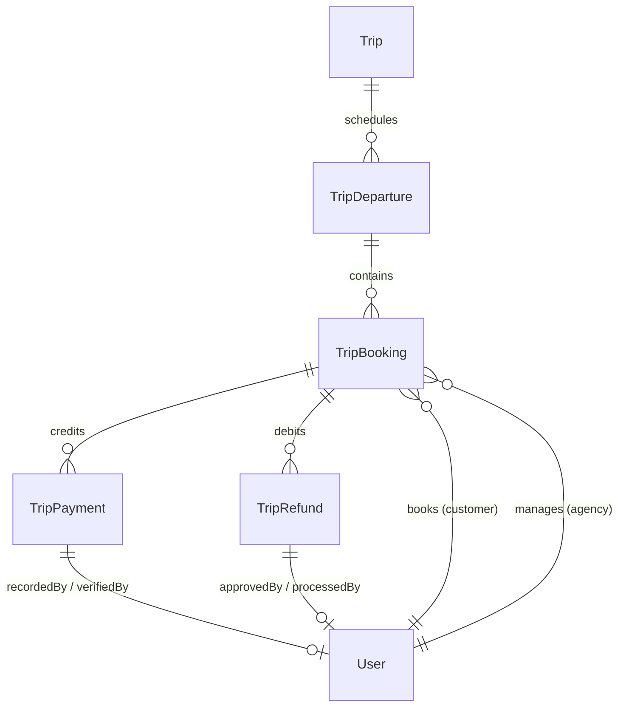
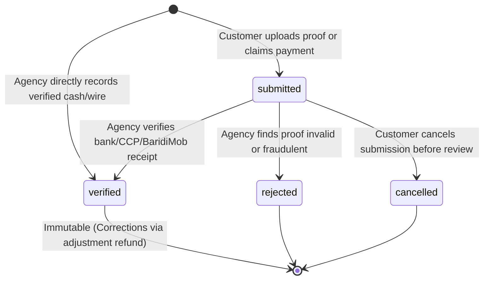
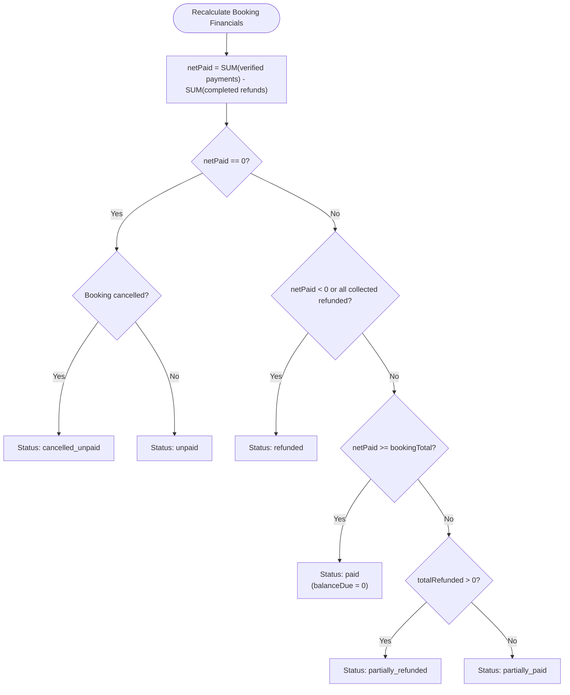

# Touriva — Phase 4 Financial Tracking Architecture Specification

**Document Version:** 1.0.0  
**Date:** October 29, 2026  
**Author:** Antigravity (Advanced Agentic Systems Architect)  
**Project:** Touriva — Algerian Tourism Platform (`/home/next/next projects/touriva`)  
**Target Codebase Baseline:** Commit `94e40ad`, Master Branch (Phases 1–3 Complete & Validated)  
**Architecture Status:** **READY WITH PRODUCT DECISIONS REQUIRED**

---

## 1. Executive Summary & Existing System Integration

Phase 4 introduces end-to-end **Financial Tracking** for the Touriva platform, enabling Algerian tourism agencies to manage excursion receipts, partial payments, deposits, offline proof verification (CCP, BaridiMob, bank wire, cash), refunds, and financial reporting.

### 1.1 Existing System Baseline & Compatibility Guarantees
The Phase 4 architecture is engineered to strictly preserve and build upon the validated Phase 1–3 foundations without breaking changes:
- **Zero Disruptions to Core Booking State:** The operational lifecycle of `TripBooking` (`pending`, `confirmed`, `rejected`, `cancelled`, `completed`) is maintained. Financial state is modeled as an orthogonal, synchronized state machine (`financialStatus`).
- **Preservation of Standalone Concurrency Safety:** MongoDB is deployed as a standalone instance (`not running with --replSet`). Concurrency protection will continue using atomic conditional writes (`$expr`, `$inc`, `$set`) and synchronous in-flight key deduplication, preserving the zero-overbooking and exactly-once seat release guarantees proven in Phase 3.
- **Strict Multi-Tenant Isolation:** Financial operations adhere to the RBAC and data isolation model proven across Phases 1–3. Agencies can only view and manage payments for bookings belonging to their agency (`payment.agency === req.user._id`).
- **Server-Authoritative Arithmetic:** All financial totals (`bookingTotal`, `totalPaid`, `balanceDue`, `refundableAmount`) are derived exclusively from immutable payment records. Client-provided prices, balances, or counters are never trusted.

---

## 2. Financial Domain Model & Data Schema

### 2.1 Decoupled Entity Model: Dedicated `TripPayment` & `TripRefund` Collections
To guarantee strict auditability, prevent document bloat, and maintain backward compatibility, financial records are **decoupled** from `TripBooking`:
- **Authoritative Ledgers:** Stored in two dedicated collections: `TripPayment` (credits) and `TripRefund` (debits).
- **Cached Financial State in `TripBooking`:** To support fast list views, search filters, and query performance, `TripBooking` maintains cached summary fields synchronized atomically upon every verified transaction.



---

### 2.2 `TripBooking` Financial Schema Extension
The existing `backend/models/TripBooking.js` schema will be extended with the following non-destructive fields:

```javascript
// New fields to be added to tripBookingSchema in TripBooking.js:
currency: {
  type: String,
  default: 'DZD',
  enum: ['DZD'],
  immutable: true
},
financialStatus: {
  type: String,
  enum: [
    'unpaid',             // 0 DZD verified
    'partially_paid',     // > 0 DZD verified, but balanceDue > 0
    'paid',               // balanceDue === 0 (100% satisfied)
    'refund_pending',     // Active refund request under review
    'partially_refunded', // Portion refunded, netPaid > 0
    'refunded',           // 100% of collected funds refunded
    'cancelled_unpaid'    // Booking cancelled while unpaid
  ],
  default: 'unpaid',
  index: true
},
totalPaidDZD: {
  type: Number,
  default: 0,
  min: [0, 'Total paid cannot be negative']
},
totalRefundedDZD: {
  type: Number,
  default: 0,
  min: [0, 'Total refunded cannot be negative']
},
netPaidDZD: {
  type: Number,
  default: 0,
  min: [0, 'Net paid cannot be negative']
},
balanceDueDZD: {
  type: Number,
  required: true,
  min: [0, 'Balance due cannot be negative']
},
paymentDueDate: {
  type: Date,
  default: null
},
requiresDeposit: {
  type: Boolean,
  default: false
},
depositAmountDZD: {
  type: Number,
  default: 0,
  min: [0, 'Deposit amount cannot be negative']
}
```

---

### 2.3 The `TripPayment` Collection Model
A dedicated Mongoose model representing individual credit transactions (`backend/models/TripPayment.js`):

```javascript
const tripPaymentSchema = new mongoose.Schema({
  paymentReference: {
    type: String,
    unique: true,
    index: true,
    trim: true
  }, // Auto-generated: TRV-PAY-XXXXXXXX
  booking: {
    type: mongoose.Schema.Types.ObjectId,
    ref: 'TripBooking',
    required: true,
    index: true
  },
  departure: {
    type: mongoose.Schema.Types.ObjectId,
    ref: 'TripDeparture',
    required: true,
    index: true
  },
  agency: {
    type: mongoose.Schema.Types.ObjectId,
    ref: 'User',
    required: true,
    index: true
  },
  customer: {
    type: mongoose.Schema.Types.ObjectId,
    ref: 'User',
    default: null,
    index: true
  },
  amountDZD: {
    type: Number,
    required: [true, 'Payment amount in DZD is required'],
    min: [1, 'Payment amount must be at least 1 DZD']
  },
  currency: {
    type: String,
    default: 'DZD',
    enum: ['DZD'],
    immutable: true
  },
  method: {
    type: String,
    required: true,
    enum: ['cash', 'ccp', 'baridimob', 'bank_transfer', 'gateway_cib', 'other'],
    index: true
  },
  status: {
    type: String,
    required: true,
    enum: ['submitted', 'verified', 'rejected', 'cancelled'],
    default: 'submitted',
    index: true
  },
  transactionReference: {
    type: String,
    trim: true,
    default: '' // Bank receipt number, CCP slip number, or BaridiMob TXID
  },
  proofDocument: {
    filename: { type: String, default: null },
    originalName: { type: String, default: null },
    mimeType: { type: String, default: null },
    sizeBytes: { type: Number, default: 0 },
    uploadedAt: { type: Date, default: null }
  },
  paymentDate: {
    type: Date,
    required: true,
    default: Date.now
  },
  recordedBy: {
    type: mongoose.Schema.Types.ObjectId,
    ref: 'User',
    required: true
  },
  verifiedBy: {
    type: mongoose.Schema.Types.ObjectId,
    ref: 'User',
    default: null
  },
  verifiedAt: {
    type: Date,
    default: null
  },
  rejectionReason: {
    type: String,
    trim: true,
    default: ''
  },
  rejectedBy: {
    type: mongoose.Schema.Types.ObjectId,
    ref: 'User',
    default: null
  },
  rejectedAt: {
    type: Date,
    default: null
  },
  customerNote: {
    type: String,
    trim: true,
    default: ''
  },
  agencyInternalNote: {
    type: String,
    trim: true,
    default: ''
  },
  idempotencyKey: {
    type: String,
    sparse: true,
    index: true,
    trim: true
  },
  statusHistory: [{
    status: { type: String, required: true },
    changedBy: { type: mongoose.Schema.Types.ObjectId, ref: 'User' },
    note: { type: String, default: '' },
    timestamp: { type: Date, default: Date.now }
  }]
}, {
  timestamps: true
})
```

---

### 2.4 The `TripRefund` Collection Model
A dedicated Mongoose model representing debit adjustments and traveler refunds (`backend/models/TripRefund.js`):

```javascript
const tripRefundSchema = new mongoose.Schema({
  refundReference: {
    type: String,
    unique: true,
    index: true,
    trim: true
  }, // Auto-generated: TRV-RFD-XXXXXXXX
  booking: {
    type: mongoose.Schema.Types.ObjectId,
    ref: 'TripBooking',
    required: true,
    index: true
  },
  payment: {
    type: mongoose.Schema.Types.ObjectId,
    ref: 'TripPayment',
    default: null // Optional link to specific original payment
  },
  agency: {
    type: mongoose.Schema.Types.ObjectId,
    ref: 'User',
    required: true,
    index: true
  },
  customer: {
    type: mongoose.Schema.Types.ObjectId,
    ref: 'User',
    default: null,
    index: true
  },
  amountDZD: {
    type: Number,
    required: [true, 'Refund amount in DZD is required'],
    min: [1, 'Refund amount must be at least 1 DZD']
  },
  cancellationFeeDZD: {
    type: Number,
    default: 0,
    min: [0, 'Cancellation fee cannot be negative']
  },
  currency: {
    type: String,
    default: 'DZD',
    enum: ['DZD'],
    immutable: true
  },
  method: {
    type: String,
    required: true,
    enum: ['cash', 'ccp', 'baridimob', 'bank_transfer', 'other']
  },
  status: {
    type: String,
    required: true,
    enum: ['requested', 'approved', 'completed', 'rejected'],
    default: 'requested',
    index: true
  },
  reason: {
    type: String,
    required: [true, 'Refund reason is mandatory'],
    trim: true
  },
  requestedBy: {
    type: mongoose.Schema.Types.ObjectId,
    ref: 'User',
    required: true
  },
  processedBy: {
    type: mongoose.Schema.Types.ObjectId,
    ref: 'User',
    default: null
  },
  processedAt: {
    type: Date,
    default: null
  },
  rejectionReason: {
    type: String,
    trim: true,
    default: ''
  },
  customerNotificationNote: {
    type: String,
    trim: true,
    default: ''
  },
  agencyInternalNote: {
    type: String,
    trim: true,
    default: ''
  },
  idempotencyKey: {
    type: String,
    sparse: true,
    index: true,
    trim: true
  },
  statusHistory: [{
    status: { type: String, required: true },
    changedBy: { type: mongoose.Schema.Types.ObjectId, ref: 'User' },
    note: { type: String, default: '' },
    timestamp: { type: Date, default: Date.now }
  }]
}, {
  timestamps: true
})
```

---

## 3. Financial State Machine & Lifecycle Transitions

### 3.1 Payment Record Lifecycle
Every payment record follows a strict one-way state transition:



### 3.2 Booking Financial Status Computation
The booking's `financialStatus` is deterministically computed from verified transactions:



---

## 4. Payment Verification & Role Authorization Matrix

| Operation / Capability | Customer | Agency Staff / Operator | Agency Manager / Owner | System Administrator |
| :--- | :---: | :---: | :---: | :---: |
| **Submit Payment Proof** | ✅ Own bookings only | ❌ | ❌ | ❌ |
| **Record Offline Payment (Direct Verify)** | ❌ | ✅ Own agency bookings | ✅ Own agency bookings | ✅ Any agency |
| **Review & Verify Submitted Proof** | ❌ | ❌ | ✅ Own agency bookings | ✅ Any agency |
| **Reject Payment Proof** | ❌ | ❌ | ✅ (Must provide reason) | ✅ |
| **View Payment Proof File** | ✅ Own booking proofs | ✅ Own agency proofs | ✅ Own agency proofs | ✅ Global |
| **View Internal Agency Notes** | ❌ Strictly forbidden | ✅ Own agency | ✅ Own agency | ✅ Global |
| **Request Refund** | ✅ Own cancelled bookings | ❌ | ❌ | ❌ |
| **Approve / Complete Refund** | ❌ | ❌ | ✅ Own agency | ✅ |
| **Delete or Mutate Verified Record** | ❌ Prohibited | ❌ Prohibited | ❌ Prohibited | ❌ Prohibited |

> [!IMPORTANT]
> **Anti-Tampering Invariant:** Customers can **never** mark their own bookings as `paid`. Customer action only transitions a payment to `submitted`. Only an authenticated agency manager or administrator can transition a payment to `verified`, which atomically updates the booking balance.

---

## 5. Payment Proof & Document Storage Architecture

### 5.1 Storage Mechanism & Security Boundary
- **Filesystem Isolation:** Files are stored in an unexposed local directory: `backend/uploads/payment_proofs/`.
- **No Direct Web Access:** The directory is **not** served via Express static middleware (`express.static`). Direct public URL access is completely blocked.
- **Controlled Streaming Endpoint:** Access is mediated exclusively through authenticated endpoints:
  - `GET /api/agency/payments/:id/proof` (Agency & Admin)
  - `GET /api/bookings/:bookingId/payments/:id/proof` (Customer Owner)
- **Path Traversal Protection:** User-supplied filenames are never used on disk. Storage filenames are synthesized cryptographically:
  ```javascript
  const sanitizedExt = path.extname(file.originalname).toLowerCase()
  const safeFilename = `proof_${payment._id}_${crypto.randomBytes(8).toString('hex')}${sanitizedExt}`
  ```

### 5.2 Document Upload Constraints
- **Maximum File Size:** **5 MB** (enforced by Multer and body parsers).
- **Permitted MIME Types:** `image/jpeg`, `image/png`, `image/webp`, `application/pdf`.
- **Magic Number File Signature Validation:** Validates actual binary file signatures to prevent executable code disguised with image extensions.

---

## 6. Interaction with Operational Booking Lifecycle

| Booking Operational State | Permitted Financial Operations | Rules & Behavioral Constraints |
| :--- | :--- | :--- |
| **`pending`** | - Customer submits proof<br>- Agency records deposit/payment | Agency can record deposit while pending. When balance satisfies required deposit, booking can be confirmed. |
| **`confirmed`** | - Customer submits balance proof<br>- Agency records payment<br>- Agency records refund | Normal operational state. Customer can pay in multiple installments until `paymentDueDate`. |
| **`rejected`** | - Agency records refund if deposit was taken<br>- No new payments allowed | If agency rejects a booking where funds were collected, status becomes `refund_pending`. |
| **`cancelled`** | - Agency processes refund<br>- No new payments allowed | Departure capacity is released immediately. If payments existed, `refundableAmount` is calculated. |
| **`completed`** | - Agency views financial history<br>- Dispute adjustments | Closed operational state. Excursion took place. |

---

## 7. Authoritative Server-Side Financial Calculations

To prevent client-side price tampering or floating-point discrepancies:
1. **Integer Arithmetic:** All currency values are stored as integers representing whole Algerian Dinars (`Number.isInteger(amount)`). Centimes are not used in Algerian tourism pricing.
2. **Deterministic Reconciliation Helper (`recalculateBookingFinancials`):**
   ```javascript
   const recalculateBookingFinancials = async (bookingId) => {
     const booking = await TripBooking.findById(bookingId)
     if (!booking) throw new Error('Booking not found')

     // Aggregate all verified payments
     const paymentAgg = await TripPayment.aggregate([
       { $match: { booking: booking._id, status: 'verified' } },
       { $group: { _id: null, total: { $sum: '$amountDZD' } } }
     ])
     const totalPaidDZD = paymentAgg[0]?.total || 0

     // Aggregate all completed refunds
     const refundAgg = await TripRefund.aggregate([
       { $match: { booking: booking._id, status: 'completed' } },
       { $group: { _id: null, total: { $sum: '$amountDZD' } } }
     ])
     const totalRefundedDZD = refundAgg[0]?.total || 0

     const netPaidDZD = Math.max(0, totalPaidDZD - totalRefundedDZD)
     const balanceDueDZD = Math.max(0, booking.totalPriceDZD - netPaidDZD)

     let financialStatus = 'unpaid'
     if (booking.status === 'cancelled' && totalPaidDZD === 0) {
       financialStatus = 'cancelled_unpaid'
     } else if (totalRefundedDZD > 0 && netPaidDZD === 0) {
       financialStatus = 'refunded'
     } else if (totalRefundedDZD > 0 && netPaidDZD > 0) {
       financialStatus = 'partially_refunded'
     } else if (netPaidDZD >= booking.totalPriceDZD) {
       financialStatus = 'paid'
     } else if (netPaidDZD > 0) {
       financialStatus = 'partially_paid'
     }

     booking.totalPaidDZD = totalPaidDZD
     booking.totalRefundedDZD = totalRefundedDZD
     booking.netPaidDZD = netPaidDZD
     booking.balanceDueDZD = balanceDueDZD
     booking.financialStatus = financialStatus

     await booking.save()
     return booking
   }
   ```

---

## 8. Anti-Overpayment & Concurrency Safeguards

1. **Overpayment Prevention:**
   When verifying or recording a payment:
   ```javascript
   if (paymentAmount > booking.balanceDueDZD) {
     return res.status(400).json({
       error: `Payment amount (${paymentAmount} DZD) exceeds outstanding balance (${booking.balanceDueDZD} DZD)`
     })
   }
   ```
2. **Concurrent Duplicate Prevention:**
   Every payment submission accepts an `idempotencyKey`. The server verifies caller ownership and payload equivalence, preventing accidental double-credits on browser refresh or network timeout.
3. **Refund Upper-Bound Invariant:**
   A refund can never exceed `booking.netPaidDZD`.

---

## 9. Agency Financial Dashboard & Reporting Architecture

### 9.1 Real-Time Financial KPI Summary
The agency dashboard (`/agency/dashboard` & `/agency/financials`) will compute five authoritative metrics:
1. **Total Booking Value:** $\sum \text{totalPriceDZD}$ for non-cancelled bookings.
2. **Gross Collected:** $\sum \text{amountDZD}$ for verified payments.
3. **Total Refunded:** $\sum \text{amountDZD}$ for completed refunds.
4. **Net Revenue:** $\text{Gross Collected} - \text{Total Refunded}$.
5. **Outstanding Balance:** $\sum \text{balanceDueDZD}$ for active departures.

### 9.2 Scalable Query Indexes
The database indexing strategy incorporates compound indexes to ensure fast dashboard aggregation even under high booking volumes:
- `TripPayment`: `{ agency: 1, status: 1, paymentDate: -1 }`
- `TripPayment`: `{ booking: 1, status: 1 }`
- `TripRefund`: `{ agency: 1, status: 1, createdAt: -1 }`
- `TripBooking`: `{ agency: 1, financialStatus: 1, createdAt: -1 }`

---

## 10. Future Payment Gateway Abstraction Layer

To ensure seamless future integration with SATIM, CIB, or official Algerian online payment aggregators without architectural restructuring:
- Every `TripPayment` includes a `method` field distinguishing `cash`, `ccp`, `baridimob` from `gateway_cib`.
- A payment service abstraction interface will isolate gateway webhooks:
  ```javascript
  // Future service interface pattern:
  // services/paymentGatewayService.js
  // - createGatewaySession(booking, amount)
  // - handleGatewayWebhook(signature, payload)
  // - verifyWebhookSignature(req)
  ```
- No online gateway logic will be implemented in Phase 4; only the clean abstraction boundaries and database fields are established.

---

## 11. Architecture Status & Final Verdict

### Status: **READY WITH PRODUCT DECISIONS REQUIRED**

The technical architecture, schema definitions, mathematical invariants, multi-tenant boundaries, and file storage designs are technically complete, robust, and backward-compatible. Implementation should proceed as soon as the business policy decisions detailed in [`TOURIVA_PHASE4_PRODUCT_DECISIONS.md`](file:///home/next/next%20projects/touriva/TOURIVA_PHASE4_PRODUCT_DECISIONS.md) are formally signed off.
