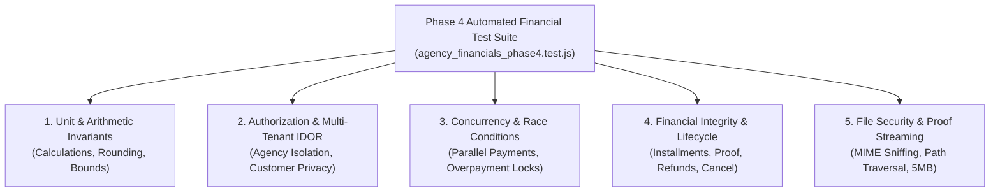

# Touriva — Phase 4 Financial Test Plan & Verification Strategy

**Document Version:** 1.0.0  
**Date:** October 29, 2026  
**Status:** SPECIFICATION (Testing Blueprint for Phase 4 Implementation)  
**Target Repository:** `/home/next/next projects/touriva`  
**Test Harness:** Jest + Supertest (Backend), Vitest + Happy-DOM (Frontend)

---

## 1. Overview & Quality Objectives

The Phase 4 test suite is designed to enforce complete financial accuracy, mathematical invariants, multi-tenant agency isolation, and fraud prevention for Algerian tourism agencies and travelers.

### 1.1 Non-Regression Guarantee
All Phase 1–3 test suites must continue passing with zero regressions:
- Baseline: 180 / 180 backend tests passing across 10 suites (`health`, `auth_and_users`, `trips_and_subscriptions`, `tourism_services`, `shop`, `critical_security_audit`, `agency_security_phase1`, `agency_packages_phase2`, `agency_bookings_phase3`, `e2e_pilot_validation`).
- Baseline: 18 / 18 frontend Vitest tests passing.
- Baseline: Clean production client build with 0 errors.

---

## 2. Automated Test Matrix



---

## 3. Detailed Automated Test Scenarios

### Section 1: Financial Arithmetic & Calculation Invariants
Target: `backend/controllers/financialController.js` and calculation utilities.

| Test ID | Test Description | Input Data | Expected Result |
| :--- | :--- | :--- | :--- |
| **`1.1`** | **Integer Arithmetic Verification** | Amounts: `15000 DZD`, `25000 DZD` | Stored strictly as whole numbers; no floating point centime artifacts. |
| **`1.2`** | **Negative Payment Rejection** | `amountDZD: -5000` | Rejected with `400 Bad Request` ("Payment amount must be at least 1 DZD"). |
| **`1.3`** | **Zero Payment Rejection** | `amountDZD: 0` | Rejected with `400 Bad Request`. |
| **`1.4`** | **Overpayment Prevention** | Balance due: `20000 DZD`; Payment: `25000 DZD` | Rejected with `400 Bad Request` ("Payment exceeds outstanding balance"). |
| **`1.5`** | **Refund Exceeding Paid Rejection** | Total paid: `20000 DZD`; Refund request: `25000 DZD` | Rejected with `400 Bad Request` ("Refund exceeds collected funds"). |
| **`1.6`** | **Deterministic Reconciliation Hook** | Multiple verified payments (10k + 15k) and refunds (5k) | `recalculateBookingFinancials()` yields: `totalPaid: 25k`, `totalRefunded: 5k`, `netPaid: 20k`. |

---

### Section 2: Multi-Tenant Authorization & IDOR Hardening
Target: Access control middleware and payment controller endpoints.

| Test ID | Test Description | Setup & Persona | Expected Result |
| :--- | :--- | :--- | :--- |
| **`2.1`** | **Agency A cannot view Agency B payments** | Agency B requests `GET /api/agency/payments` | Response `payments` array strictly excludes Agency A records. |
| **`2.2`** | **Agency A cannot verify Agency B payments** | Agency A calls `PATCH /api/agency/payments/:id_B/verify` | Rejected with `403 Forbidden` ("Access forbidden: You cannot modify another agency's payments"). |
| **`2.3`** | **Agency A cannot reject Agency B payments** | Agency A calls `PATCH /api/agency/payments/:id_B/reject` | Rejected with `403 Forbidden`. |
| **`2.4`** | **Customer cannot view another's payments** | Tourist 2 calls `GET /api/bookings/:id_A/financials` | Rejected with `403 Forbidden`. |
| **`2.5`** | **Customer cannot view internal agency notes** | Tourist 1 calls `GET /api/bookings/:id_A/financials` | `agencyInternalNote` is omitted or stripped from response. |
| **`2.6`** | **Customer cannot verify own payment** | Tourist 1 calls `PATCH /api/agency/payments/:id/verify` | Rejected with `403 Forbidden` (Agency role required). |
| **`2.7`** | **Unauthenticated caller rejected** | No token supplied to financial endpoints | Rejected with `401 Unauthorized`. |
| **`2.8`** | **Administrator global financial access** | Admin calls `GET /api/agency/financials/dashboard?agency=:id` | Allowed with `200 OK`; returns agency-specific KPI aggregates. |

---

### Section 3: Concurrency, Idempotency & Race Condition Prevention
Target: Standalone MongoDB write serialization and in-flight key locks.

| Test ID | Test Description | Scenario & Execution | Expected Result |
| :--- | :--- | :--- | :--- |
| **`3.1`** | **Same-Caller Idempotency Retry** | Tourist submits payment with `Idempotency-Key: K1` twice | Call 1: `201 Created`; Call 2: `200 OK` (returns identical payment, 0 extra credit). |
| **`3.2`** | **Cross-Caller Idempotency Reuse** | Tourist 2 submits payment with Tourist 1's key `K1` | Rejected with `409 Conflict`; zero payment details leaked. |
| **`3.3`** | **Changed-Payload Idempotency Reuse** | Tourist submits key `K1` with altered amount | Rejected with `409 Conflict` ("Request parameters do not match original request"). |
| **`3.4`** | **Concurrent Duplicate Payments** | 2 simultaneous requests with same key sent via `Promise.all` | Both resolve safely; exact same payment reference returned; balance credited once. |
| **`3.5`** | **Concurrent Overpayment Race** | Balance due is `10000 DZD`; 2 parallel payments of `10000 DZD` each sent | Exactly 1 payment succeeds; 2nd payment fails with `400 Bad Request` (overpayment invariant). |

---

### Section 4: Financial Integrity, Proof Verification & Refunds
Target: Complete booking and payment lifecycle transitions.

| Test ID | Test Description | Sequence of Actions | Expected Result |
| :--- | :--- | :--- | :--- |
| **`4.1`** | **Multiple Partial Installments** | Total: `60000 DZD`. Pay 1: `20k`, Pay 2: `20k`, Pay 3: `20k` | Status transitions: `unpaid` → `partially_paid` → `partially_paid` → `paid` (`balanceDue: 0`). |
| **`4.2`** | **Proof Submission & Review** | Tourist uploads BaridiMob screenshot | Payment created in `submitted`; booking status remains `unpaid` until verified. |
| **`4.3`** | **Proof Verification Credits Balance** | Agency confirms proof with transaction ref | Payment becomes `verified`; booking `totalPaid` increases; `balanceDue` decreases. |
| **`4.4`** | **Proof Rejection Leaves Balance Unchanged** | Agency rejects illegible proof with reason | Payment becomes `rejected`; booking balances remain unchanged; rejection reason saved. |
| **`4.5`** | **Cancellation with Unpaid Status** | Tourist cancels unpaid booking | Status becomes `cancelled_unpaid`; departure capacity released. |
| **`4.6`** | **Cancellation with Partial Payment** | Tourist cancels booking after 20k payment | Departure capacity released; booking status `cancelled`; financial status `refund_pending`. |
| **`4.7`** | **Full Refund Disbursement** | Agency approves and completes 20k refund | Status becomes `refunded`; `netPaid: 0`; departure seats remain released. |
| **`4.8`** | **Partial Refund with Cancellation Fee** | Agency completes 18k refund with 2k fee | Status becomes `partially_refunded`; `netPaid: 2000`; audit trail logs penalty. |
| **`4.9`** | **Repeated Refund Attempt** | Customer requests 2nd refund after 100% refunded | Rejected with `400 Bad Request` ("No refundable balance remaining"). |

---

### Section 5: Proof Document Upload & Streaming Security
Target: Multer middleware, magic number validation, and streaming router.

| Test ID | Test Description | Input / Vector | Expected Result |
| :--- | :--- | :--- | :--- |
| **`5.1`** | **Valid Image Upload** | Real JPEG binary (1.2 MB) | Stored in `/uploads/payment_proofs/` with cryptographic filename; 201 Created. |
| **`5.2`** | **Valid PDF Upload** | Real PDF binary (2.4 MB) | Stored successfully; MIME validated as `application/pdf`. |
| **`5.3`** | **Oversized File Rejection** | File size 6.1 MB (> 5MB limit) | Rejected with `413 Payload Too Large`. |
| **`5.4`** | **Disguised Executable Rejection** | Bash script or `.exe` renamed to `receipt.jpg` | Magic-number binary check fails; rejected with `415 Unsupported Media Type`. |
| **`5.5`** | **Path Traversal Rejection** | Filename `../../../../etc/passwd` | Discarded; server-generated cryptographic filename used. |
| **`5.6`** | **Proof Streaming Authorization** | Agency B requests Agency A proof stream | HTTP `403 Forbidden`; zero file bytes transmitted. |

---

## 4. Manual End-to-End Pilot Walkthrough Scenarios

For visual and operational validation by agency operators in the staging environment:

| Step | Persona | Action | Visual & System Verification |
| :---: | :--- | :--- | :--- |
| **M1** | **Tourist** | Books excursion (total: 50,000 DZD). Chooses BaridiMob. | Booking created. Sees "Montant à régler : 50 000 DZD. Instructions de virement BaridiMob affichées." |
| **M2** | **Tourist** | Uploads transaction screenshot (25,000 DZD) with transaction ID. | Status shows "Paiement en attente de vérification (25 000 DZD)". |
| **M3** | **Agency** | Opens `/agency/bookings`, navigates to "Paiements à Vérifier". | Sees pending payment badge. Clicks "Examiner le justificatif". Image preview opens in modal. |
| **M4** | **Agency** | Clicks "Valider le Paiement", enters internal bank note. | Payment marked "Vérifié". Booking badge updates to "Partiellement Payé (Reste : 25 000 DZD)". |
| **M5** | **Agency** | In person, records remaining 25,000 DZD cash at desk. | Enters receipt number. Booking badge updates to "Intégralement Payé". |
| **M6** | **Agency** | Visits `/agency/financials/dashboard`. | Revenue charts reflect 50,000 DZD collected (25k BaridiMob, 25k Espèces). |

---

## 5. Execution Command Baseline
```bash
# Targeted financial test suite execution
npm --prefix backend test -- tests/agency_financials_phase4.test.js

# Full repository regression verification
npm --prefix backend test
npm --prefix frontEnd/touriva test
npm --prefix frontEnd/touriva run build
```
