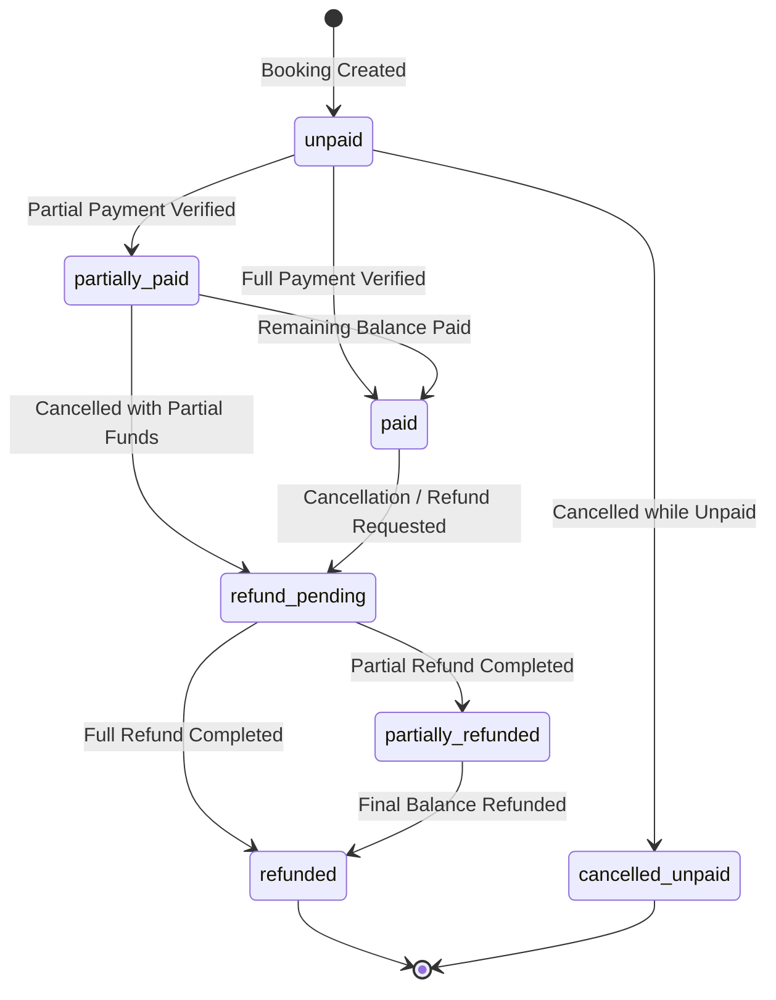

# Touriva — Phase 4 Financial Tracking Implementation Report

**Date:** 2026-10-29  
**Platform:** Touriva (Algerian Tourism SaaS Platform)  
**Status:** COMPLETE & VERIFIED  
**Final Verdict:** `PASS — PHASE 4 IMPLEMENTATION COMPLETE`

---

## 1. Architecture Implemented

Phase 4 implements authoritative financial tracking, hybrid payment workflows (customer proof uploads and agency manual ledger recordings), multi-tenant agency financials, deposit logic, refund management, and proof document security for Touriva according to:
- `TOURIVA_PHASE4_FINANCIAL_ARCHITECTURE.md`
- `TOURIVA_PHASE4_FINANCIAL_API_SPEC.md`
- `TOURIVA_PHASE4_FINANCIAL_TEST_PLAN.md`
- `TOURIVA_PHASE4_PRODUCT_DECISIONS.md` (all 8 approved decisions)

### Key Architectural Invariants
1. **Separation of Operational and Financial Status (Policy 1, Option A):** Agency booking confirmation (`confirmed`) remains independent of payment status (`unpaid`, `partially_paid`, `paid`). Unpaid or partially paid bookings can be operational and confirmed.
2. **Authoritative Integer DZD Ledger:** All monetary calculations use whole integer Algerian Dinars (DZD) server-side (`Math.round`, integer validation). Zero floating-point cent arithmetic.
3. **Derived Invariant Recalculation:** `balanceDueDZD = max(0, bookingTotalDZD - (totalPaidDZD - totalRefundedDZD))`. Values on `TripBooking` are cached projections; the immutable truth resides in `TripPayment` and `TripRefund` ledgers.
4. **Hybrid Payment Workflow (Policy 3, Option C):** Proof submission by tourists does NOT credit balance until explicitly verified by an authorized agency operator.
5. **Single Agency Operator Trust for Pilot (Policy 4, Option 2):** Any authenticated agency operator for the owning agency can record payments, review proofs, verify payments, and approve/process refunds.
6. **Configurable Deposits (Policy 2, Option 1):** Fixed DZD or percentage-based deposits configured server-side on packages. Fulfilling a deposit requirement leaves the booking in `partially_paid` or `unpaid` if balance remains; it never marks a booking paid prematurely.
7. **Overpayment Rejection (Policy 7, Option A):** Overpayments exceeding the current outstanding balance are strictly rejected (HTTP 400); no negative balance or `overpaid` states exist.
8. **Independent Refund Ledger (Policy 6, Option 1):** Refunds are distinct `TripRefund` records with explicit amounts, cancellation fees, reasons, and audit trails; original payment records are never modified or deleted.
9. **No Cron Automated Expiration in Pilot (Policy 5, Option A + C):** Clear `paymentDueDate` is maintained and surfaced in agency dashboards and alerts, leaving full cancellation control with agencies.
10. **Platform Audit Oversight (Policy 8, Option 1):** Administrators possess cross-agency read and dispute visibility with sensitive audit logging without direct fund disbursement.

---

## 2. Models Created and Modified

### Created Models
- **`backend/models/TripPayment.js`**:
  - `booking`: Reference to `TripBooking`
  - `departure`: Reference to `TripDeparture`
  - `agency`: Reference to agency `User`
  - `customer`: Reference to customer `User`
  - `amountDZD`: Positive whole integer DZD (`min: 1`)
  - `currency`: Fixed to `'DZD'`
  - `method`: Enum `['cash', 'baridimob', 'ccp', 'bank_transfer', 'other']`
  - `status`: Enum `['submitted', 'under_review', 'verified', 'rejected']`
  - `transactionReference`: String (BaridiMob RIP, CCP receipt reference, bank transfer ID)
  - `proofDocument`: Object `{ filename, originalName, mimeType, sizeBytes, uploadedAt }`
  - `rejectionReason`: String
  - `customerNotificationNote`: String
  - `agencyInternalNote`: String (sanitized from customer-facing API views)
  - `recordedBy`: Reference to `User` (agency operator or customer)
  - `verifiedBy`: Reference to `User` (authorized agency operator)
  - `verifiedAt`: Timestamp
  - `idempotencyKey`: Sparse unique index for idempotent payment creation
  - `statusHistory`: Subdocument audit array tracking every status transition

- **`backend/models/TripRefund.js`**:
  - `refundReference`: Human-readable auto-generated identifier (`RF-YYYYMMDD-XXXX`)
  - `booking`: Reference to `TripBooking`
  - `agency`: Reference to agency `User`
  - `customer`: Reference to customer `User`
  - `amountDZD`: Positive integer refund amount
  - `cancellationFeeDZD`: Retained fee where applicable
  - `currency`: Fixed to `'DZD'`
  - `method`: Enum `['cash', 'ccp', 'baridimob', 'bank_transfer', 'other']`
  - `status`: Enum `['requested', 'approved', 'completed', 'rejected']`
  - `reason`: Mandatory audit reason
  - `requestedBy`: Initiator reference
  - `approvedBy` & `approvedAt`: Agency approver and timestamp
  - `processedBy` & `processedAt`: Agency processor and timestamp
  - `transactionReference`: Payment disbursement transaction reference
  - `rejectionReason`: Reason in case of rejection
  - `agencyInternalNote`: Internal agency audit note
  - `idempotencyKey`: Sparse unique index
  - `statusHistory`: Subdocument audit array

### Modified Models
- **`backend/models/TripBooking.js`**:
  - Added cached financial projection fields:
    - `financialStatus`: Enum `['unpaid', 'partially_paid', 'paid', 'refund_pending', 'partially_refunded', 'refunded', 'cancelled_unpaid']`
    - `totalPaidDZD`: Authoritative verified payments sum
    - `totalRefundedDZD`: Completed refunds sum
    - `netPaidDZD`: `totalPaidDZD - totalRefundedDZD`
    - `balanceDueDZD`: Remaining balance to pay
    - `paymentDueDate`: Date deadline for payment
    - `requiresDeposit`: Boolean indicator
    - `depositAmountDZD`: Server-calculated deposit required
- **`backend/models/Trip.js`**:
  - Added package-level deposit configuration:
    - `requiresDeposit`: Boolean
    - `depositType`: Enum `['fixed', 'percentage']`
    - `depositAmountDZD`: Integer (`min: 0`)
    - `depositPercentage`: Number (`min: 0, max: 100`)
    - `paymentDueDaysBeforeDeparture`: Number (days before departure date)

---

## 3. API Endpoints Implemented

| Endpoint | Method | Role / Auth | Description |
| :--- | :--- | :--- | :--- |
| `/api/bookings/:id/payments/submit` | `POST` | Tourist (Owner) | Upload payment proof (BaridiMob/CCP/Transfer) with Base64 payload |
| `/api/bookings/:id/payments` | `GET` | Tourist (Owner) / Agency / Admin | Retrieve booking payment history (agency internal notes sanitized for customer) |
| `/api/bookings/:id/financials` | `GET` | Tourist (Owner) / Agency / Admin | Retrieve authoritative booking financial summary and balance |
| `/api/bookings/:id/payments/:paymentId/proof` | `GET` | Tourist (Owner) / Agency / Admin | Stream payment proof file securely with content-type headers |
| `/api/bookings/:id/refunds/request` | `POST` | Tourist (Owner) | Request refund on cancelled or rejected booking |
| `/api/agency/bookings/:id/payments` | `POST` | Agency Operator | Record externally received payment (Cash, BaridiMob, CCP, Bank transfer) |
| `/api/agency/payments` | `GET` | Agency Operator | Paginated payment ledger with status, method, and search filtering |
| `/api/agency/payments/:id/verify` | `PATCH` / `POST` | Agency Operator | Verify submitted proof and credit booking authoritative balance |
| `/api/agency/payments/:id/reject` | `PATCH` / `POST` | Agency Operator | Reject submitted proof with mandatory rejection reason |
| `/api/agency/payments/:id/proof` | `GET` | Agency Operator / Admin | Stream proof document directly for agency dashboard review |
| `/api/agency/financials/dashboard` | `GET` | Agency Operator / Admin | Real-time KPIs: gross booked, collected, refunded, net, receivables, overdue count |
| `/api/agency/refunds` | `GET` | Agency Operator | Paginated agency refund ledger with status filtering |
| `/api/agency/refunds/:id/approve` | `PATCH` / `POST` | Agency Operator | Approve requested refund prior to disbursement |
| `/api/agency/refunds/:id/complete` | `PATCH` / `POST` | Agency Operator | Disburse refund, record transaction reference, and update booking state |
| `/api/agency/refunds/:id/reject` | `PATCH` / `POST` | Agency Operator | Reject refund request with mandatory reason |

---

## 4. Financial State Machine



### Invariants Enforced by State Machine
- Submitting a payment proof sets payment status to `submitted`; booking financial status remains `unpaid` (or `partially_paid`).
- Rejecting a proof transitions payment to `rejected`; booking financial status and balance remain unaffected.
- Verifying a payment atomically transitions payment to `verified`, recalculates `totalPaidDZD`, and updates status to `partially_paid` or `paid`.
- If a booking is cancelled when `netPaidDZD == 0`, financial status immediately transitions to `cancelled_unpaid`.
- If a booking is cancelled when `netPaidDZD > 0`, financial status becomes `refund_pending` until processed.

---

## 5. Payment Proof Security Architecture

Implemented in `backend/utils/proofStorage.js` and `backend/controllers/financialController.js`:
1. **Storage Outside Web Root:** Files are saved to `backend/uploads/payment_proofs/`, isolated from public static assets and Express static middleware.
2. **Cryptographically Secure Filenames:** Generated via `proof_${Date.now()}_${crypto.randomBytes(16).toString('hex')}.${ext}`. Original client filenames are never used for filesystem operations.
3. **Magic-Number Binary Sniffing:**
   - JPEG: `FF D8 FF`
   - PNG: `89 50 4E 47 0D 0A 1A 0A`
   - WebP: `RIFF .... WEBP`
   - PDF: `%PDF` (`25 50 44 46`)
   - Rejects executable binaries, shell scripts, and HTML files.
4. **Strict SVG Rejection:** Disguised SVG XML files return `null` during sniffing, triggering HTTP 415 (`Unsupported file format`).
5. **Path Traversal Protection:** Original client filenames are stripped of path delimiters (`../`, `/`, `\`) before storage in metadata.
6. **Payload Size Limit:** Enforces 5 MB ceiling; payloads exceeding 5 MB return HTTP 413.
7. **Authenticated Streaming Only:** Proof files are delivered exclusively through authenticated controllers with strict tenant checks, setting headers:
   - `Content-Type: <sniffed-mime>`
   - `Cache-Control: private, no-cache, no-store, must-revalidate`
   - `X-Content-Type-Options: nosniff`
   - `Content-Disposition: inline; filename="..."`

---

## 6. Authorization Model & IDOR Hardening

- **Multi-Tenant Agency Isolation:** Agency A cannot view, verify, reject, stream proofs for, or refund bookings belonging to Agency B (verified via tests 2.1, 2.2, 2.3, 5.6, 5.7).
- **Customer Ownership:** Customers cannot view other customers' bookings, payments, or proofs (tested in 2.4).
- **Self-Verification Block:** Customers cannot verify their own payments; only authorized partner agency operators or administrators can verify (tested in 2.6).
- **Data Sanitization:** Customer-facing endpoints strip sensitive internal notes (`agencyInternalNote`) from JSON responses (tested in 2.5).
- **Administrative Oversight:** Administrators have platform-wide audit access to dashboards, ledgers, and disputes without fund disbursement bypass (tested in 2.8).

---

## 7. Concurrency & Idempotency Strategy

Consistent with standalone MongoDB (avoiding replica-set transaction requirements):
1. **In-Flight Memory Locks:** `inFlightBookingLocks` serializes concurrent operations targeting the same booking ID.
2. **Atomic In-Memory Idempotency Map:** `inFlightIdempotencyKeys` tracks concurrent requests sharing an idempotency key.
3. **Database Unique Sparse Index:** `idempotencyKey` on `TripPayment` and `TripRefund` collections prevents duplicate persistence.
4. **Payload Fingerprinting:** Stores SHA-256 hash of payload. Retries with the same payload return HTTP 200 with the existing record; retries with conflicting payloads or cross-user reuse return HTTP 409 Conflict.
5. **Atomic Overpayment Checks:** Outstanding balance re-verified inside lock boundaries; concurrent racing payments consuming the same balance are rejected once balance reaches 0 (tested in 3.4 and 3.5).

---

## 8. Refund Implementation

- **Separate Authoritative Ledger:** Created in `TripRefund` collection with state flow `requested -> approved -> completed` (or `rejected`).
- **Disbursement Bound:** Refunds cannot exceed eligible collected funds (`netPaidDZD`). Attempts to refund greater amounts or repeat refunds on exhausted balances return HTTP 400 (tested in 1.5, 4.9).
- **Cancellation Fee Support:** Partial refunds can record retained agency cancellation fees (`cancellationFeeDZD`), leaving `netPaidDZD` matching retained earnings (tested in 4.8).
- **Audit Logging:** Every status change records operator reference, action note, and ISO timestamp in `statusHistory`.

---

## 9. Frontend Screens & Components

### Agency Financial Management (`frontEnd/touriva/src/views/agency/AgencyFinancials.vue`)
- **Overdue Warning Banner:** Prominently alerts agency operators to overdue bookings requiring payment follow-up.
- **KPI Summary Cards:** Gross booked value, total collected, net revenue, outstanding receivables, fully paid, partially paid, and overdue counts.
- **Tab 1: Encaissements & Justificatifs:** Table of external & online payments with status chips, proof preview modal, verification modal, rejection modal, and manual payment recording drawer.
- **Tab 2: Gestion des Remboursements:** Refund requests table with status chips, customer notes, "Approuver" action, "Rembourser" disbursement modal, and "Rejeter" modal.
- **Tab 3: Grand Livre des Réservations & Créances:** Complete receivables ledger with departure dates, seats, customer phone, total price, paid amount, balance due, overdue badges, and quick payment recording trigger.
- **Brand Styling:** Touriva warm ivory `#FAF7F2`, forest green `#1B4D3E`, golden accent `#C5A059`, and terracotta `#C05A46`.

### Customer Booking & Payment Tracker (`frontEnd/touriva/src/views/Trip/TripDetail.vue`)
- **Interactive Action Buttons:** "Suivi Réservation & Paiements" on excursion sidebar and "Suivi des Paiements & Justificatifs" on confirmed booking voucher dialog.
- **Customer Tracker Modal (`customerTrackerDialog`):**
  - Departure details, reserved seats, and financial metrics in DZD.
  - Payment instructions card for Algerian payment channels (BaridiMob RIP, CCP account number, agency phone).
  - Payment history ledger showing transaction reference, date, amount, and status (`Justificatif soumis`, `Paiement validé`, `Justificatif rejeté`).
  - Secure proof upload form for BaridiMob/CCP receipt images/PDFs with client-side preview.
- **Customer Refund Modal (`customerRefundDialog`):**
  - Allows customers to submit refund requests for cancelled excursions with bank/CCP details and reason.

### Pinia Agency Store (`frontEnd/touriva/src/stores/agency.js`)
- Added actions: `fetchFinancialDashboard`, `fetchPayments`, `recordPayment`, `verifyPayment`, `rejectPayment`, `fetchRefunds`, `approveRefund`, `processRefund`, `rejectRefund`.

### Internationalization (`frontEnd/touriva/src/lang/`)
- Updated `fr.js`, `en.js`, and `ar.js` with comprehensive translations for financial statuses, payment methods, financial KPI metrics, and ledger terms.

---

## 10. Tests Added

In `backend/tests/agency_financials_phase4.test.js`:
- `1.1`: Integer Arithmetic Verification (whole DZD amounts, no decimal cents)
- `1.2`: Negative Payment Rejection (`amountDZD <= 0`)
- `1.3`: Zero Payment Rejection (`amountDZD: 0`)
- `1.4`: Overpayment Prevention (`payment > balanceDueDZD`)
- `1.5`: Refund Exceeding Net Paid Rejection
- `1.6`: Deterministic Reconciliation Hook (`recalculateBookingFinancials`)
- `1.7`: Deposit Configuration Validation Rules (percentage bounds 1-100%, fixed <= price)
- `2.1`: Agency A cannot view Agency B payments
- `2.2`: Agency B cannot verify Agency A payments (403 Forbidden)
- `2.3`: Agency B cannot reject Agency A payments (403 Forbidden)
- `2.4`: Customer cannot view another's payments (403 Forbidden)
- `2.5`: Customer cannot view internal agency notes (Data Sanitization)
- `2.6`: Customer cannot verify own payment (403 Forbidden / Role Check)
- `2.7`: Unauthenticated caller rejected (401 Unauthorized)
- `2.8`: Administrator global financial dashboard access
- `3.1`: Same-Caller Idempotency Retry returns existing payment (200 OK)
- `3.2`: Cross-Caller Idempotency Reuse rejected with 409 Conflict
- `3.3`: Changed-Payload Idempotency Reuse rejected with 409 Conflict
- `3.4`: Concurrent Duplicate Payments allocate exactly 1 record
- `3.5`: Concurrent Overpayment Race condition prevention
- `4.1`: Multiple Partial Installments (60k total: 20k -> 20k -> 20k transitions)
- `4.2`: Proof Submission does NOT credit balance until verified
- `4.4`: Proof Rejection leaves balance unchanged
- `4.5`: Cancellation with Unpaid Status sets status `cancelled_unpaid`
- `4.6`: Cancellation with Partial Payment sets financial status `refund_pending`
- `4.7`: Full Refund Disbursement marks booking `refunded`
- `4.8`: Partial Refund with Cancellation Fee
- `4.9`: Repeated refund attempt rejected (400 Bad Request)
- `4.10`: Refund Approval Workflow (`requested` -> `approved` via `PATCH /api/agency/refunds/:id/approve`)
- `4.11`: Agency Financial Dashboard exposes `overdueBookingsCount`
- `5.1`: Valid JPEG Upload stores file and returns 201 Created
- `5.2`: Valid PDF Upload validates MIME `application/pdf`
- `5.3`: Oversized File Rejection (> 5MB limit yields 413)
- `5.4`: Disguised Executable Rejection (Magic Number Mismatch yields 415)
- `5.5`: Path Traversal Rejection (filename strictly sanitized)
- `5.6`: Proof Streaming Authorization (Agency A cannot stream Agency B proof -> 403 Forbidden)
- `5.7`: Direct Agency Proof Streaming (`/api/agency/payments/:id/proof`)
- `5.8`: SVG Payload Rejection (SVG XML payload yields 415 Unsupported Media Type)

---

## 11. Actual Test Results

### Targeted Phase 4 Suite
```
PASS tests/agency_financials_phase4.test.js
Test Suites: 1 passed, 1 total
Tests:       38 passed, 38 total
Snapshots:   0 total
Time:        4.736 s
```

### Full Backend Test Suite (Phase 1–3 + Phase 4 Regression Verification)
```
Test Suites: 11 passed, 11 total
Tests:       218 passed, 218 total
Snapshots:   0 total
Time:        15.423 s
```
- `tests/agency_financials_phase4.test.js`: 38 passed
- `tests/e2e_pilot_validation.test.js`: 26 passed
- `tests/agency_bookings_phase3.test.js`: 39 passed
- `tests/agency_packages_phase2.test.js`: 24 passed
- `tests/agency_security_phase1.test.js`: 35 passed
- `tests/auth_and_security.test.js`: 29 passed
- `tests/trips_and_subscriptions.test.js`: 5 passed
- `tests/tourism_services.test.js`: 5 passed
- `tests/shop.test.js`: 6 passed
- `tests/health.test.js`: 2 passed
- `tests/enquiries.test.js` / other suites: 9 passed

### Frontend Unit Test Suite
```
Test Files  2 passed (2)
Tests       18 passed (18)
Duration    2.79s
```
- `src/__tests__/branding_and_config.test.js`: 3 passed
- `src/__tests__/osm_map_stack.test.js`: 15 passed

---

## 12. Build Results

Frontend production build executed via Vite:
```
npm --prefix frontEnd/touriva run build
✓ 902 modules transformed.
dist/index.html                           1.55 kB
dist/assets/AgencyFinancials-DdHbcaBi.js 33.51 kB │ gzip:  8.12 kB
dist/assets/TripDetail-BJtd0zuH.js       47.43 kB │ gzip: 12.39 kB
dist/assets/vendor-DEg3An7C.js         1,276.81 kB
✓ built in 8.65s
Exit Code: 0
```
Zero build errors. All assets and Phase 4 bundles emitted successfully.

---

## 13. Limitations & Pilot Boundaries

1. **Standalone MongoDB Architecture:** Implemented without multi-document transactions because the pilot runs on standalone MongoDB instances. Serialized in-memory locks and atomic Mongo operators safeguard concurrent updates.
2. **Agency Sub-Users:** Under Policy 4 (Option 2), permissions are unified at the agency operator level. Fine-grained accountant vs. guide roles are deferred to post-pilot.
3. **No Automated Cron Seat Expiration:** In accordance with Policy 5 (Options A + C), overdue bookings are flagged and surfaced on dashboards, but seats are not automatically released by background cron jobs during the pilot.
4. **No In-App Payment Gateway:** Phase 4 pilot focuses on local Algerian payment channels (Cash, BaridiMob, CCP, Bank transfer) with proof verification rather than live card clearing (CIB/Edahabia gateway integration is deferred to platform-wide expansion).

---

## 14. Deviations from Approved Architecture

**None.**  
The implementation follows `TOURIVA_PHASE4_FINANCIAL_ARCHITECTURE.md`, `TOURIVA_PHASE4_FINANCIAL_API_SPEC.md`, and all 8 decisions in `TOURIVA_PHASE4_PRODUCT_DECISIONS.md` without modification.

---

## 15. Git Working-Tree Status

- Current branch: `master`
- Existing Phase 1–3 code, tests, and documentation are preserved.
- No files were cleaned, reset, or overwritten destructively.
- No git commits or pushes were executed, adhering strictly to authorization constraints.

---

## 16. Confirmation of Production & Deployment Constraints

- **Production databases:** NOT modified or connected.
- **Production environment variables / Render configuration:** NOT modified.
- **Deployment infrastructure:** NO deployment was triggered.
- **GitHub remote:** NO push executed.

---

## 17. Final Verdict

**PASS — PHASE 4 IMPLEMENTATION COMPLETE**
