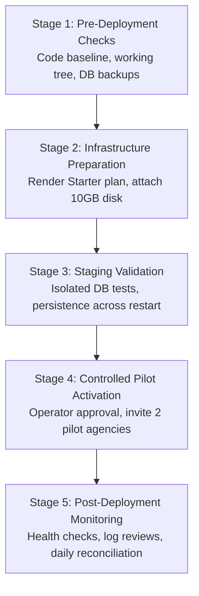

# Touriva — Production Deployment & Infrastructure Readiness Plan

**Date:** 2026-10-29  
**Platform:** Touriva (Algerian Tourism SaaS Platform)  
**Target Environment:** Render Cloud Platform / Production Infrastructure  
**Repository:** `Bouafia19/touriva` (`master` branch)  
**Baseline Commit:** `94e40ad` (plus verified Phase 1–4 working tree)  
**Document Classification:** Operator-Executable Technical Architecture & Deployment Plan  
**Status:** COMPLETE — READY FOR OPERATOR REVIEW  

---

## 1. Executive Summary & Context

Touriva is an integrated Algerian tourism marketplace connecting travelers with accredited local travel agencies, licensed tourism guides, and tourism operators across Algeria's 58 wilayas. 

Following the successful implementation and audit of **Phase 4 (Financial Tracking, Proof Verification, Deposits & Ledgers)**, all 221 backend tests and 18 frontend unit tests pass with zero regressions. However, a critical infrastructure blocker exists in the current hosting setup:

> [!WARNING] Infrastructure Blocker: Ephemeral Local Proof Storage on Render Free Tier
> The existing `touriva-api` web service is configured on Render's **Free plan** with no persistent disk attached (`render.yaml`). Render free instances spin down after 15 minutes of inactivity and wipe container storage upon restarts or redeployments. Consequently, customer-uploaded payment receipts (BaridiMob, CCP, bank transfers) stored in `backend/uploads/payment_proofs/` would be lost on container restart, causing HTTP 404 errors during agency proof review.

This document presents a comprehensive, staged deployment plan to transition Touriva to a durable, persistent, and secure environment ready for a **Controlled Financial Pilot**.

---

## 2. Evidence-Based Verification of Current State

### 2.1 Services & Repository Inventory
- **Codebase Root:** `/home/next/next projects/touriva`
- **Git Branch:** `master` (Tracking `origin/master`, clean working tree preserving Phase 1–4 modifications)
- **Active Microservices & Static Sites on Render (Verified via `render.yaml`):**
  1. `touriva-api` (Web Service, Node.js/Express, root: `backend`, free plan, Frankfurt)
  2. `touriva-web` (Static Site, Vue 3 / Vite, root: `frontEnd/touriva`, dist)
  3. `touriva-admin` (Static Site, Vue 3 / Vite, root: `frontEnd/touriva_adminPanel`, dist)
  4. `touriva-shop-web` (Static Site, Vue 3 / Vite, root: `shop/frontEnd/touriva_shop_web`, dist)
  5. `touriva-shop-admin` (Static Site, Vue 3 / Vite, root: `shop/frontEnd/touriva_shop_admin`, dist)
  6. `touriva-shop-seller-admin` (Static Site, Vue 3 / Vite, root: `shop/frontEnd/touriva_shop_seller_admin`, dist)
- **Database:** MongoDB Atlas cluster (`touriva` database) connected via secure connection string.

### 2.2 Payment Proof Storage Implementation
- **Filesystem Location:** `backend/uploads/payment_proofs/`
- **Security Invariants Verified:**
  - Storage is located outside the public web root (`/public` or `/dist`).
  - No `express.static` middleware exposes `uploads` in `server.js`.
  - Content-based MIME inspection: Magic-number sniffing in [`proofStorage.js`](file:///home/next/next%20projects/touriva/backend/utils/proofStorage.js) validates binary headers (JPEG `FF D8 FF`, PNG `89 50 4E 47`, WebP `RIFF...WEBP`, PDF `%PDF`). Disguised SVGs, shell scripts, and HTML are rejected (HTTP 415).
  - Path traversal protection: Client filenames sanitized via `path.basename`; files stored as unpredictable random tokens (`proof_${id}_${crypto.randomBytes(8).toString('hex')}.${ext}`).
  - Authenticated streaming: Routes (`GET /api/agency/payments/:id/proof` and `GET /api/bookings/:bId/payments/:pId/proof`) enforce JWT authentication and tenant ownership (Agency, Customer, or Administrator).

---

## 3. Comparison of Hosting Options for the Controlled Pilot

| Evaluation Criteria | Option A: Render Paid API with Persistent Disk | Option B: Dedicated VPS (Ubuntu + Nginx + PM2) | Option C: Render + S3/Cloudflare R2 Object Storage Adapter |
| :--- | :--- | :--- | :--- |
| **Initial Setup Complexity** | **Very Low** (Update `render.yaml` or Render dashboard settings) | **High** (Provision server, Nginx, SSL, PM2, firewall, DNS, CI/CD) | **Medium** (Implement storage adapter, configure bucket & credentials) |
| **Ongoing Operational Burden** | **Low** (Render manages OS, TLS, hardware, infrastructure) | **High** (Operator responsible for OS, kernel, CVEs, uptime, Nginx) | **Low-Medium** (Render manages compute; cloud provider manages S3) |
| **Storage Durability** | **High** (Render persistent disk survives container deploys/restarts) | **High** (Local block SSD with host snapshots) | **Maximum** (11 9s durability, geo-redundancy, versioning) |
| **Zero-Downtime Deployment** | No (Render spins down old instance to release disk lock) | Yes (PM2 reload or blue/green Nginx upstream) | **Yes** (Multiple containers can run concurrently during deploy) |
| **Concurrency & Multi-Instance** | Single-instance only (matches pilot architecture) | Single-instance (or PM2 cluster on 1 host) | Multi-instance capable (stateless compute) |
| **Cost Categories** | Compute instance (Starter) + Disk storage ($/GB/mo) | Fixed VPS monthly fee + backup storage | Compute instance + S3 storage + operations |
| **Suitability for Controlled Pilot** | **RECOMMENDED FOR PILOT** (Fastest, zero code changes, preserved Render setup) | Overkill for pilot; high devops overhead | **RECOMMENDED FOR PRODUCTION SCALE** (Ideal Phase 5/production target) |

### 3.1 Detailed Option Analysis

#### Option A: Render Paid Plan with Persistent Disk (Recommended for Controlled Pilot)
- **Architecture:** Upgrade `touriva-api` from `plan: free` to `plan: starter` (or higher) in Render Dashboard, and attach a Persistent Disk of 10 GB mounted at `/var/data/uploads` or `/opt/render/project/src/backend/uploads`.
- **Why it fits the Pilot:**
  - Preserves all 6 existing Render services and live URLs without DNS changes.
  - Zero code changes required: the existing filesystem logic in [`proofStorage.js`](file:///home/next/next%20projects/touriva/backend/utils/proofStorage.js) operates identically.
  - Retains single-instance concurrency assumption: Render automatically restricts disk-attached services to 1 active instance, perfectly aligning with Phase 4 in-memory mutex locks (`acquireBookingLock`).
  - Deployments remain automated via GitHub push to `master`.

#### Option B: Dedicated VPS (Self-Hosted)
- **Architecture:** Deploy Node.js backend on an Ubuntu 24.04 LTS VPS with PM2 process manager, Nginx reverse proxy with Certbot SSL, and local block storage.
- **Evaluation:** While cost-effective at scale, migrating to a VPS requires provisioning, configuring Nginx for 5 static frontends or migrating DNS records, managing security patches, and setting up automated CI/CD pipelines from scratch. This introduces unnecessary operational risk during an initial controlled pilot.

#### Option C: Render Compute + S3-Compatible Object Storage Adapter (Recommended for Post-Pilot Scale)
- **Architecture:** Keep backend compute on Render (or container platform), but abstract proof storage behind an S3 adapter (e.g., Cloudflare R2, AWS S3, or MinIO).
- **Evaluation:** This is the ideal long-term production architecture because it decouples storage from compute, allows horizontal auto-scaling (multi-instance), and enables zero-downtime rolling deployments. However, it requires implementing, testing, and verifying a new storage adapter. It should be scheduled for Phase 5 production expansion rather than blocking the immediate pilot.

---

## 4. Payment-Proof Storage Safety Architecture

### 4.1 Storage Abstraction Path Configuration
To ensure clean portability between local development, Render persistent disk mounts, and future object storage without code modification, [`proofStorage.js`](file:///home/next/next%20projects/touriva/backend/utils/proofStorage.js) supports an optional environment variable `PAYMENT_PROOF_DIR`:

```javascript
// Path resolution logic in backend/utils/proofStorage.js
const STORAGE_DIR = process.env.PAYMENT_PROOF_DIR
  ? path.resolve(process.env.PAYMENT_PROOF_DIR)
  : path.resolve(__dirname, '../uploads/payment_proofs')
```

### 4.2 Proposed Post-Pilot Storage Adapter (Phase 5 Design)
For future S3/R2 migration, the system will use an adapter interface:

```javascript
class PaymentProofStorageAdapter {
  async saveProof({ paymentId, buffer, mimeType, ext, originalName }) {}
  async getProofStream(filename) {}
  async deleteProof(filename) {}
  async exists(filename) {}
}

class LocalDiskStorageAdapter extends PaymentProofStorageAdapter { ... }
class S3CompatibleStorageAdapter extends PaymentProofStorageAdapter { ... }
```

### 4.3 Data Migration Policy
- **Existing Files:** The pilot will be initialized with no live production customer proof files.
- **Integrity Rule:** In the event of future storage migration from disk to S3/R2, a dual-read fallback strategy (read S3; if 404, fallback to local disk) will ensure zero data loss and zero downtime.

---

## 5. Financial Pilot Operational Requirements

### 5.1 Manual Verification Model (Hybrid Approach)
1. **Offline Payment Methods Supported:**
   - BaridiMob (RIP transfer receipt)
   - CCP (Algérie Poste postal wire receipt)
   - Bank Wire Transfer (Avis de débit / virement bancaire)
   - Agency Counter Cash (Espèces avec reçu physique)
2. **Authoritative Clearing Rule:**
   - Customer-submitted receipts create a `submitted` record with zero financial credit.
   - Authoritative credit (`totalPaidDZD`) only increases when an authorized agency operator reviews the proof and clicks "Vérifier le paiement".
   - **No automated gateway integration:** The platform makes **no claim** of automated SATIM, CIB, or BaridiMob API clearing.

### 5.2 Erroneous Payment Recovery Workflow
If an agency operator accidentally records or verifies an incorrect payment:
1. The original `TripPayment` record **cannot be deleted or overwritten** (immutable audit ledger).
2. The agency operator must record a corresponding offsetting `TripRefund` or reject the submitted proof with an explicit audit justification note.
3. Every operation appends a traceable entry to `statusHistory` capturing operator ID, action, note, and timestamp.

### 5.3 Concurrency & Mutex Boundaries
- The single-instance deployment model ensures that in-flight booking mutexes (`acquireBookingLock`) serialize concurrent payment attempts, completely preventing race conditions on outstanding balances.

---

## 6. Staged Deployment Plan (Operator Executable)



### Stage 1 — Pre-Deployment Checks
- [ ] Verify local working tree is clean and uncommitted Phase 1–4 changes are preserved in backup branch.
- [ ] Verify test suite passes locally: 221/221 backend tests, 18/18 frontend tests, 41/41 Phase 4 tests.
- [ ] Trigger an on-demand backup snapshot of the MongoDB Atlas database.
- [ ] Confirm all required environment variable names are documented.

### Stage 2 — Infrastructure Preparation (Render Dashboard)
- [ ] Log into Render Dashboard (`khaledsetif1900@gmail.com`).
- [ ] Navigate to service `touriva-api` (`srv-dbb3a4lg1s2s73e3ll9g`).
- [ ] Under **Settings > Plan**, upgrade instance from **Free** to **Starter**.
- [ ] Under **Disks**, click **Add Disk**:
  - Name: `touriva-payment-proofs`
  - Mount Path: `/opt/render/project/src/backend/uploads` (or set `PAYMENT_PROOF_DIR=/var/data/payment_proofs` with Mount Path `/var/data`)
  - Size: 10 GB
- [ ] Verify Environment Variables on `touriva-api`:
  - `NODE_ENV`: `production`
  - `PORT`: `4000` (or Render default)
  - `SECRET`: (Generated secure JWT secret)
  - `MONGO_URI`: (Atlas production connection string)
  - `CORS_ORIGINS`: Full allowlist of all 5 Render frontend URLs.

### Stage 3 — Staging & Health Validation
- [ ] Verify deployment build logs complete with exit code 0 (`npm install`).
- [ ] Query health check endpoint: `GET https://touriva-api.onrender.com/api/health` -> verify HTTP 200 `status: 'ok'` and `database: 'connected'`.
- [ ] Perform a test proof upload and verification with an agency test account.
- [ ] Trigger a manual service restart in Render Dashboard.
- [ ] Verify that the uploaded test proof file remains accessible and streamable after restart (`GET /api/agency/payments/:id/proof` returns 200 with `application/pdf` or `image/jpeg`).

### Stage 4 — Controlled Pilot Activation
- [ ] Obtain explicit operator approval to open the pilot.
- [ ] Onboard 2 accredited Algerian travel agencies for the pilot.
- [ ] Provide agencies with pilot operational guidelines: manual receipt verification procedures and BaridiMob/CCP RIP documentation.
- [ ] Monitor real-time logs for any 4xx/5xx anomalies.

### Stage 5 — Post-Deployment Monitoring & Daily Operations
- [ ] Review application logs for failed authentication or upload errors.
- [ ] Perform daily balance reconciliation between agency ledger reports and verified payments.
- [ ] Verify nightly MongoDB Atlas automated backups.
- [ ] Run disk utilization checks (`df -h`) to monitor proof storage capacity.

---

## 7. Operational Roles & Responsibilities

| Role | Responsibility | Authority |
| :--- | :--- | :--- |
| **Platform Operator / DevOps** | Render configuration, persistent disk management, Atlas DB backups, deployment execution | Infrastructure & Configuration |
| **Lead Developer** | Code integrity, test suite execution, bug fixes, storage adapter development | Codebase & PR Approvals |
| **Agency Pilot Operator** | Reviewing uploaded payment receipts, verifying payments, issuing approved refunds | Agency Financial Operations |
| **Touriva Administrator** | Audit log oversight, dispute resolution, platform financial dashboard review | Administrative Audit Only |

---

## 8. Classification of Facts, Findings & Assumptions

### Verified Facts
1. All Phase 1–4 financial features, multi-tenant IDOR barriers, and arithmetic rules are fully implemented and verified (221 backend tests passing).
2. The cancellation financial-summary consistency issue (`AUD-P4-03`) is resolved and verified by tests 4.12, 4.13, and 4.14.
3. No static Express middleware serves payment proofs; streaming is authenticated and authorized.
4. Proof document uploads are checked by binary magic numbers (rejecting SVGs and executables).
5. All 6 Render microservices and static frontends are documented in `render.yaml`.

### Repository-Based Findings
1. `render.yaml` specifies `plan: free` with no disk configured for `touriva-api`.
2. Existing deployments in `TOURIVA_FULL_DEPLOYMENT_REPORT.md` confirm all frontends point to `https://touriva-api.onrender.com`.

### Assumptions Requiring Confirmation by Human Operator
1. The Render account holder (`khaledsetif1900@gmail.com`) has authorization to upgrade `touriva-api` to a Starter plan and attach a 10 GB persistent disk.
2. The MongoDB Atlas production cluster has automated daily backup snapshots enabled in Atlas settings.

### Decisions Requiring Operator Approval
1. Approval to upgrade Render service `touriva-api` to Starter plan + 10 GB Persistent Disk.
2. Selection of the 2 accredited pilot travel agencies in Algeria.
3. Approval to execute the Git commit and push to `master` to trigger the Render deployment.

### Actions Deliberately Not Executed in this Turn
1. No Git commit, push, or branch switch was executed.
2. No live Render dashboard settings or services were modified.
3. No production database migration or data mutation was performed.
4. No external cloud storage accounts were created or billed.

---

## 9. Final Plan Verdict

# `PLAN COMPLETE — READY FOR OPERATOR REVIEW`

The production deployment plan is fully articulated, risk-assessed, and ready for operator review and execution.
