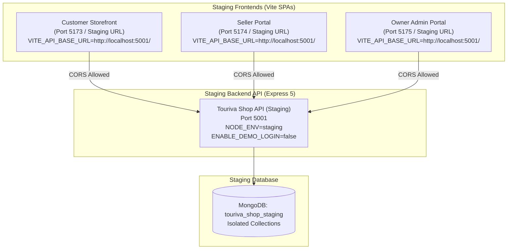

# TOURIVA MARKETPLACE — STAGING DEPLOYMENT PLAN

**Document Identifier:** TRV-STG-PLAN-2026-V1  
**Target Environment:** Isolated Pre-Production Staging  
**Release Candidate:** v1.0.0-rc.1  
**Author:** Lead DevOps & Cloud Infrastructure Engineer  
**Date:** November 5, 2026  
**Status:** STAGING ARCHITECTURE PREPARED & ISOLATED  

---

## 1. OBJECTIVE & BOUNDARY RULES

The objective of the staging environment is to provide a complete, production-identical mirror of the Touriva Independent Marketplace for stakeholder acceptance testing, merchant onboarding rehearsals, and final end-to-end verification without touching production data, domains, or infrastructure.

### Strict Boundary Rules:
1. **Production Isolation:** The staging environment operates on an isolated database (`touriva_shop_staging`). It must never connect to or modify production MongoDB collections.
2. **Domain Preservation:** Existing production domains (`market.touriva.nextchallenge.tech`, `seller.market.touriva.nextchallenge.tech`, `admin.market.touriva.nextchallenge.tech`) and their Netlify/Render configurations remain 100% untouched.
3. **Admin Portal Protection:** The owner administration portal is deployed as a private, non-indexed SPA (`X-Robots-Tag: noindex, nofollow`) and strictly requires administrator JWT authentication before rendering data or moderation controls.
4. **No Unapproved Deployment:** No remote deployment commands will be executed until the platform owner authorizes release.

---

## 2. STAGING ARCHITECTURE & PORT ALLOCATION



### Component Configuration Matrix:

| Component | Repository Path | Staging Port | Staging Target Domain / URL | Database Target |
| :--- | :--- | :---: | :--- | :--- |
| **Backend API** | `shop/backend` | `5001` | `http://localhost:5001` or Render Staging Service | `touriva_shop_staging` |
| **Storefront** | `shop/frontEnd/touriva_shop_web` | `5173` | `http://localhost:5173` or `staging-market.*` | Via API |
| **Seller Portal** | `shop/frontEnd/touriva_shop_seller_admin` | `5174` | `http://localhost:5174` or `staging-seller.*` | Via API |
| **Owner Admin** | `shop/frontEnd/touriva_shop_admin` | `5175` | `http://localhost:5175` or `staging-admin.*` | Via API |

---

## 3. STAGING CONFIGURATION ARTIFACTS

Separate `.env.staging` configuration files have been prepared across all 4 sub-projects:

### 3.1 Backend Configuration (`shop/backend/.env.staging`)
```dotenv
PORT=5001
NODE_ENV=staging
ENABLE_DEMO_LOGIN=false
MONGO_URI=mongodb://localhost:27017/touriva_shop_staging
SECRET=touriva_staging_jwt_secret_rc1_2026_isolated_do_not_use_in_prod
JWT_EXPIRES_IN=7d
CORS_ORIGINS=http://localhost:5173,http://localhost:5174,http://localhost:5175,https://staging-market.touriva.nextchallenge.tech,https://staging-seller.market.touriva.nextchallenge.tech,https://staging-admin.market.touriva.nextchallenge.tech
```

### 3.2 Customer Storefront Configuration (`shop/frontEnd/touriva_shop_web/.env.staging`)
```dotenv
VITE_API_BASE_URL=http://localhost:5001/
VITE_SHOP_API_BASE_URL=http://localhost:5001/
VITE_APP_ENV=staging
```

### 3.3 Seller Portal Configuration (`shop/frontEnd/touriva_shop_seller_admin/.env.staging`)
```dotenv
VITE_API_BASE_URL=http://localhost:5001/
VITE_SHOP_API_BASE_URL=http://localhost:5001/
VITE_APP_ENV=staging
```

### 3.4 Owner Admin Configuration (`shop/frontEnd/touriva_shop_admin/.env.staging`)
```dotenv
VITE_API_BASE_URL=http://localhost:5001/
VITE_SHOP_API_BASE_URL=http://localhost:5001/
VITE_APP_ENV=staging
```

---

## 4. STAGING LAUNCH RUNBOOK (STEP-BY-STEP)

When authorized to launch the staging environment locally or in cloud previews:

### Step 1: Initialize Staging Database & Seed Baseline Data
```bash
# Seed staging database with categories and wilayas without altering production
cd "shop/backend"
MONGO_URI="mongodb://localhost:27017/touriva_shop_staging" node -e "
  const mongoose = require('mongoose');
  const Category = require('./models/Category');
  const MarketplaceSettings = require('./models/MarketplaceSettings');
  
  async function seed() {
    await mongoose.connect('mongodb://localhost:27017/touriva_shop_staging');
    await MarketplaceSettings.findOneAndUpdate(
      { key: 'global_marketplace_config' },
      { marketplaceName: 'Touriva Marketplace (Staging)', defaultCommissionPercent: 10 },
      { upsert: true }
    );
    const count = await Category.countDocuments();
    if (count === 0) {
      await Category.insertMany([
        { name: 'Artisanat & Terroir' },
        { name: 'Maroquinerie Saharienne' },
        { name: 'Poterie & Céramique' },
        { name: 'Tapis & Tissages' },
        { name: 'Équipements de Bivouac' }
      ]);
    }
    console.log('[Staging DB] Seed completed successfully.');
    await mongoose.connection.close();
  }
  seed();
"
```

### Step 2: Start Backend Staging API
```bash
cd "shop/backend"
# Start on port 5001 with staging environment
node -r dotenv/config server.js dotenv_config_path=.env.staging
```
*Health Check Verification:* `curl -s http://localhost:5001/api/health | jq .`  
Expected Output: `{"status": "ok", "service": "touriva-shop-backend", "database": "connected"}`

### Step 3: Launch Staging Frontends
In separate terminal sessions:
```bash
# Terminal A: Customer Storefront (Port 5173)
cd "shop/frontEnd/touriva_shop_web"
npx vite --mode staging --port 5173

# Terminal B: Seller Portal (Port 5174)
cd "shop/frontEnd/touriva_shop_seller_admin"
npx vite --mode staging --port 5174

# Terminal C: Owner Admin Portal (Port 5175)
cd "shop/frontEnd/touriva_shop_admin"
npx vite --mode staging --port 5175
```

---

## 5. CLOUD STAGING PROVISIONING (RENDER & NETLIFY PREVIEW)

If the platform owner prefers a public cloud staging environment rather than local staging:

1. **Render Web Service (Staging):**
   - Service Name: `touriva-shop-api-staging`
   - Repo Branch: `staging` or `master` (preview)
   - Root Directory: `shop/backend`
   - Build Command: `npm install`
   - Start Command: `node server.js`
   - Environment Variables: Same as `.env.staging` targeting an isolated Atlas database.
2. **Netlify Branch Deploys (Frontends):**
   - Netlify automatically provides branch deploys: `staging--touriva-market-web.netlify.app`.
   - Configure environment variables in Netlify UI: `VITE_API_BASE_URL=https://touriva-shop-api-staging.onrender.com`.

---

## 6. STAGING ACCEPTANCE CRITERIA FOR PRODUCTION PROMOTION

Before promoting RC-1 from staging to production:

- [ ] All 14 steps of the End-to-End Acceptance test suite pass cleanly on staging.
- [ ] No administrator demo routes exist (`GET/POST /api/users/demo-login` returns 404).
- [ ] Real artisan account registration and approval tested by commercial lead.
- [ ] Real BaridiMob receipt upload tested and approved by platform owner.
- [ ] Render Web Service plan upgraded from Free to Starter/Standard to eliminate cold starts.
- [ ] Platform owner (Khaled Bouafia) issues formal signed release approval.
