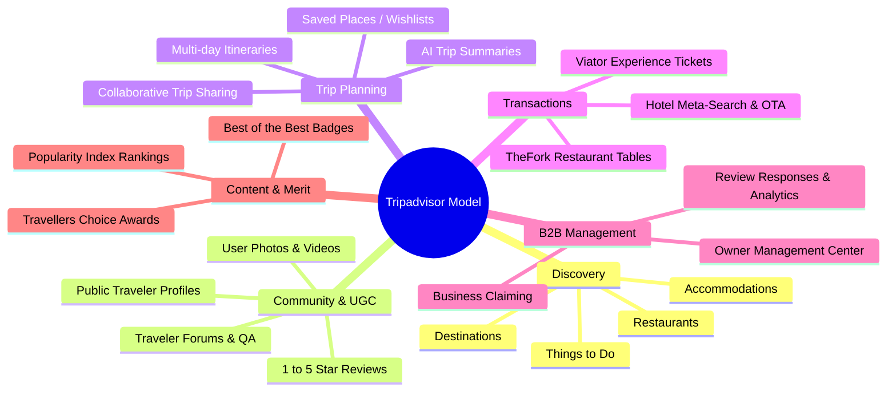
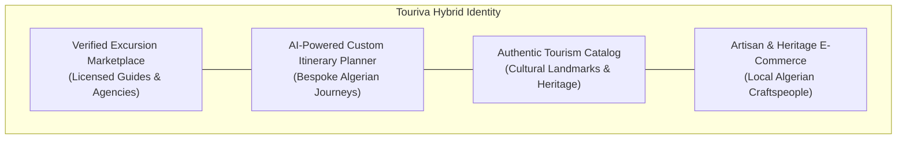
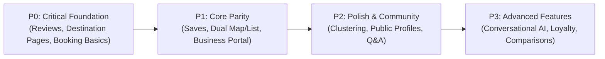

# TOURIVA — TRIPADVISOR FUNCTIONAL & FEATURE GAP ANALYSIS

**Document Date:** October 29, 2026  
**Auditor:** Antigravity Autonomous Security & Product Architecture Agent  
**Target Codebase:** `/home/next/next projects/touriva`  
**Target Commit:** `dd591cd9383849cf56d456ae173cb86e589c88b0`  
**Classification:** Product Functional Gap Analysis & Technical Due Diligence  

---

## 1. EXECUTIVE SUMMARY

This audit delivers an evidence-based functional comparison between the **Touriva** platform and the public product experience of **Tripadvisor**. 

Touriva was conceived as an Algerian travel and tourism platform providing travel discovery, accommodations, culinary spots, historical sites, guided excursions, trip building, and artisan commerce.

### Core Audit Finding

Touriva currently stands at **PARTIALLY CLOSE TO TRIPADVISOR (Overall Functional Parity: 47/100)**. 

Touriva has built an attractive, high-quality architectural foundation:
- A responsive, editorial Vue 3 frontend (`frontEnd/touriva`) with Algerian heritage branding;
- Complete migration away from proprietary Google Maps to an independent, zero-cost **MapLibre GL + OpenFreeMap + OpenStreetMap** mapping stack (`TourivaMap.vue`);
- A multi-day interactive itinerary builder with day-by-day routing (`New.vue`);
- A functioning **AI Trip Concierge** integrated with Ollama LLM (`gpt-oss:20b-cloud`) via `/api/aiTrips/generate`;
- A functioning **Excursion Booking Engine** (`TripSubscription`) connecting travelers with licensed guides;
- A dedicated **Touriva Shop** e-commerce ecosystem for authentic Algerian handicrafts and travel goods;
- A robust role-based Admin Panel (`frontEnd/touriva_adminPanel`) enforcing CASL authorization and regulatory document compliance for Algerian tourism operators (agencies, certified guides, associations).

### The Critical Gaps

Despite these achievements, Touriva diverges significantly from Tripadvisor in five fundamental operational areas:
1. **Total Absence of a User Review System:** Touriva possesses **zero review models, zero review submission endpoints, and zero written reviews**. The rating values displayed in the UI are static single float attributes stored directly on place documents, and the review counts displayed on cards (e.g. `28 reviews`) are hardcoded frontend fallback literals (`place.value?.reviews || 28`).
2. **Missing Destination Landing Pages:** Touriva has no `/destinations/:id` pages. Destinations exist only as filter chips (`Adrar`, `Algiers`, `Djanet`, `Oran`, etc.) and geo-coordinates in an internal dictionary.
3. **Absence of Hotel & Restaurant Transactional Engines:** Touriva's accommodations and dining listings are informational catalog cards. There are no room types, no night rates, no availability calendars, no menu models, and no table reservation engines. Clicking "Reserve Your Visit" on a hotel or restaurant routes the user to the guided excursions catalog (`/trips`).
4. **No Saved Places / Favorites or Social Collaboration:** Users cannot bookmark places, curate personal wishlists, invite fellow travelers, or collaborate on trip itineraries.
5. **Lack of a B2B Business Owner Portal:** Touriva has no self-serve "Tripadvisor for Business" portal allowing hoteliers or restaurateurs to claim, edit, and manage their own listings or respond to inquiries. All catalog listings are maintained exclusively by platform administrators.

---

## 2. TOURIVA ARCHITECTURE REVIEWED

The Touriva ecosystem comprises seven distinct architectural units across two repositories:

```
/home/next/next projects/touriva/
├── backend/                               # Primary Tourism REST API (Node/Express/MongoDB)
├── frontEnd/
│   ├── touriva/                           # Main Tourism Web & Mobile Client (Vue 3, Vuetify 3, Pinia)
│   │   └── android/                       # Capacitor 7 Android Native Shell (Target SDK 35)
│   └── touriva_adminPanel/                # Tourism Platform Administration Panel (Vue 3, CASL)
├── shop/
│   ├── backend/                           # E-commerce Shop REST API (Node/Express/MongoDB)
│   └── frontEnd/
│       ├── touriva_shop_web/              # Traveler Artisan Marketplace (Vue 3, Pinia)
│       ├── touriva_shop_admin/            # E-commerce Central Admin Panel
│       └── touriva_shop_seller_admin/     # Artisan / Merchant Portal
```

### Technological Stack & Dependencies Verified

| Component | Technology | Evidence / Version |
|---|---|---|
| **Main Web Client** | Vue 3 + Vuetify 3 + Pinia | `frontEnd/touriva/package.json` (`vue@3.5.44`, `vuetify@4.2.6`, `pinia@3.0.4`) |
| **Mapping Engine** | MapLibre GL + OpenFreeMap | `frontEnd/touriva/src/utils/osmMap.js` (`maplibre-gl@6.16.0`) |
| **Geocoding & Autocomplete** | Curated 58 Wilayas DB + OSM Nominatim | `frontEnd/touriva/src/utils/geocoding.js` (Throttled <= 1 req/sec) |
| **Mobile Shell** | Capacitor 7 Android | `frontEnd/touriva/capacitor.config.json` (`@capacitor/android@7.6.9`) |
| **Main Backend** | Node.js / Express 5 / Mongoose | `backend/server.js`, `backend/package.json` (`express@5.1.0`, `mongoose@8.19.1`) |
| **AI Trip Generation** | Ollama API (`gpt-oss:20b-cloud`) | `backend/services/aiTripGenerator.js` (`ollama@0.5.18`) |
| **Security & Auth** | JWT + Bcrypt + Helmet + Rate Limit | `backend/server.js`, `backend/middleware/requireAuth.js` |
| **Admin Panel** | Vue 3 + CASL Permissions | `frontEnd/touriva_adminPanel/src/router/index.js` |
| **Commerce Shop** | Node.js + Vue 3 Multi-app | `shop/backend/server.js`, `shop/frontEnd/*` |

---

## 3. TRIPADVISOR REFERENCE CAPABILITY MODEL

Tripadvisor operates as a global travel guidance and transactional marketplace with 12 foundational capability pillars:



---

## 4. DEEP FUNCTIONAL AUDIT BY AREA

### 4.1 CORE DISCOVERY & DESTINATIONS

| Capability | Tripadvisor Reference | Touriva Implementation | Status | Code Evidence | Priority |
|---|---|---|---|---|---|
| **Destination Discovery** | Global exploration by country, region, city | Curated homepage carousel with Algerian Wilayas | **Partial** | `frontEnd/touriva/src/views/Home.vue#L160-L240` | P1 |
| **Destination Landing Pages** | Dedicated pages (`/Tourism-g293718-Algiers...`) with weather, best time to visit, guides | **None.** No `/destination/:id` route exists. Clicking a destination routes to `/trips?destination=Algiers` | **Missing** | `frontEnd/touriva/src/router/index.js` | P0 |
| **Destination Descriptions** | Comprehensive cultural, geographic, and historical narratives | Brief static blurbs in local code dictionary | **Partial** | `frontEnd/touriva/src/utils/geocoding.js#L7-L95` | P1 |
| **Destination Photos** | Hundreds of user and official curated photos | Curated static photography array | **Partial** | `frontEnd/touriva/src/config/curatedImages.js` | P2 |
| **Destinations Taxonomy** | Beaches, Saharan, Mountain, Heritage classifications | No destination category model; Wilayas are flat administrative entities | **Missing** | `backend/models/Wilaya.js` | P1 |
| **Things to Do within Destination** | Tabbed attractions, tours, outdoor activities in city | Filterable via `/sites` search or city chips | **Partial** | `frontEnd/touriva/src/views/Site/Sites.vue#L50-L80` | P1 |
| **Hotels within Destination** | Ranked accommodation directory in city | Filterable via `/hotels` city chips | **Partial** | `frontEnd/touriva/src/views/Hotel/Hotels.vue#L55-L85` | P1 |
| **Restaurants within Destination** | Ranked dining directory in city | Filterable via `/restaurants` city chips | **Partial** | `frontEnd/touriva/src/views/Restaurant/Restaurants.vue` | P1 |
| **Map-based Discovery** | Full-screen interactive map with dynamic viewport loading | Individual place maps and trip itinerary maps; no global interactive catalog map | **Partial** | `frontEnd/touriva/src/components/TourivaMap.vue` | P1 |

---

### 4.2 HOTELS & ACCOMMODATIONS

| Capability | Tripadvisor Reference | Touriva Implementation | Status | Code Evidence | Priority |
|---|---|---|---|---|---|
| **Hotel Listings** | Directory with star class, photos, amenities, price | Directory grid showing photo, name, address, rating badge | **Implemented** | `frontEnd/touriva/src/views/Hotel/Hotels.vue`, `backend/controllers/hotelsController.js` | Core |
| **Hotel Detail Page** | Dedicated page with room types, amenities, policies, reviews, map | Generic `PlaceDetail.vue` shared with restaurants and sites | **Partial** | `frontEnd/touriva/src/views/PlaceDetail.vue` | P0 |
| **Room Information** | Single, Double, Deluxe Suite, Bed types, Sqm | **None.** Hotel schema has no room models or fields | **Missing** | `backend/models/Hotel.js` | P1 |
| **Nightly Rates & Pricing** | Live rates from OTAs / direct booking | **None.** Hotel schema has no price attribute | **Missing** | `backend/models/Hotel.js` | P0 |
| **Amenities Checklist** | WiFi, Pool, Spa, Free Breakfast, AC, Parking | **None.** No amenities schema or UI filters | **Missing** | `backend/models/Hotel.js` | P1 |
| **Availability Calendar** | Real-time check-in/out date selection | **None.** No calendar or date-selection for hotels | **Missing** | `frontEnd/touriva/src/views/PlaceDetail.vue` | P0 |
| **Hotel Booking Engine** | Instant booking or affiliate linkout | "Reserve Your Visit" button redirects to `/trips` (Guided Excursions) | **Missing** | `frontEnd/touriva/src/views/PlaceDetail.vue#L162-L168` | P0 |
| **Property Comparison** | Side-by-side amenity, price, rating comparison | **None.** | **Missing** | Codebase search: zero comparison logic | P3 |
| **Hotelier Management Portal** | B2B self-service for owners to manage rates, photos, info | None. Creation is admin-only (`requireRole('administrator')`). `DialogAdd.vue` fails with 403 for non-admins | **Missing** | `backend/routes/hotels.js#L26`, `frontEnd/touriva/src/components/DialogAdd.vue` | P1 |

---

### 4.3 RESTAURANTS & DINING

| Capability | Tripadvisor Reference | Touriva Implementation | Status | Code Evidence | Priority |
|---|---|---|---|---|---|
| **Restaurant Directory** | Cuisines, dietary restrictions, price tier, locations | Directory grid with photo, name, address, rating badge | **Implemented** | `frontEnd/touriva/src/views/Restaurant/Restaurants.vue`, `backend/controllers/restaurantsController.js` | Core |
| **Cuisine Taxonomy** | Traditional Algerian, Kabyle, Seafood, Italian, French | **None.** Restaurant schema has no cuisine field | **Missing** | `backend/models/Restaurant.js` | P0 |
| **Price Tier** | `$`, `$$ - $$$`, `$$$$` affordability indicator | **None.** Restaurant schema has no price tier field | **Missing** | `backend/models/Restaurant.js` | P1 |
| **Menus** | Full dish catalog, prices, drinks, dietary flags | **None.** No menu model or digital menu viewer | **Missing** | Codebase search: zero menu entities | P1 |
| **Opening Hours** | Weekly operating schedule (lunch, dinner, holidays) | **None.** Restaurant schema has no hours field | **Missing** | `backend/models/Restaurant.js` | P1 |
| **Table Reservations** | TheFork / OpenTable live booking widget | **None.** PlaceDetail directs to guided trips | **Missing** | `frontEnd/touriva/src/views/PlaceDetail.vue` | P2 |
| **Restaurateur Portal** | Claim listing, update hours, post daily specials | **None.** Managed exclusively in central admin panel | **Missing** | `frontEnd/touriva_adminPanel/src/views/Restaurant/index.vue` | P2 |

---

### 4.4 THINGS TO DO / ATTRACTIONS / EXPERIENCES

| Capability | Tripadvisor Reference | Touriva Implementation | Status | Code Evidence | Priority |
|---|---|---|---|---|---|
| **Historical & Tourist Sites** | UNESCO sites, monuments, museums, natural parks | Rich curated catalog (Casbah, Tassili, Djemila, Tipaza) with GeoJSON location | **Implemented** | `backend/models/Site.js`, `backend/seed/seed_touriva.js#L250-L750` | Core |
| **Guided Excursions & Tours** | Multi-day circuits, guided hikes, desert treks | Comprehensive `Trip` entity with day-by-day program, price in DZD, creator guide info | **Implemented** | `backend/models/Trip.js`, `frontEnd/touriva/src/views/Trip/TripsList.vue` | Core |
| **Activity Categories** | Hiking, 4x4 Sahara, Roman History, Architecture | Curated activity tags in AI builder; `Activity` model in DB is name-only | **Partial** | `backend/models/Activity.js`, `frontEnd/touriva/src/views/Trip/TripBuilder.vue#L410-L430` | P1 |
| **Site Admission & Hours** | Ticket prices, operating schedule, audio guides | **None.** Not modeled on `Site` schema | **Missing** | `backend/models/Site.js` | P1 |
| **Excursion Booking** | Viator-style instant booking and seat reservation | `TripSubscription` booking form collecting traveler full name + phone | **Implemented** | `backend/controllers/tripSubscriptionController.js#L6-L32`, `frontEnd/touriva/src/views/Trip/TripDetail.vue#L180-L240` | Core |
| **Booking Management (Guides)** | Dashboard of confirmed travelers and contact info | `Subscriptions.vue` view for creators and admin to review participants | **Implemented** | `frontEnd/touriva/src/views/Subscription/Subscriptions.vue`, `backend/controllers/tripSubscriptionController.js#L85-L115` | Core |

---

### 4.5 REVIEWS & COMMUNITY

This is the **single largest functional divergence** between Touriva and Tripadvisor.

| Capability | Tripadvisor Reference | Touriva Implementation | Status | Code Evidence | Priority |
|---|---|---|---|---|---|
| **Submit Review** | Written title, body text, star rating, visit date | **None.** No Review model, route, or submission form exists anywhere in the repository | **Missing** | Codebase search: zero review POST routes | P0 |
| **Review Editing / Deletion** | Edit review within 24h, delete review | **None.** | **Missing** | Codebase search | P1 |
| **Review Photos** | Upload traveler photos with review | **None.** | **Missing** | Codebase search | P1 |
| **Sub-Ratings** | Cleanliness, Service, Value, Location (1-5) | **None.** | **Missing** | Codebase search | P2 |
| **Review Aggregation** | True arithmetic mean + rating breakdown bar chart | Static float attribute on place document (`rating: 4.8`) seeded or set by admin | **Partial** | `backend/models/Hotel.js#L11`, `frontEnd/touriva/src/views/PlaceDetail.vue#L225` | P0 |
| **Review Count** | Verified count of traveler submissions | Hardcoded fallback literal: `place.value?.reviews \|\| 28`, `r.reviews \|\| 32`, `s.reviews \|\| 24`, `h.reviews \|\| 18` | **Broken / Fake** | `frontEnd/touriva/src/views/PlaceDetail.vue#L228-L230`, `frontEnd/touriva/src/stores/hotels.js#L26` | P0 |
| **Verified Stay Badge** | Reviewer confirmed booking badge | **None.** | **Missing** | Codebase search | P2 |
| **Management Response** | Business owner can publicly reply to reviews | **None.** | **Missing** | Codebase search | P1 |
| **Helpfulness Voting** | "Helpful" button on user reviews | **None.** | **Missing** | Codebase search | P2 |
| **Review Moderation** | Admin queue for flagged/reported reviews | **None.** Admin panel has no review moderation screen | **Missing** | `frontEnd/touriva_adminPanel/src/router/index.js` | P0 |
| **Public Traveler Profiles** | User avatar, review count, photos, contribution level | **None.** User profiles are private account settings only | **Missing** | `frontEnd/touriva/src/views/Profile.vue` | P2 |
| **Traveler Forums & Q&A** | Ask question about destination or hotel | **None.** | **Missing** | Codebase search | P3 |
| **Followers / Social** | Follow travel experts and guides | **None.** | **Missing** | Codebase search | P3 |

---

### 4.6 SEARCH CAPABILITIES

| Capability | Tripadvisor Reference | Touriva Implementation | Status | Code Evidence | Priority |
|---|---|---|---|---|---|
| **Global Header Search** | Unified search bar returning mixed entities (cities, hotels, sites) | Search dock on Home routes to selected category (`/trips?q=...` or `/hotels?q=...`) | **Partial** | `frontEnd/touriva/src/views/Home.vue#L320-L335` | P1 |
| **Destination Autocomplete** | Instant multi-lingual typeahead dropdown | Fully implemented in AI builder via `ALGERIAN_DESTINATIONS` + throttled OSM Nominatim fallback | **Implemented** | `frontEnd/touriva/src/utils/geocoding.js#L140-L260`, `frontEnd/touriva/src/views/Trip/TripBuilder.vue#L480-L510` | Core |
| **Search Engine Quality** | Elasticsearch / Vector search / Typo tolerance | Client-side `.filter(item => item.name.toLowerCase().includes(query))` | **Partial** | `frontEnd/touriva/src/views/Hotel/Hotels.vue#L165-L175` | P1 |
| **Multilingual Search** | Seamless search in Arabic, French, and English | Destination search supports Arabic, French, English names; catalog search is substring match | **Partial** | `frontEnd/touriva/src/utils/geocoding.js#L7-L95` | P1 |
| **Radius / Geo Search** | "Near me" or "Within 10 km" search | Backend supports `$geoWithin` `$centerSphere` 20km; frontend does not expose radius control | **Backend-Only** | `backend/controllers/hotelsController.js#L125-L145` | P1 |
| **Price & Date Filtering** | Filter accommodations by price range and dates | Implemented for Trips (`TripsList.vue` has price range slider); missing for hotels/sites | **Partial** | `frontEnd/touriva/src/views/Trip/TripsList.vue#L85-L115` | P1 |
| **Map/List Synchronization** | Moving map refreshes listing cards in real-time | Implemented in Trip Creator (`New.vue`); catalog views (`/hotels`, `/sites`) are static card grids | **Partial** | `frontEnd/touriva/src/views/Trip/New.vue#L380-L450` | P1 |

---

### 4.7 MAP EXPERIENCE

Touriva intentionally utilizes **MapLibre GL + OpenFreeMap + OpenStreetMap**. This is an architectural strength that avoids Google Maps API billing exposure.

| Capability | Tripadvisor Reference | Touriva Implementation | Status | Code Evidence | Priority |
|---|---|---|---|---|---|
| **Interactive Map** | Vector map with smooth pan/zoom and gestures | MapLibre GL instance with OpenFreeMap Liberty/Bright and OSM raster fallback | **Implemented** | `frontEnd/touriva/src/utils/osmMap.js#L45-L95`, `frontEnd/touriva/src/components/TourivaMap.vue` | Core |
| **Custom Markers** | Numbered category pins with drop shadows | Branded SVG pins displaying day stop numbers in Touriva forest green / gold | **Implemented** | `frontEnd/touriva/src/utils/osmMap.js#L100-L140` | Core |
| **Interactive Popups** | Click marker to view photo, rating, title, and link | HTML popups with stop thumbnail, scheduled time, and description | **Implemented** | `frontEnd/touriva/src/utils/osmMap.js#L145-L165` | Core |
| **Route Polylines** | Visual transit routes connecting itinerary stops | GeoJSON `LineString` layers with distinct colors per day (`DAY_ROUTE_COLORS`) | **Implemented** | `frontEnd/touriva/src/components/TourivaMap.vue#L90-L150` | Core |
| **Marker Clustering** | Supercluster grouping dense markers into bubbles | **None.** All markers are created as individual DOM elements; causes lag if >150 markers rendered | **Missing** | `frontEnd/touriva/src/components/TourivaMap.vue#L100-L125` | P2 |
| **List/Map Dual View** | Split view (cards left, map right) on catalog pages | Present only in Trip Creator (`New.vue`); `/hotels`, `/restaurants`, `/sites` lack split-map view | **Partial** | `frontEnd/touriva/src/views/Trip/New.vue` | P1 |

---

### 4.8 TRIP PLANNING & ITINERARIES

| Capability | Tripadvisor Reference | Touriva Implementation | Status | Code Evidence | Priority |
|---|---|---|---|---|---|
| **Create Custom Trip** | Named trip container with destination and dates | `MyTrips.vue` allows creating trips manually or via AI wizard | **Implemented** | `frontEnd/touriva/src/views/Trip/MyTrips.vue#L220-L260`, `backend/models/Trip.js` | Core |
| **Multi-Day Itinerary** | Day 1, Day 2, Day 3 structured timeline | `DaySchema` array containing ordered stop items with title, time, lat/lng, image | **Implemented** | `backend/models/Trip.js#L14-L24`, `frontEnd/touriva/src/views/Trip/New.vue` | Core |
| **Add / Remove Stops** | Search places and append to day program | Dialog to search and insert stops with coordinates and images | **Implemented** | `frontEnd/touriva/src/views/Trip/New.vue#L210-L280` | Core |
| **Reorder Itinerary Items** | Drag-and-drop reordering of stops | `vuedraggable` dependency installed, but component is commented out in `New.vue` | **Broken / Partial** | `frontEnd/touriva/src/views/Trip/New.vue#L108` (`<!-- <draggable ... -->`) | P1 |
| **Saved Places / Wishlists** | Save button on place cards; curated "Saves" tab | **None.** No wishlist or saved places model exists | **Missing** | Codebase search: zero save place routes | P0 |
| **Trip Sharing** | Public shareable link (`tripadvisor.com/Trips/...`) | **None.** Only public/private publish toggle requiring admin approval | **Missing** | `backend/models/Trip.js#L38-L45` | P1 |
| **Collaborative Planning** | Invite companions with edit or view permissions | **None.** A trip has a single creator ID (`creator: ref User`) | **Missing** | `backend/models/Trip.js#L21` | P2 |
| **Duplicate Trip** | Clone existing trip itinerary to personal planner | **None.** | **Missing** | Codebase search | P2 |

---

### 4.9 AI TRAVEL ASSISTANT & CONCIERGE

Touriva has an active, working AI Concierge pipeline.

| Capability | Tripadvisor Reference | Touriva Implementation | Status | Code Evidence | Priority |
|---|---|---|---|---|---|
| **AI Itinerary Generator** | Tripadvisor AI Trip Builder (generates complete multi-day schedule) | 4-step wizard (Destination, Dates, Party Type, Activities) generates full structured JSON itinerary | **Implemented** | `frontEnd/touriva/src/views/Trip/TripBuilder.vue#L320-L380`, `backend/services/aiTripGenerator.js` | Core |
| **LLM Orchestration** | OpenAI GPT-4o / Claude backend | Ollama SDK connecting to `https://ollama.com` running `gpt-oss:20b-cloud` with valid API key | **Implemented** | `backend/services/aiTripGenerator.js#L3-L9`, `backend/.env` | Core |
| **Grounded Local Knowledge** | Feeds verified local database entities to prompt | Slices real catalog hotels, restaurants, and sites into Ollama prompt to prevent hallucinations | **Implemented** | `frontEnd/touriva/src/views/Trip/TripBuilder.vue#L370-L375`, `backend/services/aiTripGenerator.js#L19-L35` | Core |
| **Conversational Chat Assistant** | Free-form natural-language travel chat | **None.** Guided wizard only; no interactive chat widget | **Missing** | Codebase search: no chat endpoints | P2 |
| **Conversational Modification** | "Replace morning activity with a museum" | **None.** User must manually edit stops in `New.vue` post-generation | **Missing** | Codebase search | P2 |

---

### 4.10 BOOKING, PAYMENTS & COMMERCE

| Capability | Tripadvisor Reference | Touriva Implementation | Status | Code Evidence | Priority |
|---|---|---|---|---|---|
| **Hotel Reservations** | Instant checkout or OTA metasearch redirect | **None.** | **Missing** | Codebase search | P0 |
| **Restaurant Table Booking** | Instant table reservation | **None.** | **Missing** | Codebase search | P2 |
| **Tour / Excursion Booking** | Viator instant checkout with credit card | Reservation submission (`TripSubscription`) saving traveler name + phone for guide follow-up | **Implemented** | `backend/controllers/tripSubscriptionController.js`, `frontEnd/touriva/src/views/Trip/TripDetail.vue` | Core |
| **Online Payment Gateway** | Stripe, Apple Pay, Google Pay, PayPal | **None.** No electronic payment gateway integration | **Missing** | Codebase search: zero payment webhooks | P0 |
| **B2B Listing Subscription Payments** | Credit card recurring billing for business ads | Manual bank/postal transfer receipt upload (`Billing.js` + receipt image approved by admin) | **Implemented** | `backend/models/Billing.js`, `frontEnd/touriva/src/views/profile/Billing.vue` | Core |
| **Artisan E-Commerce Marketplace** | **Not offered by Tripadvisor.** Physical commerce absent from Tripadvisor | Complete secondary ecosystem (`touriva_shop_web`, `shop/backend`, `Order`, `Product`, cart) | **Implemented (Touriva Differentiator)** | `shop/backend/models/Product.js`, `shop/backend/models/Order.js`, `shop/frontEnd/touriva_shop_web` | Plus |

---

### 4.11 BUSINESS OWNER PLATFORM

| Capability | Tripadvisor Reference | Touriva Implementation | Status | Code Evidence | Priority |
|---|---|---|---|---|---|
| **Claim Listing** | "Own this business? Claim it now" verification workflow | **None.** No claiming mechanism | **Missing** | Codebase search | P0 |
| **Business Management Portal** | Tripadvisor Management Center for hoteliers and restaurateurs | None for business owners. Listing management is centralized inside `touriva_adminPanel` | **Missing** | `frontEnd/touriva_adminPanel/src/views/Hotel/index.vue` | P0 |
| **Review Management** | Receive alerts on new reviews, submit public responses | **None.** No review system | **Missing** | Codebase search | P0 |
| **Performance Analytics** | Impressions, click-through rates, competitor sets | **None.** Admin panel displays only global entity counts | **Missing** | `frontEnd/touriva_adminPanel/src/views/Dashboard.vue` | P2 |
| **Regulatory Verification Workflow** | Basic phone or credit card check | **Comprehensive Algerian legal compliance:** upload and admin verification of `commercialRegister`, `transportCard`, `grayCard`, `trafficPermit`, `nisDoc`, `nifDoc`, `accreditation` | **Implemented (Touriva Differentiator)** | `backend/models/User.js#L50-L100`, `frontEnd/touriva/src/views/Documents.vue`, `frontEnd/touriva/src/views/Pending.vue` | Plus |

---

### 4.12 TRAVEL GUIDES, RANKINGS & EDITORIAL CONTENT

| Capability | Tripadvisor Reference | Touriva Implementation | Status | Code Evidence | Priority |
|---|---|---|---|---|---|
| **Travel Guides & Articles** | Curated destination articles, "48 Hours in...", insider tips | **None.** The `Publications.vue` view is a classifieds marketplace table inherited from previous architecture | **Missing** | `frontEnd/touriva/src/views/Publication/Publications.vue`, `backend/models/Publication.js` | P1 |
| **Popularity Rankings** | "#1 of 124 Hotels in Algiers", algorithm based on recency/quality | **None.** No ranking algorithm exists | **Missing** | Codebase search | P1 |
| **Traveler Badges / Awards** | "Travellers' Choice", "Best of the Best" | **None.** | **Missing** | Codebase search | P2 |
| **Editorial Recommendations** | Handpicked seasonal spots (e.g. Saharan Winter circuits) | Curated destionations on Home.vue and pre-seeded editorial trips | **Implemented** | `frontEnd/touriva/src/views/Home.vue`, `backend/seed/seed_touriva.js` | Core |

---

### 4.13 USER ACCOUNTS & COMMUNITY

| Capability | Tripadvisor Reference | Touriva Implementation | Status | Code Evidence | Priority |
|---|---|---|---|---|---|
| **User Registration & Login** | Email, Google OAuth, Apple ID | Phone-based auth (normalized for Algerian `+213` and `05/06/07...` formats) + Email login on web | **Implemented** | `backend/models/User.js#L140-L240`, `backend/controllers/usersController.js` | Core |
| **Password Reset** | Automated email token with reset link | OTP reset code stored in DB (`resetOtp`); phone verification flow in UI | **Implemented** | `backend/models/User.js#L95`, `frontEnd/touriva/src/views/ForgotPassword.vue` | Core |
| **Public Profile** | User avatar, bio, badges, city, travel stats | Private settings screen only (`UpdateProfile.vue`); no public profile URL | **Partial** | `frontEnd/touriva/src/views/UpdateProfile.vue` | P2 |
| **Activity History** | Timeline of reviews, photos, forum questions | My Trips (`MyTrips.vue`) and My Reservations (`Subscriptions.vue`) | **Implemented** | `frontEnd/touriva/src/views/Trip/MyTrips.vue`, `frontEnd/touriva/src/views/Subscription/Subscriptions.vue` | Core |
| **Notifications** | Push / In-app alerts for price drops, review replies, trip updates | Disabled / broken: `Notifications.vue` is commented out; backend notification router commented out in `server.js` | **Broken / Disabled** | `backend/server.js#L30`, `frontEnd/touriva/src/views/profile/Notifications.vue` | P1 |
| **Support Channels** | Help center, ticket submission, live chat | `ContactSupport.vue` displays headquarters contact info; submission form simulates submit with `setTimeout` without persisting | **UI-Only** | `frontEnd/touriva/src/views/profile/ContactSupport.vue#L225-L240` | P1 |

---

### 4.14 MOBILE & ANDROID PARITY

Touriva includes a native Android wrapper generated via **Capacitor 7** targeting Android 15 (API 35).

| Capability | Tripadvisor Mobile App | Touriva Android App | Parity Evaluation | Code Evidence |
|---|---|---|---|---|
| **Feature Parity with Web** | Complete | Complete | **Identical.** Capacitor loads the exact compiled Vite web bundle | `frontEnd/touriva/capacitor.config.json` |
| **Offline Capabilities** | Offline maps, saved places, downloaded itineraries | Native asset bundle cached locally; dynamic API calls require active connection | **Partial** | `frontEnd/touriva/android/app/src/main/assets/public/` |
| **Location Services** | Dynamic "Near Me" GPS discovery | Geolocation permissions configured (`ACCESS_FINE_LOCATION`, `ACCESS_COARSE_LOCATION`) | **Implemented** | `frontEnd/touriva/android/app/src/main/AndroidManifest.xml#L28-L31` |
| **Deep Linking** | Universal App Links for place and trip URLs | **None.** No domain intent-filters configured in AndroidManifest | **Missing** | `frontEnd/touriva/android/app/src/main/AndroidManifest.xml` |
| **Push Notifications** | FCM transactional alerts | FCM tokens commented out in User schema | **Missing** | `backend/models/User.js#L75` |
| **Release Signing** | Google Play signed release | Build succeeds cleanly; awaiting official production upload keystore | **Blocked (Awaiting Key)** | `TOURIVA_ANDROID_RELEASE_READINESS.md` |

---

### 4.15 ADMIN & MODERATION PLATFORM

Touriva includes a standalone administration application (`frontEnd/touriva_adminPanel`) executing on port 2021.

| Admin Capability | Touriva Implementation | Status | Code Evidence |
|---|---|---|---|
| **User & Role Administration** | CASL subject-based permissions (`Manage Users`, `Manage Roles`) | **Implemented** | `backend/models/Role.js`, `frontEnd/touriva_adminPanel/src/views/User/index.vue` |
| **Tourism Catalog Management** | CRUD tables for Hotels, Restaurants, Sites, Trips, Activities | **Implemented** | `frontEnd/touriva_adminPanel/src/views/Hotel/index.vue`, `Site/index.vue`, etc. |
| **Trip Reservation Oversight** | Grouped table of all traveler bookings with participant contact | **Implemented** | `frontEnd/touriva_adminPanel/src/views/Trip/subscriptions.vue` |
| **Professional Compliance Verification** | Document viewer to inspect and approve/reject partner licenses | **Implemented** | `backend/controllers/usersController.js#L260-L310` |
| **B2B Billing Verification** | Inspect payment slip images and activate partner plans | **Implemented** | `backend/controllers/billingsController.js` |
| **Review Moderation / Spam Queue** | **None.** Review system does not exist | **Not Applicable** | Zero review controllers in admin panel |

---

## 5. FUNCTIONAL PARITY SCORING & METHODOLOGY

### Scoring Methodology

Each category is scored from 0 to 100 based on the percentage of standard Tripadvisor travel-platform capabilities that are **fully implemented and functional in Touriva's codebase**.
- **Fully Implemented (Functional end-to-end):** 100% credit
- **Partial (Working foundation but critical attributes missing):** 50% credit
- **UI-Only / Backend-Only / Broken / Missing:** 0% credit

```
Category Score = (Sum of Feature Credits / Total Category Capabilities) * 100
```

| Domain | Weight | Points Awarded / Max | Category Score | Rationale |
|---|:---:|:---:|:---:|---|
| **Core Discovery & Destinations** | 15% | 4.0 / 10 | **40 / 100** | Good catalog listings and home widgets; total absence of destination landing pages and categories. |
| **Accommodations & Hotels** | 12% | 3.5 / 10 | **35 / 100** | Listings and map work; missing nightly rates, rooms, amenities, calendar, and booking engine. |
| **Restaurants & Dining** | 8% | 2.5 / 8 | **31 / 100** | Listings and map work; missing cuisine taxonomy, menus, hours, price tiers, and table reservations. |
| **Things to Do & Excursions** | 12% | 5.5 / 8 | **69 / 100** | Strongest discovery pillar. Rich sites catalog, detailed multi-day trips, and working reservation booking. |
| **Reviews & Community** | 20% | 0.5 / 12 | **4 / 100** | Critical gap. Zero review model, zero written reviews, hardcoded review counts, no user forums or public profiles. |
| **Search & Navigation** | 8% | 4.5 / 8 | **56 / 100** | Multi-lingual autocomplete and OSM geocoding work well; catalog search is simple string match; radius UI missing. |
| **Maps & Location** | 8% | 6.0 / 8 | **75 / 100** | Excellent MapLibre GL implementation with custom pins and route lines; lacks marker clustering and split-map catalog view. |
| **Trip Planning** | 10% | 6.5 / 10 | **65 / 100** | Multi-day itinerary builder, timeline, and stop CRUD implemented; missing wishlist/saves, sharing, and drag-and-drop. |
| **AI Travel Assistant** | 5% | 3.5 / 5 | **70 / 100** | Functional Ollama LLM integration generating multi-day JSON trips; lacks conversational chat interface. |
| **Business / Seller Platform** | 8% | 4.0 / 8 | **50 / 100** | Outstanding regulatory document verification and billing slip workflow; lacks self-serve listing management. |
| **Mobile Experience (Android)** | 7% | 5.0 / 7 | **71 / 100** | Flawless web feature parity on Android 15; missing deep links, offline caching, and push notifications. |
| **Admin & Moderation** | 7% | 6.0 / 8 | **75 / 100** | Comprehensive CASL permissions, catalog CRUD, and compliance approval; lacks review moderation tools. |

### Weighted Overall Functional Parity Score

$$\text{Overall Score} = \sum (\text{Category Score} \times \text{Weight})$$

$$\text{Overall Score} = (40 \times 0.15) + (35 \times 0.12) + (31 \times 0.08) + (69 \times 0.12) + (4 \times 0.20) + (56 \times 0.08) + (75 \times 0.08) + (65 \times 0.10) + (70 \times 0.05) + (50 \times 0.08) + (71 \times 0.07) + (75 \times 0.07)$$

$$\mathbf{\text{Overall Functional Parity: } 47.1\% \approx 47 / 100}$$

---

## 6. COMPLETE FEATURE MATRIX

| Feature / Capability | Tripadvisor | Touriva | Status | Code Evidence | Priority |
|---|:---:|:---:|:---:|---|:---:|
| **Hotels Directory** | Yes | Yes | **Full** | `frontEnd/touriva/src/views/Hotel/Hotels.vue` | Core |
| **Hotel Room Types & Rates** | Yes | No | **Missing** | `backend/models/Hotel.js` | P0 |
| **Hotel Amenities Checklist** | Yes | No | **Missing** | `backend/models/Hotel.js` | P1 |
| **Hotel Booking / Checkout** | Yes | No | **Missing** | `frontEnd/touriva/src/views/PlaceDetail.vue#L162` | P0 |
| **Restaurant Directory** | Yes | Yes | **Full** | `frontEnd/touriva/src/views/Restaurant/Restaurants.vue` | Core |
| **Restaurant Cuisine & Price Tier** | Yes | No | **Missing** | `backend/models/Restaurant.js` | P0 |
| **Restaurant Menus & Hours** | Yes | No | **Missing** | `backend/models/Restaurant.js` | P1 |
| **Tourist Sites & Attractions** | Yes | Yes | **Full** | `frontEnd/touriva/src/views/Site/Sites.vue` | Core |
| **Guided Excursions Catalog** | Yes | Yes | **Full** | `frontEnd/touriva/src/views/Trip/TripsList.vue` | Core |
| **Excursion Traveler Booking** | Yes | Yes | **Full** | `backend/controllers/tripSubscriptionController.js` | Core |
| **Written User Reviews** | Yes | No | **Missing** | Zero review models in repository | P0 |
| **Review Photo Upload** | Yes | No | **Missing** | Zero review upload routes | P1 |
| **True Aggregated Rating** | Yes | No | **Missing** | Static float attribute on place document | P0 |
| **Management Review Response** | Yes | No | **Missing** | No review response logic | P1 |
| **Destination Landing Pages** | Yes | No | **Missing** | No `/destinations/:id` route in Vue router | P0 |
| **Saved Places / Favorites** | Yes | No | **Missing** | Zero wishlist entities in DB or frontend | P0 |
| **Interactive Map (Vector)** | Yes | Yes | **Full** | `frontEnd/touriva/src/utils/osmMap.js` (MapLibre GL) | Core |
| **Marker Clustering** | Yes | No | **Missing** | `frontEnd/touriva/src/components/TourivaMap.vue` | P2 |
| **Day-by-Day Trip Planner** | Yes | Yes | **Full** | `frontEnd/touriva/src/views/Trip/New.vue` | Core |
| **Drag & Drop Stop Reordering** | Yes | No | **Broken** | `vuedraggable` commented out in `New.vue#L108` | P1 |
| **Trip Sharing & Collaboration** | Yes | No | **Missing** | Single creator ID in `Trip.js` | P1 |
| **AI Itinerary Concierge** | Yes | Yes | **Full** | `backend/services/aiTripGenerator.js` (Ollama LLM) | Core |
| **Conversational Travel Chatbot** | Yes | No | **Missing** | Guided stepper only; no chat interface | P2 |
| **Multilingual Support (AR/FR/EN)** | Yes | Yes | **Full** | `frontEnd/touriva/src/lang/{ar,fr,en}.js` | Core |
| **Regulatory Guide/Agency Verification**| No | Yes | **Full (Differentiator)** | `backend/models/User.js`, `Documents.vue` | Plus |
| **Artisan Goods E-Commerce Shop** | No | Yes | **Full (Differentiator)** | `shop/frontEnd/touriva_shop_web`, `shop/backend` | Plus |
| **Electronic Payment Gateway (Card/CIB)**| Yes | No | **Missing** | Manual CCP/bank receipt upload only | P0 |
| **Business Owner Management Center**| Yes | No | **Missing** | Admin panel only; no hotelier portal | P0 |
| **Travel Guides & Editorial Content**| Yes | No | **Missing** | `Publications.vue` is classifieds table | P1 |
| **Popularity Index & Awards** | Yes | No | **Missing** | Zero ranking algorithms in codebase | P2 |
| **In-App & Push Notifications** | Yes | No | **Broken** | Commented out in `server.js` and `Notifications.vue` | P1 |
| **Contact Support Ticket Engine** | Yes | No | **UI-Only** | Form simulates submit via `setTimeout` | P1 |

---

## 7. TOURIVA PLATFORM STRENGTHS & ASSETS

1. **Independent, Zero-Cost Mapping Architecture:**  
   Touriva has successfully replaced proprietary Google Maps with **MapLibre GL, OpenFreeMap vector styles (Liberty & Bright), and OpenStreetMap raster fallback** (`frontEnd/touriva/src/utils/osmMap.js`). This eliminates recurring map API costs, avoids billing surprises, and guarantees complete sovereign control over mapping infrastructure.
2. **First-Class AI Trip Concierge Pipeline:**  
   Unlike many platforms with static mockups, Touriva features an operational AI trip generator wired to an Ollama LLM (`gpt-oss:20b-cloud`). The pipeline feeds real catalog spots into a structured JSON prompt, creating valid multi-day itineraries with geolocation coordinates (`backend/services/aiTripGenerator.js`).
3. **Dedicated Algerian Tourism Regulatory Engine:**  
   Touriva includes a verification workflow tailored to Algerian tourism laws. Tourist guides, agencies, and associations submit government accreditation documents (`grayCard`, `commercialRegister`, `transportCard`, `trafficPermit`, `nisDoc`, `nifDoc`, `diploma`), which are moderated via the admin portal before profiles gain partner status.
4. **Integrated Artisan E-Commerce Marketplace:**  
   Tripadvisor provides no direct commerce for physical goods. Touriva features a complete secondary marketplace (`touriva_shop_web`) enabling travelers to discover and order authentic Algerian artisanal creations, pottery, and traditional goods with nationwide delivery tracking.
5. **Native Trilingual Localization:**  
   The platform features complete language bundles in **Arabic, French, and English** (`frontEnd/touriva/src/lang/`), including automated RTL/LTR directional layout toggling for Arabic script.

---

## 8. STRATEGIC POSITIONING: WHY TOURIVA SHOULD NOT MERELY COPY TRIPADVISOR

Tripadvisor was built over two decades for global Western markets where OTA integration (Booking.com, Expedia), electronic credit cards (Visa/Mastercard), and automated review aggregation dominate. 

Merely cloning Tripadvisor in Algeria would be a commercial mistake for three reasons:
1. **Low Domestic Hotel Meta-Search Penetration:** A majority of boutique guest houses, Saharan gîtes, and traditional kasbahs in Algeria are not connected to global OTAs or automated channel managers.
2. **Cash & Postal Payment Realities:** The predominant local payment mechanisms in Algeria are **Edahabia (Algérie Poste), CIB cards, BaridiMob, and cash on arrival**. A standard global credit card checkout fails local users.
3. **The Guided Experience Economy:** In Algeria, tourism is heavily **guide-centric and circuit-based** (e.g., Tassili n'Ajjer expeditions, Taghit dune crossings, Djemila archaeological circuits, Casbah cultural walks). Travelers require verified, licensed escorts and organized logistics rather than standalone room keys.

### Touriva's True Strategic Identity

Touriva is not a pure "Tripadvisor clone". It is a **Hybrid Tourism Platform & Guided Excursion Marketplace**.



### Opportunities to be BETTER than Tripadvisor for Algeria

| Strategic Domain | Tripadvisor's Weakness | Touriva's Local Advantage |
|---|---|---|
| **Guide & Agency Authenticity** | Plagued by unverified tour operators and fake business listings | Official government document verification (`commercialRegister`, `license`, `diploma`) guarantees 100% verified guides |
| **Local Domestic Payments** | Requires international credit cards; unusable for most Algerians | Opportunity to integrate **Edahabia / BaridiMob / CIB** for instant booking in Algerian Dinars (DZD) |
| **58 Wilayas Administrative Coverage** | Superficial data outside Algiers, Oran, and Constantine | Deep local data coverage across all 58 Wilayas, including southern oases (Djanet, Tamanrasset, Timimoun, Ghardaïa) |
| **Cultural & Linguistic Nuance** | Machine-translated Arabic with frequent grammatical errors | Native Algerian Arabic and French phrasing with cultural resonance |
| **Handicrafts & Souvenirs** | Zero physical commerce; relies on third-party links | Direct connection between tourism discovery and verified artisan workshops via Touriva Shop |

---

## 9. PRIORITIZED GAP ROADMAP (P0, P1, P2, P3)



### P0 — Critical Missing Functionality (Prerequisites for Market Credibility)

#### 1. Real User Review & Rating Engine
- **Why Tripadvisor Has It:** Core trust foundation of the platform.
- **Touriva Status:** Completely missing; static float attributes only.
- **Business Value:** Essential for traveler trust and content virality.
- **Technical Complexity:** Medium (Mongoose Review schema, POST/GET endpoints, rating aggregation pipeline).
- **Dependencies:** User authentication.
- **Recommended Timing:** **Phase 1 (Immediate).**

#### 2. Dedicated Destination Landing Pages (`/destinations/:slug`)
- **Why Tripadvisor Has It:** Primary entry point for organic search (SEO) and traveler inspiration.
- **Touriva Status:** Completely missing; filter chips only.
- **Business Value:** Critical for organic search traffic across 58 Wilayas.
- **Technical Complexity:** Low-to-Medium (New Vue route, aggregate existing sites/hotels/restaurants by `wilayaId`).
- **Dependencies:** Catalog data.
- **Recommended Timing:** **Phase 1 (Immediate).**

#### 3. Saved Places / Wishlists (Personal Saves)
- **Why Tripadvisor Has It:** Allows travelers to bookmark places during research.
- **Touriva Status:** Completely missing.
- **Business Value:** Improves user session return rate and retention.
- **Technical Complexity:** Low (`SavedPlace` collection linking `userId` to `placeId` + heart icon on cards).
- **Dependencies:** User authentication.
- **Recommended Timing:** **Phase 1 (Immediate).**

#### 4. Extended Accommodation & Dining Schemas
- **Why Tripadvisor Has It:** Travelers must know room prices, amenities, and food cuisine before booking.
- **Touriva Status:** Missing room rates, amenities, cuisines, and hours.
- **Business Value:** Converts catalog from a basic phone directory into an actionable discovery tool.
- **Technical Complexity:** Low (Extend Mongoose schemas and add filter checkboxes).
- **Dependencies:** Admin panel form updates.
- **Recommended Timing:** **Phase 1 (Immediate).**

---

### P1 — High-Value Parity Features

| Feature Name | Why Tripadvisor Has It | Touriva Status | Business Value | Complexity | Dependencies |
|---|---|---|---|:---:|---|
| **B2B Listing Claiming & Owner Portal** | Enables businesses to keep data fresh without admin labor | Missing (admin-only) | High (scalable onboarding) | Medium | Auth, listing schema |
| **Map/List Dual Catalog View** | Allows travelers to browse listings while seeing locations on map | Partial (in `New.vue` only) | High (industry standard UX) | Medium | `TourivaMap.vue` |
| **Drag & Drop Itinerary Reordering** | Smooth itinerary customization in trip builder | Broken (commented out) | Medium (planner usability) | Low | `vuedraggable` |
| **Trip Sharing via Unique URL** | Travelers share plans with family/friends | Missing | High (viral acquisition) | Low | Public trip route |
| **Notification Pipeline Reactivation** | Alerts users on reservation status and trip updates | Broken / disabled | Medium | Low | Socket.io / Mailer |
| **Local Algerian Electronic Payments** | Instant reservation settlement | Missing (manual slip upload) | High (revenue automation) | High | SATIM / BaridiMob gateway |

---

### P2 — Medium-Value Enhancements

| Feature Name | Why Tripadvisor Has It | Touriva Status | Business Value | Complexity | Dependencies |
|---|---|---|---|:---:|---|
| **Map Marker Clustering** | Prevents visual overlap of pins in dense urban centers | Missing | Medium (visual polish) | Medium | MapLibre supercluster |
| **Public Traveler Profiles** | Gamifies contributions and social proof | Missing | Medium | Medium | Review engine |
| **Sub-Ratings Breakdown** | Rates cleanliness, service, location separately | Missing | Medium | Low | Review engine |
| **Travel Guides & Editorial Blog** | Long-form editorial inspiration ("Top 10 in Tassili") | Missing | Medium | Low | CMS / Markdown engine |
| **Verified Stay Badges** | Proves reviewer actually booked the tour | Missing | Medium | Medium | Review engine + Bookings |

---

### P3 — Future Differentiators & Advanced Capabilities

| Feature Name | Description & Strategic Fit | Touriva Priority |
|---|---|:---:|
| **Conversational AI Assistant** | Real-time chat concierge answering questions via WhatsApp or in-app | P3 (Build Later) |
| **Automated Table Reservations** | Live restaurant table booking (low adoption in Algerian dining) | P3 (Not Essential Now) |
| **Side-by-Side Property Comparison**| Matrix comparing 3 hotels side-by-side | P3 (Build Later) |
| **Traveler Q&A Forums** | Community forum board (better served initially by social media/WhatsApp) | P3 (Build Later) |

---

## 10. FEATURES NOT WORTH COPYING FROM TRIPADVISOR

Touriva should deliberately **avoid** copying certain Tripadvisor features that are counterproductive to its mission in North Africa:

1. **Third-Party Global OTA Affiliate Popups (Booking.com / Agoda / Expedia):**  
   Tripadvisor often frustrates users with aggressive redirect windows and conflicting meta-search prices. Touriva should remain a **clean, direct-booking ecosystem** connecting travelers directly to verified local operators.
2. **Complex Flight Comparison Engine:**  
   Metasearch flight engines require multi-million-dollar GDS licensing (Amadeus/Sabre) with razor-thin margins. Domestic Algerian flights are almost exclusively operated by Air Algérie and Tassili Airlines, making a flight comparison engine unnecessary.
3. **Cruise Metasearch:**  
   Cruise tourism is negligible in domestic Algerian travel and is completely irrelevant to Touriva's target demographic.
4. **Anonymous, Unverified Negative Review Bombing:**  
   Tripadvisor suffers from extortionate fake reviews targeting independent restaurants. Touriva should adopt an **authenticated, phone-verified review model** ensuring only real travelers can submit feedback.

---

## 11. FINAL VERDICT & CLASSIFICATION

### Product Parity Verdict

### **PARTIALLY CLOSE TO TRIPADVISOR**

> **Justification:**  
> Touriva has successfully established the core architecture expected of a modern travel platform: an independent vector mapping engine, catalog directories for stays and dining, an operational AI itinerary generator, multi-day trip planning, excursion bookings, and an artisan commerce shop.  
> However, because it currently **lacks a user review system, destination landing pages, hotel/restaurant transactional capabilities, personal saves/wishlists, and business-owner claiming**, it cannot yet deliver the full guidance and decision-making utility that travelers expect from Tripadvisor.

### Strategic Platform Classification

### **HYBRID TOURISM PLATFORM & GUIDED EXCURSION MARKETPLACE**

> **Justification:**  
> Touriva's architecture blends four distinct models:
> 1. **Travel Discovery Directory** (Hotels, Restaurants, Historical Sites);
> 2. **AI Trip Planner** (Bespoke itinerary synthesis);
> 3. **Guided Excursion Marketplace** (Licensed guides offering bookable multi-day tours);
> 4. **Artisan E-Commerce Marketplace** (Touriva Shop selling regional Algerian crafts).

---

## 12. THE TOP 10 USER EXPECTATION GAPS

> **If a traveler familiar with Tripadvisor uses Touriva today, what are the top 10 things they expect to do that Touriva cannot currently do?**

In strict priority order:

1. **Read Authentic Traveler Reviews:**  
   The user cannot read past traveler reviews, look at review ratings breakdowns, or read advice from other tourists on hotels, restaurants, or attractions.
2. **Write a Review & Post Photos:**  
   After completing a trip or visiting a landmark, the user has no way to rate their experience, write feedback, or upload photos to help other travelers.
3. **Explore Dedicated Destination Guides:**  
   Searching for "Djanet" or "Constantine" does not open a comprehensive destination landing page featuring the city's top sights, best time to visit, weather, and curated highlights.
4. **Save Places to a Personal Wishlist ("Saves"):**  
   The user cannot click a "Heart" or "Bookmark" button on interesting hotels or kasbahs to save them for later trip planning.
5. **View Hotel Room Rates & Nightly Pricing:**  
   When looking at an accommodation listing, the user cannot see room options, nightly prices, or check-in/out date availability.
6. **Book a Hotel Room Online:**  
   Clicking "Reserve Your Visit" on a hotel listing does not open a room booking engine or payment checkout; it redirects the user to guided group excursions.
7. **Filter Restaurants by Cuisine & Operating Hours:**  
   The user cannot filter dining options by cuisine type (e.g., Traditional Algerian, Seafood, Grill) or check what time a restaurant opens or closes.
8. **Share an Itinerary with Travel Companions:**  
   The user cannot generate a public link or invite friends to view or collaborate on a multi-day trip itinerary.
9. **Search by "Near Me" / Geographic Distance:**  
   The user cannot tap a "Find near me" button on mobile to view hotels, restaurants, and sights within 5 km of their current GPS location.
10. **Claim or Manage a Business Listing (as an Owner):**  
    A hotel manager or restaurant owner who finds their venue on Touriva cannot claim the listing, verify ownership, update their phone/photos, or respond to customer inquiries.
